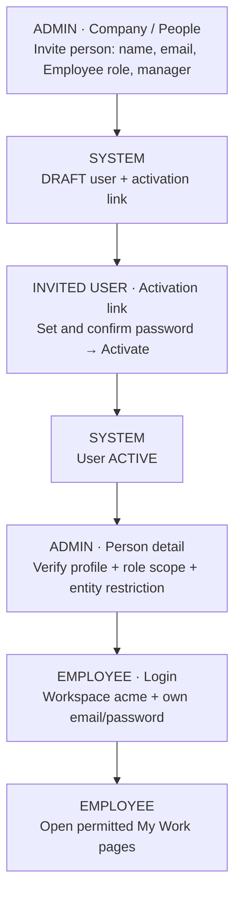
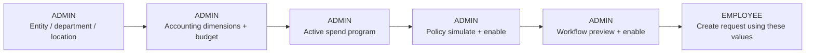
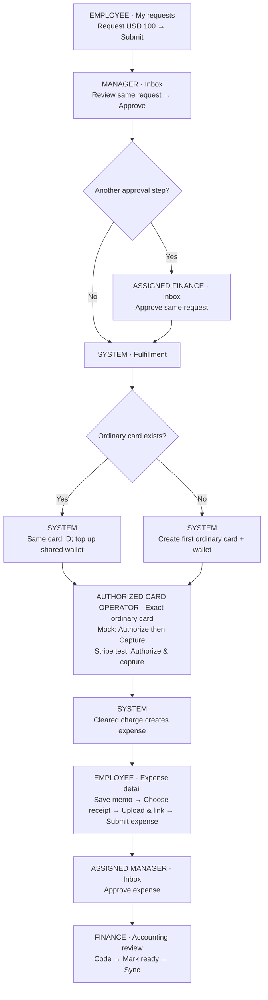
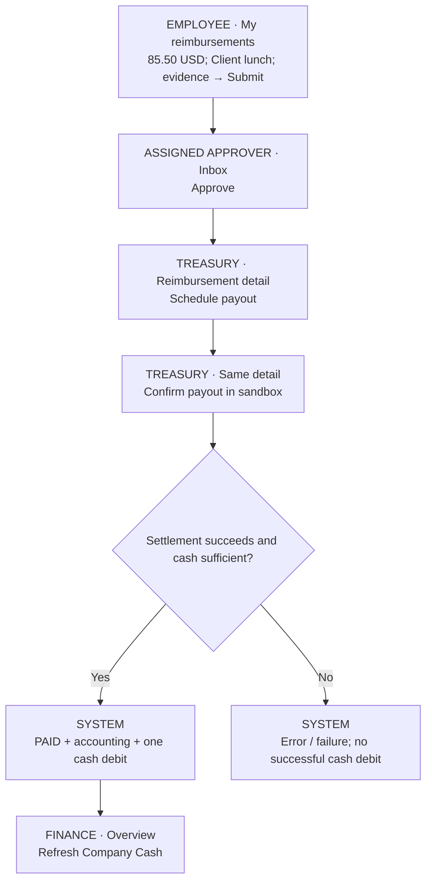
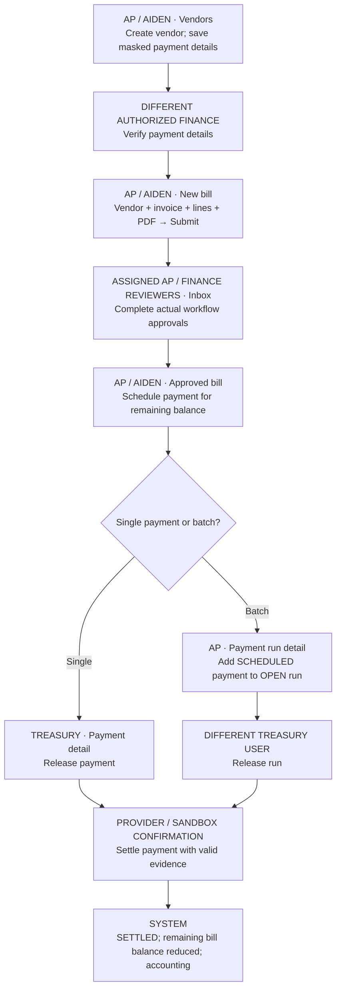
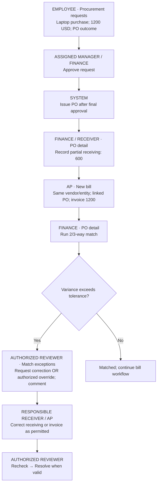
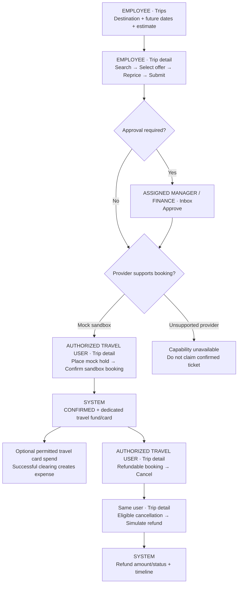

# Role-wise operating flow and demo data

18 October 2026. These diagrams describe the current P0/P0.5 workflow and its provider conditions. They are operating instructions, not a claim that all live journeys have passed. Replace `:id` with the selected record ID. Keep that same record across account switches.

## Accounts to use

| Label in diagram | Login user | Actual role | Responsibility |
|---|---|---|---|
| Admin | admin@acme.test | Owner | Onboarding, role assignments and configuration |
| Employee / Elena | employee@acme.test | Employee | Own requests, receipts, claims and travel |
| Manager | manager@acme.test | Manager | Assigned direct-report approvals |
| AP / Aiden | ap@acme.test | Finance Admin | Vendors, bills and payment scheduling |
| Treasury | treasury@acme.test | Finance Admin | Assigned finance approvals, payouts and settlement |

Workspace: `acme`. Seed password is `password123` only if unchanged. AP and Treasury are separate users with the same role, not separate built-in roles. Actual workflow assignment and entity restrictions determine access. An Owner login does not bypass self-approval or payment creator separation.

## 1. Create user, activate and assign role

| Step | User and page | Fill / click | Check before continuing |
|---|---|---|---|
| 1 | Admin — `/app/company/people` | Invite person: Demo / Employee; unique email `demo.employee@acme.test`; role Employee; manager `manager@acme.test`; save | DRAFT; copy activation link |
| 2 | Invited user — copied `/activate?...` | New password + confirmation; Activate | ACTIVE; login works |
| 3 | Admin — `/app/company/people/:id` | Set Engineering / Austin and manager on profile; assign Employee with Acme US LLC entity restriction using assignment controls | Correct assignment and profile saved |
| 4 | Invited user — `/login` | Workspace acme; own email; chosen password | Correct name appears in header |

Entity/department/location are not fields on the current invite form. Set them separately on person detail as supported. For the remaining examples use seeded Elena; a newly invited user has different records and must have a manager configured.

## 2. Admin prepares the reference data

| Page — Admin user | Example data / action |
|---|---|
| `/app/company/entities` | Acme US LLC / US / USD; use existing record |
| `/app/company/departments`, `/app/company/locations` | Engineering; Austin |
| `/app/company/accounting-dimensions` | Controlled GL 6100, Office equipment; project P0 Demo; use actual catalog values |
| `/app/insights/budgets` | Existing Engineering budget with enough remaining capacity |
| `/app/spend/programs` | Software demo; entity Acme US LLC; max 5000 USD; Virtual card; permitted merchant/MCC; select available budget |
| `/app/company/policy` | Expense receipt requirement; choose supported amount condition and receipt action; simulate before enable |
| `/app/company/approvals` | Spend request: Manager then Finance; preview resolved actors before enabling |

For every approval below, use the account named by the actual task. A second Finance/Admin approval is needed only if the enabled workflow requires it.

## 3. Spend request, shared card wallet and expense

| Step | User / page | Sample data and action | Expected result |
|---|---|---|---|
| 1 | Employee — `/app/me/requests` | Annual analytics subscription; purpose Customer reporting; 100 USD; Acme US LLC; active Software demo program; Virtual card; submit | Approval task |
| 2 | Manager — `/app/inbox` | Open exact request; review; Approve | Next task or fulfillment |
| 3 | Assigned Treasury/Finance — `/app/inbox` | Approve next step if present | FULFILLED |
| 4 | Employee — `/app/spend/requests/:id` → linked card / `/app/me/cards` | Note card ID and wallet balance | Existing ordinary card reused; 100 added without intervening spend |
| 5 | Admin/authorized Finance — exact `/app/cards/:id` | Ordinary card: permitted merchant OpenAI, amount 25 USD, supported software category; use helper shown by issuer mode | Successful cleared transaction, or explicit decline reason |
| 6 | Employee — `/app/me/expenses` → `/app/expenses/:id` | Open matching merchant/amount; memo ChatGPT team plan → Save memo; File → select PDF/PNG/JPG → Upload & link → Submit expense | Receipt attached; expense submitted |
| 7 | Assigned Manager — `/app/inbox` | Approve expense | Approved expense |
| 8 | Finance — `/app/accounting/review` | Select actual GL/department/location/project values; Mark ready; then `/app/accounting/ready-to-sync` → Sync | Provider-dependent sync result |

Receipt form requires the owner's INCOMPLETE/REJECTED expense. APPROVED + Attached already finished this step. Expense merchant name can differ from request title. Direct Upload & link does not require another candidate-link step. An unlinked existing receipt can instead use `/app/expenses/receipts/:id` candidate search.

The Corporate Cards overview can select travel instead of ordinary primary card. Use the request's exact linked card or My card and check fund name. FUND_ONLY creates no card. A declined charge creates no successful spend.

## 4. Employee reimbursement and company cash

| User / page | Fill or action |
|---|---|
| Employee — `/app/me/reimbursements` | New reimbursement; STANDARD; Acme US LLC; 85.50 USD; Client lunch; merchant Cafe Demo; Meals; expense date; attach required receipt; Submit |
| Assigned Manager — `/app/inbox` | Review same claim; Approve; complete any additional assigned approval |
| Treasury — `/app/expenses/reimbursements/:id` | Schedule payout → SCHEDULED; Confirm payout in sandbox → PAID |
| Finance — `/app/home` | Refresh Company Cash; inspect payout status and amount |

Approval alone does not pay. Local mock banks are debited at settlement. In Stripe TEST configuration the current mock payout is an explicitly labeled app-ledger adjustment deducted from displayed cash; it does not transfer real money or alter external Stripe balance. Previously PAID claims are not automatically backfilled. Retry must not debit twice.

## 5. Vendor, verified payment details and bill payment

| Step | User / page | Data / action |
|---|---|---|
| 1 | Aiden/AP — `/app/vendors` | Acme Office Supplies; entity Acme US LLC; category Office; save |
| 2 | Aiden/AP — `/app/vendors/:id`, Payment Details | Method ACH; last4 1111; masked routing; reason Initial setup; save |
| 3 | Different authorized Finance — same vendor | Review details → Verify; changer must not self-verify |
| 4 | Aiden/AP — `/app/bill-pay/bills/new` | Same entity/vendor; unique invoice INV-DEMO-001; invoice date; due +30 days; USD; PDF; Office chair: quantity 2 × 150 plus tax 30 = 330; controlled coding; Save draft → Submit |
| 5 | Assigned reviewers — `/app/inbox` | Review same bill and approve each assigned step; creator cannot assume self-approval |
| 6 | Aiden/AP — `/app/bill-pay/bills/:id` | Schedule payment; amount remaining 330; valid rail → SCHEDULED |
| 7A | Treasury — `/app/bill-pay/payments/:id` | Single-payment path: Release payment; settlement action/provider confirmation according to configured rail |
| 7B | AP — `/app/bill-pay/payment-runs` | Batch alternative: Weekly AP Demo; Acme US LLC; actual available source account; save OPEN run |
| 8B | AP — `/app/bill-pay/payment-runs/:id` | Select existing SCHEDULED payment → Add selected payments; check total/count/issues |
| 9B | Treasury — same run | Different from run creator and included payment creators → Release run |
| 10 | Authorized Finance/provider — payment detail | Complete supported settlement path; verify SETTLED and remaining bill amount |

Choose 7A OR 7B for a payment. To demo both, use two separate approved bills/payments. Do not add a settled payment to a run. Account `Operating ••••1111` is only an example—this deployment may have no local bank accounts. Never invent a source balance.

## 6. Procurement, receiving and match exception

Employee `/app/procurement/requests`: Laptop purchase; Acme US LLC; active procurement program; 1200 USD; Purchase order; active vendor; memo Two laptops. Assigned Manager/Finance approve from Inbox. Finance opens issued `/app/procurement/purchase-orders/:id`, records partial receiving 600. AP creates linked bill 1200. Finance explicitly runs match; receiving alone does not create an exception. At `/app/procurement/match-exceptions`, select an allowed correction/override action, give reason/comment and resolve only when domain validation permits. These are alternative actions, not a sequence requiring every button.

## 6A. Purchase Order — complete request-to-payment diagram

Use this diagram specifically for the Purchase Order outcome. A PO is the company's purchasing commitment; the supplier invoice becomes a separate bill, and payment follows that bill's approvals.

```mermaid
flowchart TD
 A["EMPLOYEE · employee@acme.test<br/>Procurement requests → New request<br/>Laptop purchase · 1200 USD · Purchase order"] --> B["EMPLOYEE<br/>Select active vendor and program → Submit"]
 B --> C["ASSIGNED MANAGER · Inbox<br/>Review request → Approve"]
 C --> D["ASSIGNED FINANCE · Inbox<br/>Complete remaining approval steps"]
 D --> E["SYSTEM<br/>Final approval issues linked Purchase Order"]
 E --> F["FINANCE · Purchase Orders<br/>Open exact PO; verify vendor, entity and total"]
 F --> G["AUTHORIZED RECEIVER / FINANCE · PO detail<br/>Record receiving: actual amount 600"]
 G --> H["AP / AIDEN · Create bill for this PO<br/>Invoice PO-DEMO-001 · amount 1200 · upload PDF"]
 H --> I["FINANCE · PO detail<br/>Select supplier bill → Run 2/3-way match"]
 I --> J{"Invoice agrees with PO and receiving?"}
 J -->|Yes| K["ASSIGNED BILL APPROVERS · Inbox<br/>Complete bill approval"]
 J -->|No| L["AUTHORIZED REVIEWER · Match exceptions<br/>Review variance; request valid correction"]
 L --> M["RECEIVER / AP<br/>Record actual remaining delivery OR correct invoice"]
 M --> N["AUTHORIZED REVIEWER<br/>Re-run match; resolve under domain rules<br/>Override only with required authority"]
 N --> K
 K --> O["AP / AIDEN · Approved bill detail<br/>Schedule payment for payable balance"]
 O --> P["DIFFERENT TREASURY USER · Payment detail<br/>Release payment"]
 P --> Q["PROVIDER / SUPPORTED SANDBOX CONFIRMATION<br/>Settle payment"]
 Q --> R["SYSTEM<br/>Payment SETTLED; bill remaining reduced;<br/>PO, receiving, bill and payment history retained"]
```

### Exact Purchase Order demo steps

| Step | Login user | Page | Data / button | Result / next user |
|---|---|---|---|---|
| PO-1 | Employee — employee@acme.test | `/app/procurement/requests` | New procurement request: name Laptop purchase; legal entity Acme US LLC; active procurement program; amount 1200; USD; outcome Purchase order; vendor Acme Office Supplies; memo Equipment for Engineering | Save draft; supply policy-required evidence before submission |
| PO-2 | Same Employee | `/app/procurement/requests/:id` | Review this same request; Submit | Approval starts; note request ID |
| PO-3 | Assigned Manager — manager@acme.test if assigned | `/app/inbox` | Open exact Laptop purchase task; review policy, vendor and amount; Approve | Next configured approval |
| PO-4 | Assigned Finance user | `/app/inbox` | Open same request's Finance task; Approve | After final approval, linked PO issued; no manual duplicate PO |
| PO-5 | Finance/AP | `/app/procurement/purchase-orders` → `/app/procurement/purchase-orders/:id` | Open PO linked to this request; verify PO number, vendor, entity, currency and amount 1200 | Note PO ID; remain on this PO |
| PO-6 | Authorized Finance/receiver | Same PO detail | Receiving amount 600; memo First partial delivery; Record receiving | Partial receipt recorded; receiving alone does not create match exception |
| PO-7 | AP/Aiden — ap@acme.test | PO detail → Create bill for this PO → `/app/bill-pay/bills/new?purchaseOrderId=:id` | Same vendor/entity; unique invoice PO-DEMO-001; dates; USD; Equipment line amount 1200; tax 0 for this example; invoice PDF; required accounting coding; save | Bill linked to PO; verify actual total 1200 |
| PO-8 | Finance with procurement review permission | `/app/procurement/purchase-orders/:id` | Select PO-DEMO-001 in bill list; Run 2/3-way match | Invoice 1200 versus receiving 600 can trigger exception, subject to configured tolerance |
| PO-9 | Authorized exception reviewer | `/app/procurement/match-exceptions` | Open exception for this PO/bill; inspect variance; request receiving update or corrected invoice; add explanation | Work goes to responsible receiver/AP; don't force approval through a mismatch |
| PO-10 | Finance/receiver OR AP | PO receiving OR allowed bill correction page | Record remaining 600 only after actual delivery; alternatively correct supplier invoice through allowed state rules | Receiving/invoice reflects reality; do not add fictional receiving just to pass match |
| PO-11 | Authorized exception reviewer | Same PO and exception records | Re-run match; resolve/mark corrected when valid; use override only where authority, SoD and tolerance rules permit | Match/exception permits bill to proceed |
| PO-12 | AP/bill creator, then assigned bill reviewers | `/app/bill-pay/bills/:id`, then `/app/inbox` | Submit bill if still DRAFT; assigned reviewers approve | Bill APPROVED with payable remaining amount |
| PO-13 | AP/Aiden | `/app/bill-pay/bills/:id` | Schedule payment for actual remaining balance; valid rail | Payment SCHEDULED |
| PO-14 | Treasury — treasury@acme.test, different from payment creator | `/app/bill-pay/payments/:id` | Review → Release payment → supported settlement confirmation | SETTLED; bill remaining reduced once |
| PO-15 | Finance/accounting user | `/app/accounting/review` | Review generated source, apply controlled coding, Mark ready; sync using configured accounting provider | PO/bill/payment traceable through accounting |

For a clean path, receive the actual full 1200 before matching the 1200 invoice; no exception is expected when all rules agree. For an exception demo, keep the partial receipt and follow PO-9 onward. If policy requires supplier quotes and the request screen has no usable upload control, that is an application gap; don't claim submission succeeded. Issued PO corrections require domain change-order handling; the current ordinary detail UI does not provide a full change-order builder.

## 7. Travel, dedicated card and refund

Employee `/app/travel/trips`: NYC customer visit; origin/destination accepted by search provider; future dates (example 10–12 November 2026); 1200 USD; Acme US LLC; purpose Customer workshop. Select an actual returned offer; use server-repriced amount. Assigned approvers use Inbox. Booking actions are on `/app/travel/trips/:id` when capability permits. Mock hold is not confirmation. Ordinary and travel cards currently remain separate. Travel card accepts its configured travel MCCs, not arbitrary software purchases. Confirmation alone does not create a cleared card transaction. Duffel search access does not prove implemented ticket issuance/cancel/refund.

## 8. Daily role tasks and correction actions

| User | Page | Task / input |
|---|---|---|
| Every user | `/app/notifications`, `/app/search` | Open permitted exact source record; search actual name/ID |
| Manager / assigned Finance | `/app/inbox` | Open assigned record; review policy/evidence; approve/reject with appropriate comment |
| Employee | `/app/me/requests`, `/app/me/expenses`, `/app/me/reimbursements`, `/app/me/travel` | Track own pending/completed records; correct only allowed states |
| Admin / authorized Finance | `/app/spend/programs`, `/app/vendors` | Edit/deactivate as allowed by financial dependencies |
| AP | `/app/bill-pay/bills/:id` | Correct DRAFT lines/document; protected records follow cancel rules |
| Finance | `/app/accounting/errors` | Read actual sync error; correct mapping/coding; retry |
| Admin | `/app/company/people/:id` | Assign/remove role, manager/profile correction, suspend/terminate/reset credentials |
| Admin | `/app/company/policy`, `/app/company/approvals` | Create/edit version, simulate/preview, enable/disable |
| Admin / authorized auditor | `/app/company/audit` | Inspect actual actor, object, action and timestamp |

Use valid archive/deactivate/cancel/terminate operations. Preserve settled financial history. A missing button can mean wrong actor, wrong scope, protected state or unsupported provider capability. Refer to [verification findings](docs/RUNBOOK_REVIEW_2026-10-15.md) for known gaps and evidence limits.
