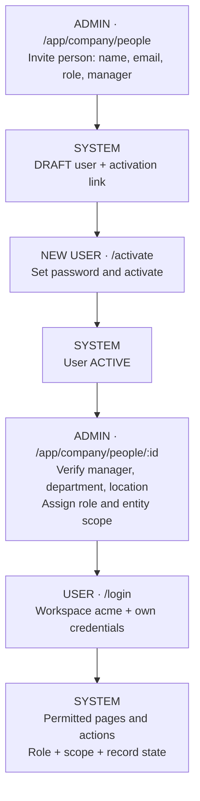
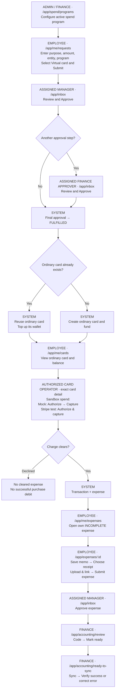
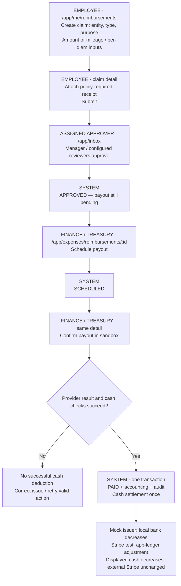
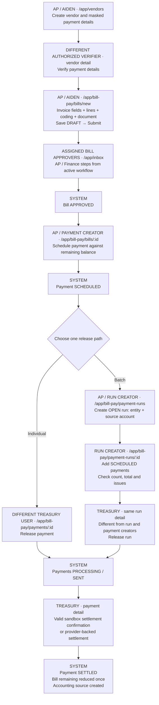
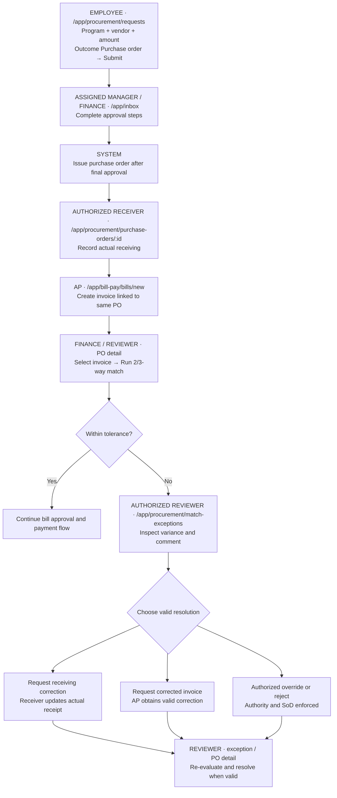
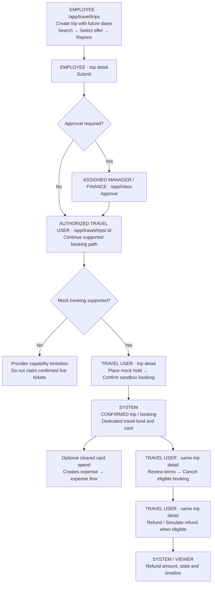
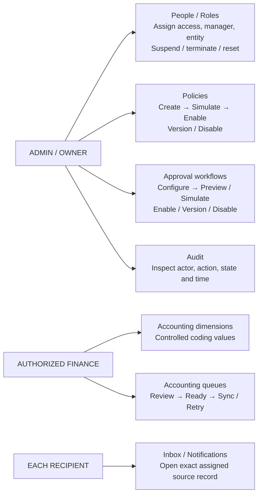

# Role-wise application flow diagrams

Use the actual assigned approver in Inbox. AP and Treasury are job responsibilities; seeded accounts both have Finance Admin role. Diagrams describe the intended operating sequence supported by current code; they do not certify every live deployment journey.

## Accounts

| Actor | Seeded account | Responsibility |
|---|---|---|
| Admin / Owner | admin@acme.test | People, roles, organization, policies and workflows |
| Employee / Elena | employee@acme.test | Own requests, expenses, claims and travel |
| Manager / Miles | manager@acme.test | Assigned direct-report approvals |
| AP / Aiden | ap@acme.test | Vendors, bills, payment scheduling |
| Finance / Treasury | treasury@acme.test | Assigned finance approval, payouts, release and accounting |

## 1. User creation and role assignment

## 2. Spend request, shared ordinary card and expense

FUND_ONLY fulfillment produces a fund without card fulfillment. An APPROVED expense does not show the normal receipt-edit form. Expense approval does not charge company cash a second time. Corporate Cards currently can select a travel card instead of the ordinary card; use the request's exact card link or My card to verify the ordinary wallet.

## 3. Reimbursement and company cash

Stripe-test reimbursement is simulated, not an external employee transfer. Existing historical PAID claims are not automatically backfilled. Production requires provider-backed confirmation.

## 4. Vendor, bill and payment — individual or batch

Never add an already settled payment to a run. A second batch demonstration needs another scheduled payment. Bill approval is separate from payment creation, release and settlement. Cash behavior depends on the configured rail; do not assume the reimbursement cash adjustment applies to bill payments.

## 5. Procurement, receiving and invoice exception

## 6. Travel — separate temporary wallet

Travel currently has dedicated instruments, unlike ordinary spend top-ups. Booking confirmation does not prove a captured card charge. Duffel search alone does not enable live order/refund fulfillment.

## 7. Daily administration and controls

Use account permissions, entity scope, record state and SoD checks at every handoff. Owner access does not eliminate all self-approval/creator-release restrictions.
