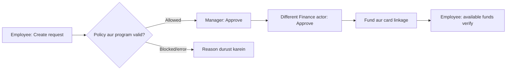
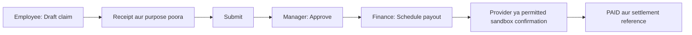
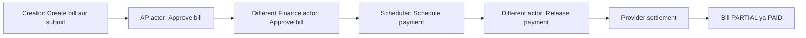
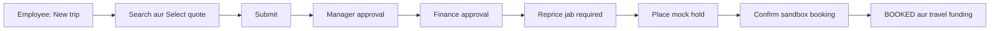
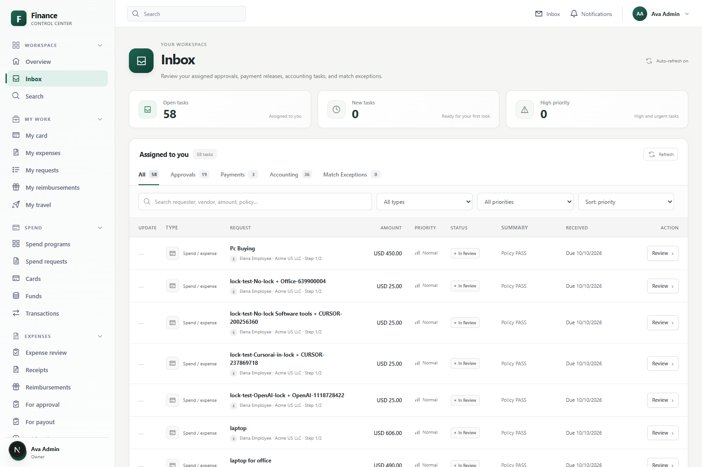

# Complete Application Training — Task ke hisaab se, Employee se Manager aur Finance tak

**Zaban:** Roman Urdu; application ke page, field aur button names English mein bilkul screen ke mutabiq rakhe gaye hain.

**Maqsad:** Ek hi document parh kar samajh aaye ke kaam kis ne shuru karna hai, kis page par kya bharna hai, policy kab check hogi, agla user kya karega aur kaam complete kab mana jayega.

**Verification:** Yeh guide repository ke current code aur pehle tayyar ki gayi source analysis par mabni hai. Live application, current database settings aur external payments/bookings ko chala kar verify nahi kiya gaya. Jahan functionality adhoori hai, wahin **Application gap** likha hai. Guide ka flow clear kiya gaya hai; application code mein tabdeeli nahi ki gayi.

## Is document ko kis order mein use karein

| Order | Task | Kis ko parhna aur practice karna hai |
|---|---|---|
| 1 | Task 1 — Company, logins aur employee setup | Owner, phir tamam users |
| 2 | Task 2 — Policies aur approval sequence | Owner aur authorized Finance Admin |
| 3 | Task 3 — Budget aur programs | Owner / Finance Admin |
| 4 | Task 4 — Company funds ki request | Employee → Manager → Finance Admin |
| 5 | Task 5 — Card purchase ki expense complete karna | Employee → Manager → Finance |
| 6 | Task 6 — Apne paison ka reimbursement | Employee → Manager → Finance |
| 7 | Task 7 — Purchase order ki request | Employee → Manager → Finance |
| 8 | Task 8 — Vendor aur bank verification | Finance actor A → Finance actor B |
| 9 | Task 9 — Delivery aur invoice matching | Procurement reviewer → Finance / Owner |
| 10 | Task 10 — Bill entry aur approval | Bill creator → AP reviewer → Finance reviewer |
| 11 | Task 11 — Bill payment | Scheduler → doosra releaser → provider |
| 12 | Task 12 — Payment batch | Run creator → doosra releaser → provider |
| 13 | Task 13 — Travel | Employee → Manager → Finance → traveler |
| 14 | Task 14 — Accounting aur QuickBooks | Finance → accounting provider |
| 15 | Task 15 — Card controls aur transaction issues | Finance / Owner |
| 16 | Task 16 — Daily review, reports aur access management | Har role apni zimmedari ke mutabiq |

**Training ka tareeqa:** Har task ka example pehle training workspace mein banayein. Us record ka naam/ID note karein. Agla role apne account se **usi record** ko open kare. Har role ke liye naya duplicate record banane ki zarurat nahi.

## Seedha task kholein

- [Task 1 — Company tayyar karna aur Employee ko login dena](#task-1--company-tayyar-karna-aur-employee-ko-login-dena)
- [Task 2 — Policy aur approval routing clear karna](#task-2--policy-aur-approval-routing-clear-karna)
- [Task 3 — Budget, spend program aur procurement program tayyar karna](#task-3--budget-spend-program-aur-procurement-program-tayyar-karna)
- [Task 4 — Employee funds mange; Manager aur Finance approve karein](#task-4--employee-funds-mange-manager-aur-finance-approve-karein)
- [Task 5 — Card purchase ki expense Employee complete kare](#task-5--card-purchase-ki-expense-employee-complete-kare)
- [Task 6 — Employee apne paison ka reimbursement le](#task-6--employee-apne-paison-ka-reimbursement-le)
- [Task 7 — Employee purchase order ki request kare](#task-7--employee-purchase-order-ki-request-kare)
- [Task 8 — Finance vendor banaye aur doosra actor bank details verify kare](#task-8--finance-vendor-banaye-aur-doosra-actor-bank-details-verify-kare)
- [Task 9 — Delivery receive karna aur supplier invoice match karna](#task-9--delivery-receive-karna-aur-supplier-invoice-match-karna)
- [Task 10 — Supplier bill create aur two-step approval](#task-10--supplier-bill-create-aur-two-step-approval)
- [Task 11 — Approved bill ka payment schedule, release aur settle karna](#task-11--approved-bill-ka-payment-schedule-release-aur-settle-karna)
- [Task 12 — Ek saath multiple payments ka run release karna](#task-12--ek-saath-multiple-payments-ka-run-release-karna)
- [Task 13 — Employee travel arrange kare; Manager aur Finance review karein](#task-13--employee-travel-arrange-kare-manager-aur-finance-review-karein)
- [Task 14 — Finance accounting review aur sync complete kare](#task-14--finance-accounting-review-aur-sync-complete-kare)
- [Task 15 — Finance card controls aur transaction exceptions handle kare](#task-15--finance-card-controls-aur-transaction-exceptions-handle-kare)
- [Task 16 — Roz ka review, search, notifications aur access management](#task-16--roz-ka-review-search-notifications-aur-access-management)

## Shuru karne se pehle: kaun kya karega

| Actual role | Zimmedari | Zaroori restriction |
|---|---|---|
| Owner | Company setup, users/roles, policies, organization-wide review aur Owner-required exceptions | Apni request approve nahi kar sakta; apna scheduled payment release nahi kar sakta. |
| Finance Admin | Spend, procurement, vendors, bills, payouts, accounting aur authorized configuration | Seed mein US entity assignment hai; doosri entity ki authority automatic nahi. Actual Owner wale controls alag hain. |
| Manager | Apne direct reports ki spend, expense, reimbursement, procurement aur travel review | Seeded Manager role mein Employee ke personal-create permissions shamil nahi. Payout/payment release bhi nahi. |
| Employee | Apni funding requests, card expenses, claims, procurement aur travel | Doosron ki approvals, finance payout, vendor maintenance aur user administration nahi. |

**AP aur Treasury alag implemented roles nahi hain.** Training example mein Aiden AP ka kaam aur Tessa Finance/Treasury ka kaam karte hain, lekin dono ka actual role **Finance Admin** hai.

### Training example ke accounts

| Insan | Account, agar demo seed maujood ho | Actual role |
|---|---|---|
| Ava | admin@acme.test | Owner |
| Miles | manager@acme.test | Manager |
| Elena | employee@acme.test | Employee; Miles ki direct report |
| Aiden | ap@acme.test | Finance Admin |
| Tessa | treasury@acme.test | Finance Admin |

Demo workspace **acme**, entity **Acme US LLC**, currency **USD** hai. Apni installation mein actual company/entity use karein. Password administrator se lein. Training ke liye database reset/reseed na karein.

### Har handoff ka ek hi rule

1. Pehla user record save/submit kare aur uska naam, amount aur ID note kare.
2. Agla user apne account se **Workspace → Inbox** ya us task ka review page open kare.
3. Usi record ka requester, entity, amount, currency, evidence aur current approval step check kare.
4. Action ke baad status dobara check kare. Sirf success message ya notification ko final completion na samjhe.
5. Agar next step doosre role ka hai to wahi role apne account se continue kare.

## Policy aur approval ko pehle samjhein

**Policy** batati hai ke record mein kya requirement ya risk hai. **Approval workflow** batata hai ke kaun pehle aur kaun baad mein decision karega. Dono alag cheezein hain.

**PASS ka matlab automatic approval nahi.** Misal ke taur par USD 120 ki spend request policy PASS ho sakti hai, lekin seeded workflow mein phir bhi Manager aur Finance approval chahiye.

### Policy result ka matlab

| Result | User ko kya karna hai | Application ka matlab |
|---|---|---|
| PASS | Record aur evidence check karke normal sequence follow karein | Koi matching policy problem nahi; workflow phir bhi chal sakta hai. |
| WARN | Warning aur reason parhein; reviewer context check kare | Warning record hoti hai; har WARN automatically ek naya approval step nahi banata. |
| REVIEW | Required action/clarification samjhein aur assigned reviewer ko evidence dein | Human review chahiye. Har module REVIEW ko submission block mein convert nahi karta. |
| BLOCK | Reason ki asal wajah durust karein; permitted correction route use karein | Jis operation par hard block enforce hai, usko normal approval se bypass nahi kar sakte. |

Ek se zyada rules match hon to zyada sakht result nazar aata hai: **BLOCK → REVIEW → WARN → PASS**. Requirements ek se zyada ho sakti hain; sirf pehli line na parhein.

### Checked-in policy rules: exact thresholds aur farq

Yeh **seed/code defaults** hain. Current company mein enabled policies aur thresholds badle hue ho sakte hain. Amount number par rule lagta hai; policy engine automatic currency conversion ka wada nahi karta. Neeche examples US/USD training ke hain.

| Policy / check | Kab lagta hai | Kya hota hai | Kis ka next action hai |
|---|---|---|---|
| Expense receipt | Amount **75 ya us se zyada**, receipt missing | Seeded receipt rule BLOCK deta hai; expense submit nahi hoti | Employee receipt attach/link kare, phir submit kare. |
| Standard reimbursement receipt | Amount **75 ya us se zyada**, receipt missing | Seeded receipt rule BLOCK deta hai | Employee claim mein receipt link kare. |
| Reimbursement business purpose | Memo required hai; seed rule threshold 0 hai | Policy REVIEW keh sakti hai; claim requirements missing hon to submission rukti hai | Employee Business purpose poora kare. |
| Mileage / Per diem | Standard amount ki jagah distance ya days | Server amount calculate karta hai; standard receipt rule in calculated types par apply nahi hota | Employee sahi distance/days aur purpose de; actual claim checklist phir bhi check kare. |
| Procurement vendor | Vendor/proposed vendor missing | Policy **REVIEW**, required action Select vendor; current handler har REVIEW ko block nahi karta | Requester supplier information de; reviewer missing evidence ko clear kare. |
| Procurement purpose | Memo missing | Policy **REVIEW**, Add memo | Requester business reason de; reviewer verify kare. |
| Procurement quote | Amount **5000 ya us se zyada**, supporting attachment missing | Policy **REVIEW**, Attach quote; yeh apne aap hard BLOCK nahi | Supporting evidence arrange karein; normal form ka upload gap neeche diya hai. |
| High-value procurement | Amount **10000 ya us se zyada** | Seed high_value rule **WARN** deta hai | Manager/Finance warning aur actual approval steps check karein. |
| Travel estimated spend | Amount **2500 se zyada** | Policy **REVIEW** | Assigned Manager/Finance travel approval karein. Exactly 2500 is rule ko match nahi karta. |
| Travel out of policy | Selected option out-of-policy | Seed mein REVIEW; configured action block ho to BLOCK | In-policy quote select karein ya permitted approval hasil karein. |
| Spend program maximum | Request maximum se zyada / program inactive / wrong entity-currency | Request reject ho sakti hai, chahe general policy PASS ho | Employee correct eligible program/amount choose kare; Finance configuration check kare. |
| Budget capacity | Final spend/PO fulfillment capacity se zyada ho | Funding/PO issue ruk sakta hai | Finance budget commitment/capacity review kare. |
| Duplicate invoice/claim | Existing record se duplicate match | Duplicate error/blocked claim | Finance existing record compare kare; identifiers badal kar check evade na karein. |
| Match override | Match variance **1000 ya us se zyada** | Finance Admin ka Approve override deny ho sakta hai | Owner/wildcard actor justified override kare. |

**Operational discipline:** Reviewer ko missing supplier/purpose/quote clear kiye baghair approve nahi karna chahiye. Yeh training ka review standard hai. Jahan current code sirf REVIEW warning deta hai aur submission allow karta hai, use document mein hard technical block nahi kaha gaya.

### Seeded approval sequence

| Record | Submit ke baad pehla reviewer | Us ke baad | Approval ke baad bhi kya baqi hai |
|---|---|---|---|
| Spend request | Employee ka assigned Manager | Finance Admin | Final approval par funds/card linkage verify karna. |
| Card expense | Employee ka assigned Manager | Seed mein doosra approval step nahi | Finance accounting coding/sync karega. |
| Reimbursement | Employee ka assigned Manager | Seed mein doosra approval step nahi | Finance payout schedule kare; provider completion verify ho. |
| Procurement | Employee ka assigned Manager | Finance Admin | PO issue, delivery, matching aur supplier bill/payment. |
| Bill | Eligible AP actor | Different eligible Finance actor | Payment schedule, independent release aur settlement. |
| Travel | Traveler ka assigned Manager | Finance Admin | Quote reprice/hold aur sandbox confirmation. |

Workflow company mein badla ja sakta hai. Record ki **actual approval progress** ko final reference samjhein.

### Kaun se actions ek hi insan nahi kar sakta

| Kaam | Restriction |
|---|---|
| Request ki approval/rejection | Requester apna decision nahi kar sakta. |
| Manager step phir distinct Finance step | Ek actor dono consecutive distinct control steps approve nahi kar sakta. |
| Bill AP step phir Finance step | Alag qualified actors chahiye. |
| Payment schedule phir release | Payment creator apna payment release nahi kar sakta. |
| Run create phir release | Run creator release nahi kar sakta; releaser included payments ka creator bhi nahi hona chahiye. |
| Bank details change phir verify | Changer usi bank change ko verify nahi kar sakta. |
| Treasury backend transfer | Creator, approver aur releaser independent hone chahiye; normal complete UI available nahi. |

**Owner bhi in controls se exempt nahi.** Do Finance Admin accounts ko alag duties dena isi liye example mein zaroori hai.

## Task 1 — Company tayyar karna aur Employee ko login dena

**Goal:** Elena/Sam sahi entity aur sahi Manager ke saath active ho, taake uski requests sahi reviewer tak jayein.

### Step A — Owner structure banaye

1. **Company → Settings** — `/app/company/settings` open kare.
2. Naam change karna ho to **Update organization name** bhare aur **Save name** kare. Yeh actual Owner ka control hai.
3. **Company → Entities** — `/app/company/entities` → **Add entity**.
4. **Legal name** = `Acme US LLC`, **Country code (ISO 2)** = `US`, **Currency code (ISO 3)** = `USD` dein, phir **Create**. Agar entity pehle se hai to duplicate na banayein.
5. **Company → Departments** — `/app/company/departments` → **Add department** → **Department name** = `Training` → **Create**.
6. **Company → Locations** — `/app/company/locations` → **Add location** → **Location name** = `Austin Training Center` → **Create**.

### Step B — Owner Employee invite kare aur reporting set kare

1. **Company → People** — `/app/company/people` → **Invite person**.
2. **First name** = `Sam`, **Last name** = `Trainer`, **Work email** = `sam.trainer@example.test` dein.
3. **Role** = `Employee`, **Manager** = actual active Manager select karein.
4. **Send invite** karein. Expected: person **DRAFT** mein nazar aayega; activation link/delivery milegi.
5. Person ka detail page `/app/company/people/[id]` open karein.
6. **Manager**, **Department**, **Location**, **Legal entity** set karke **Save assignments** karein.
7. Role assignment area mein **Role** aur **Entity scope** verify karein. Zarurat ho to **Assign role** karein. Sirf profile entity bharne ko complete role/entity permission assignment na samjhein.
8. Sandbox mein email configured na ho to provided activation link copy karke trainee ko agreed training channel se dein. Guide banana actual message bhejne ka action nahi karta.

**Application gap:** Entity-limited Finance Admin ke People list filter mein current mismatch hai; list empty/actions not found aa sakte hain. Aise mein Owner onboarding complete kare. Empty directory dekh kar doosra duplicate user na banayein.

### Step C — Employee activate aur sign in kare

1. Invitation ka poora `/activate` link open kare; token ko remove na kare.
2. **Workspace**, **Email**, **New password**, **Confirm password** bhare.
3. Password 12–128 characters ka ho; uppercase, lowercase aur number shamil hon.
4. **Activate account** kare → **Your account is active** → **Sign in**.
5. `/login` par **Workspace**, **Email**, **Password** dein → **Sign in**.
6. Expected: **Workspace → Overview**, `/app/home`. Sidebar mein apna naam/role check kare.

### Step D — Manager reporting verify kare

1. Manager apne account se sign in kare.
2. Employee ek sample Task 4 request submit kare.
3. Manager **Inbox** mein woh task dekhe. Agar nahi aata to Owner actual **Manager assignment**, current workflow step aur permissions check kare.

**Complete kab:** User ACTIVE ho, role/entity sahi ho aur sample request sahi Manager ki queue mein aaye.

## Task 2 — Policy aur approval routing clear karna

**Goal:** Training shuru hone se pehle Owner ko pata ho ke kis amount par evidence chahiye aur kis user ka agla step hai.

### Step A — Owner existing policies inspect kare

1. **Company → Policies** — `/app/company/policy` open kare.
2. Expense, reimbursement, procurement aur travel ki enabled policies, thresholds aur versions note kare.
3. Training ki worksheet mein actual threshold likhe; sirf is guide ke default par andha bharosa na kare.

### Step B — Policy create ya version kare, jab configuration change chahiye

1. **Policy name** = `Training receipt policy`, **Object type** = `expense`.
2. **Priority**, **Effective date**, **Enabled** set kare; review se pehle Enabled off rakhna ek sensible training practice hai.
3. **Rule type** mein receipt requirement choose kare, **Amount threshold** = `75`.
4. Additional rule ke liye **Add rule**; rule ke mutabiq **Category** / **Result when matched** bhare. Fixed result edit nahi hota.
5. Simulation mein **Amount** = `85`, **Has receipt** off kare → **Simulate**. Missing receipt ka result parhe.
6. **Has receipt** on karke dobara **Simulate** kare; compare kare.
7. **Save** kare. Existing policy edit karni ho to **Edit / version** use kare.
8. Enable/disable karne ke baad active version dobara verify kare.

**Application gap:** Policy **Enable** control par non-Owner permission error aa sakta hai, kyun ke access map aur exposed action align nahi. Owner se action complete karwayein; bar bar role badal kar workaround na banayein.

### Step C — Approval rules banaye/verify kare

1. **Company → Approval rules** — `/app/company/approvals` open kare.
2. **Workflow name**, **Object type**, **Enable after save** set kare.
3. Spend/procurement/travel ke liye step 1 **Direct manager**, step 2 **Finance Admin** choose kare.
4. **Approval mode** = **Sequential** for normal training; **Add step** se doosra step add kare.
5. Conditional routing chahiye to **Minimum amount**, **Maximum amount**, **Department condition**, **Legal entity condition** bhare.
6. Preview area mein sample amount, department aur entity dein → **Preview / simulate**.
7. **Save** kare. Existing rule change ho to **Edit / version** kare.
8. Naya sample record submit karke actual current step inspect kare. Old pending records ke rules automatically rewrite hone ka assumption na karein.

**Application gaps:** Preview mein sab conditional steps filter out hon to runtime original steps par fallback kar sakta hai. Parallel groups ko full simultaneous task delivery samajhna bhi verified nahi. Normal training mein pehle sequential happy path complete karein.

**Complete kab:** Active policy thresholds aur actual reviewer order training team ko maloom hon; eligible independent actors maujood hon.

## Task 3 — Budget, spend program aur procurement program tayyar karna

**Role:** Owner ya authorized Finance Admin. **Goal:** Employee ke dropdown mein valid program ho aur final approval par funding capacity ho.

### Step A — Budget

1. **Insights → Budgets** — `/app/insights/budgets` → **New budget**.
2. **Budget name** = `Training 2026`, **Legal entity** = `Acme US LLC`.
3. **Amount** = `10000`, **Currency** = `USD`, **Period** = `Monthly`.
4. **Create** kare; budget row open kare, `/app/insights/budgets/[id]`.
5. **Actual**, **Committed**, **Remaining**, capacity aur freshness check kare. Committed ka matlab reserved; Actual captured spend hai.

### Step B — Spend program

1. **Spend → Spend programs** — `/app/spend/programs` → **New spend program**.
2. **Program name** = `Training software`, same entity/currency.
3. **Maximum request amount** = `500`, **Budget** = training budget.
4. **Default fulfillment** = `Virtual card`.
5. Optional controls: **Default merchant lock** = `OpenAI`; **Default allowed MCCs (comma-separated)** = `software`; **Default per-transaction limit** = `200`; **Default validity (days)** = `30`.
6. **Default velocity max amount/count** sirf zarurat par positive values dein; unused numbers blank chhor dein.
7. **Create** kare. Program detail `/app/spend/programs/[id]` par settings verify kare; supported edits ke baad **Save changes** kare.

### Step C — Procurement program

1. **Procurement → Programs** — `/app/procurement/programs` → **New intake program**.
2. **Program name** = `Training purchases`, **Default outcome** = `Purchase order`.
3. **Create** kare; active program confirm kare.

**Checks:** Program currency/entity employee ke assignment ke mutabiq ho. Merchant lock vendor selection ko restrict karega. Budget ko actual + commitments se kam karna supported nahi; full budget-edit journey normal UI mein available nahi. Advanced procurement tolerance/receiving/budget settings har field ke liye normal create form mein nahi hain.

**Complete kab:** Valid active programs select ho sakein aur budget ki remaining capacity sample request cover kare.

## Task 4 — Employee funds mange; Manager aur Finance approve karein

**Example:** Elena ko USD 120 ki software subscription ke liye company funds chahiye.

### Step A — Employee request banaye

**Page:** **My work → My requests** — `/app/me/requests` → **New spend request**.

| Screen field | Kya bharna hai |
|---|---|
| What are you purchasing? — required | `Training software subscription` |
| Business purpose | `Customer support team ki training ke liye software` |
| Amount — required | `120.00` |
| Legal entity — required | `Acme US LLC` |
| Currency — required | `USD`; entity/program ke saath match |
| Spend program — required | `Training software`, ya valid existing `Software tools` |
| Vendor | `OpenAI`; merchant lock ke mutabiq |
| Category | `Software` |
| Fulfillment | `Virtual card`; sirf fund chahiye to `Fund only` |
| Recurrence | `One-time` is example ke liye |
| Expiration | Future date, ya blank to program default |
| Comments | Zaroori business context; optional |

1. Fields fill karne ke baad **Create** kare.
2. Yeh request **seedha review mein submit** hoti hai. Alag Submit button dhoondhne ki zarurat nahi.
3. Expected status **IN_REVIEW**; hard policy block ho to **BLOCKED** record mil sakta hai.
4. Naam/ID note kare; row se `/app/spend/requests/[id]` open karke policy aur approval progress check kare.

### Step B — Manager pehla decision kare

1. Apne account se **Workspace → Inbox** — `/app/inbox` open kare.
2. **Approvals** category mein Elena ki `Training software subscription` request par **Review** kare.
3. Requester, USD 120, entity, vendor, business purpose, policy reason aur current step check kare.
4. Munasib ho to **Approve**.
5. Expected: Manager step complete; request abhi final fulfilled nahi. Next finance step baqi hai.

Alternative page: **Spend → Spend requests** — `/app/spend/requests` → same request → **Approve**. Reject/clarification ke liye Inbox use kare.

### Step C — Finance final approval kare

1. Manager se **different eligible actor** apne Finance Admin account mein Inbox khole.
2. Same request open kare; Manager approval, amount, budget/program aur policy verify kare.
3. **Approve** kare.
4. Final approval par funding create/link hoti hai. Existing live card reuse/top-up bhi ho sakta hai; har request par naya card number lazmi nahi.
5. Finance **Spend → Funds**, `/app/spend/funds` → linked fund detail mein amount/owner check kare.

### Step D — Employee funds verify kare

1. **My work → My card** — `/app/me/cards` khole.
2. Available funds, card status, merchant/category restrictions aur **Spend top-ups** check kare.
3. Request detail mein final progress aur linked fund/card verify kare.

**Complete kab:** Request **FULFILLED** aur actual linked spending authority verify ho. Sirf Manager ka approval completion nahi.

**Agar issue aaye:** Maximum/program/currency/vendor lock error par valid values choose kare. Final approval par budget error ho to Finance capacity investigate kare. Rejected/blocked spend request ka normal edit/resubmit journey verified nahi; corrected new request banane se pehle old record ka treatment reviewer se confirm kare.

## Task 5 — Card purchase ki expense Employee complete kare

**Example:** Approved card se USD 120 ki training subscription ki purchase hui.

### Step A — Card activity application mein aaye

1. Finance **Spend → Cards** — `/app/cards` → Employee card detail open kare.
2. Training sandbox mein authorized form ho to **Merchant** = `OpenAI`, **Amount** = `120.00`, **Merchant category** = `software` dein.
3. Mock mode mein **Authorize**; eligible local pending transaction par **Capture** ya **Simulate clearing** use kare.
4. Explicitly enabled Stripe test helpers mein **Authorize & capture** dikh sakta hai. Otherwise configured issuer events follow karein.
5. Cleared activity ke baad linked expense dhoondhein. Apne paise ki payment ho to is workflow ki jagah Task 6 use karein.

### Step B — Employee memo aur receipt de

1. **My work → My expenses** — `/app/me/expenses` → correct merchant row open kare.
2. Detail `/app/expenses/[id]` par merchant, amount aur transaction compare kare.
3. **Business purpose / memo** = `October customer training subscription` → **Save memo**.
4. **Attach receipt → File** mein PDF/PNG/JPEG select kare → **Upload & link**.
5. Receipt linked ho aur file/scan status theek ho, yeh check kare. File select karna upload complete hona nahi hai.
6. USD 120 example mein receipt threshold 75 se upar hai; receipt ke baghair seeded policy submit rokegi.
7. **Submit expense** kare. Expected **SUBMITTED** ya policy ke mutabiq **IN_REVIEW**.

Expense ki requirement panel receipt/purpose/category ko display kar sakti hai. Server enforcement aur displayed checklist har cheez mein identical nahi; task mein actual missing requirement/error follow karein. Is screen par unimplemented category editor assume na karein.

### Step C — Manager evidence check karke approve kare

1. **Inbox → Approvals → Review**, ya **Expenses → Expense review**, `/app/expenses/transactions`.
2. Same expense khole. Amount, merchant, purpose, receipt aur policy check kare.
3. **Approve** kare. Default expense workflow mein Manager approval ke baad **APPROVED** hoti hai.
4. Finance ko accounting handoff milta hai; Task 14 follow karein.

### Step D — Employee final status dekhe

**My expenses** mein same record dobara open kare. **APPROVED** aur activity history check kare.

**Rejected expense:** Allowed correction kare, memo/receipt save kare, phir **Resubmit expense**. Reviewer dobara same corrected record review kare.

**Receipt linking:** **Expenses → Receipts**, `/app/expenses/receipts` → **Unmatched** → receipt open → candidate expense search → **Link to this expense**. Matched receipt ka link correct expense par jana chahiye.

**Application gap — Split:** Screen ek split append karti hai, lekin server har save par full total balance mangta hai. Partial pehla split fail ho sakta hai. Normal multi-line split ka smooth UI verified nahi; Finance/support ko involve karein.

**Complete kab:** Expense APPROVED ho; accounting ka final SYNCED outcome Task 14 mein alag verify ho.

## Task 6 — Employee apne paison ka reimbursement le

**Example:** Elena ne customer visit ka USD 85 taxi fare personally pay kiya.

### Step A — Employee claim banaye

**Page:** **My work → My reimbursements** — `/app/me/reimbursements` → **New reimbursement**.

| Field | Standard example | Mileage example | Per diem example |
|---|---|---|---|
| Legal entity | Acme US LLC | Acme US LLC | Acme US LLC |
| Type | Standard | Mileage | Per diem |
| Amount (standard only) | 85.00 | Blank | Blank |
| Currency | USD | USD | USD |
| Business purpose — required | Customer training visit ka taxi fare | Customer site visit | Do din ki business visit |
| Merchant | Training Taxi | Optional | Optional |
| Category | Travel | Travel | Travel |
| Expense date | Actual date | Actual date | Actual date |
| Distance (miles) | Blank | 120 | Blank |
| Per-diem days / Eligible days | Blank | Blank | 2 whole days; ek day-count basis use karein |
| Destination (per diem) | Blank | Blank | Austin |

1. **Create** kare. Expected **DRAFT**; calculated amount aur duplicate result check kare.
2. Current code defaults par 120 miles ka USD **80.40**, 2 days ka USD **150.00** banta hai. Yeh application defaults hain; current legal rates ki statement nahi.
3. Claim `/app/expenses/reimbursements/[id]` open kare.
4. Standard USD 85 example mein **Attach receipt** file choose kare → **Upload & link**.
5. Purpose, duplicate check aur requirements verify kare → **Submit**.
6. Expected **IN_REVIEW**. Duplicate/policy/missing evidence error ho to usi cause ko resolve kare.

### Step B — Manager approve kare

1. **Inbox**, ya **Expenses → Reimbursements → For approval** — `/app/expenses/reimbursements?status=IN_REVIEW`.
2. Same claim open kare. Standard/mileage/per-diem type, amount breakdown, purpose, receipt aur duplicate finding check kare.
3. **Approve** kare. Default workflow ke baad **APPROVED**.

### Step C — Finance payout kare

1. **Expenses → Reimbursements → For payout** — `/app/expenses/reimbursements?status=APPROVED`.
2. Same approved claim open kare → **Schedule payout**.
3. Current detail button ACH bhejta hai; is page par rail chooser nahi.
4. Expected **SCHEDULED** aur provider reference.
5. Permitted sandbox mein **Confirm payout** available ho to confirmation simulate kare; otherwise configured completion process ka wait kare.
6. **Paid / History** — `?status=PAID` mein paid date/settlement reference check kare. Failure ho to **Failures**, `?status=FAILED`, par reason dekhe; eligible failure cause fix karne ke baad reschedule ho sakta hai.

### Step D — Employee outcome dekhe

**My reimbursements** mein **PAID** status check kare. APPROVED/SCHEDULED ko payment received na samjhe. Mock label ho to outcome simulated hai.

**Application gap:** General claim edit/rejected claim resubmit UI complete nahi. Rejected claim ka duplicate bana kar problem solve na karein. Finance existing claim ka treatment decide kare. Request-information ki limitation common exception section mein hai.

**Complete kab:** PAID + valid completion reference; real payout ke liye actual provider evidence. Finance accounting Task 14 kare.

## Task 7 — Employee purchase order ki request kare

**Example:** Training classroom ke USD 600 supplies chahiye. Supplier ko PO dena hai.

### Step A — Employee procurement draft banaye

**Page:** **Procurement → Requests** — `/app/procurement/requests` → **New procurement request**.

| Exact field | Value |
|---|---|
| Request name — required | Training room supplies |
| Legal entity — required | Acme US LLC |
| Procurement program — required | Training purchases |
| Amount — required | 600.00 |
| Currency — required | USD |
| Outcome — required | Purchase order |
| Vendor | Actual active supplier; Task 8 se pehle tayyar hona chahiye |
| Memo | Onboarding classroom ke liye supplies |

1. **Create** kare. Expected **DRAFT**. Spend request se farq: yahan separate submit step hai.
2. Same request detail `/app/procurement/requests/[id]` open kare → details/policy review → **Submit**.
3. Expected **IN_REVIEW**. Vendor/memo missing ho to policy REVIEW/required action aa sakta hai; evidence clear karein.

### Step B — Manager pehla approval kare

1. **Inbox → Review** mein same request khole.
2. Business purpose, supplier, amount, outcome aur policy check kare.
3. **Approve** kare. Is waqt **PO nahi banna chahiye**, kyun ke finance final step baqi hai.

### Step C — Finance final approval kare

1. Different eligible Finance actor Inbox mein same request open kare.
2. Manager progress, supplier, purpose, warnings aur applicable commitment/budget check kare.
3. **Approve** kare.
4. Final Purchase order outcome par request **FULFILLED** aur issued PO ka link aata hai.
5. PO number note kare. **Procurement → Purchase Orders** — `/app/procurement/purchase-orders` → `/app/procurement/purchase-orders/[id]`.

### Step D — Next user ko delivery handoff

Procurement reviewer/Finance ko PO number aur expected delivery ka business context dein. Delivery Task 9 mein receive hogi; invoice/payment Task 10–11 mein.

**Policy example:** USD 5000 ya us se upar quote missing ho to seed policy **REVIEW / Attach quote** deti hai. Generic procurement form mein supporting quote upload nahi. Yeh clear application gap hai; reviewer/support se evidence handling arrange karein. Isko automatically hard-blocked form ya available upload button na samjhein.

**Other outcomes:** Virtual card/Vendor setup select ho sakte hain, lekin current approval sirf outcome reference record karta hai. Actual card fulfillment Task 4 aur vendor setup Task 8 ke supported flow se alag karna hoga.

**Complete kab:** Purchase order request FULFILLED aur actual PO issued. Is ka matlab supplier paid nahi.

## Task 8 — Finance vendor banaye aur doosra actor bank details verify kare

**Prerequisite:** Procurement/bill mein supplier select karna ho to supplier pehle available ho.

### Step A — Finance actor A vendor create kare

1. **Vendors & Bill Pay → Vendors** — `/app/vendors` → **Add vendor**.
2. **Vendor name** = `Training Supplies Ltd`, **Category** = `Office`, **Legal entity** = `Acme US LLC`, **Risk** = `Low`, optional **Notes**.
3. **Create** kare; duplicate name error ho to existing supplier check kare.
4. `/app/vendors/[id]` par **Name**, **Legal name**, **Display name**, **Category**, **Risk**, **Notes** update karne ke baad **Save vendor** kare.

### Step B — Actor A bank change enter kare

1. Vendor detail mein **Last 4** = `6789`, **Routing (masked)** = `xxxx111`.
2. **Payment method** = `ACH`, **Change reason** = `Training supplier initial setup`.
3. **Update bank details** kare.
4. Yeh masked training values hain; full real bank onboarding ka equivalent nahi.

### Step C — Finance actor B independently verify kare

1. Doosra authorized user same vendor open kare.
2. Bank history/current account aur change reason review kare.
3. Relevant row par **Verify** kare.
4. Changer apne usi change ko verify kare to separation-of-duties error aayega; doosra actor zaroori hai.

**Complete kab:** Correct active vendor aur relevant verified bank record check ho. Vendor create/verification real bank payment ka proof nahi.

## Task 9 — Delivery receive karna aur supplier invoice match karna

**Example:** Task 7 ka USD 600 PO issue hua; poori delivery aa gayi.

### Step A — Procurement reviewer delivery record kare

1. **Procurement → Purchase Orders** → correct PO detail open kare.
2. PO number, supplier, ordered lines/quantity aur remaining delivery verify kare.
3. **Amount** = `600.00`, **Memo** = `Training supplies received` → **Record receipt**.
4. Quantity basis use karni ho to **Quantity** dein. Amount aur quantity dono bharne se detail screen quantity bhejti hai; ek basis jaan-boojh kar use karein.
5. Remaining order se zyada receive na karein; application reject kar sakti hai.

Alternative: **Procurement → Receiving** — `/app/procurement/receiving` → **Record receipt** → **Purchase order**, **Amount (or use quantity)** / **Quantity (or use amount)**, **Memo** → **Create**.

### Step B — Finance invoice enter kare

Task 10 ke mutabiq same supplier/entity ka bill banaye. Bill number/ID note kare aur reviewer ko handoff kare.

### Step C — Authorized reviewer match run kare

1. PO detail dobara khole.
2. Correct existing bill select kare; zarurat par **Invoiced quantity (optional)** de.
3. **Run 2/3-way match** kare.
4. Match result, variance aur receiving/billing totals check kare. Match payment nahi karta.

**Manager limitation:** Manager ke paas procurement.review hai lekin default bill read permission nahi. Bill dropdown inaccessible ho to Finance matching complete kare. Manager ko unrelated bill banane ko na kahein.

### Step D — Exception aaye to faisla kare

**Page:** **Procurement → Match Exceptions** — `/app/procurement/match-exceptions`.

| Button | Kab use karein | Expected handling |
|---|---|---|
| Request receiving update | Delivery entry missing/wrong ho | Exception review mein rehti hai; responsible operator asal receiving correct kare. |
| Request corrected invoice | Invoice wrong ho | Review state record hoti hai; external vendor ko email bhejne ka proof nahi. |
| Comment | Context add karna ho | Comment bharein; exception in review rehti hai. |
| Mark corrected | Asal correction ho chuki ho | Supported match resolution record hota hai. |
| Resolve | Verified resolution ho | Match within-tolerance state set ho sakti hai. |
| Approve override | Justified variance accept karni ho | Variance 1000+ par Owner/wildcard required. |
| Reject | Exception accept nahi karni | Rejection/resolution state record hoti hai; underlying bill payment status alag hai. |

Har action se pehle **Comment** mein justification likhna achhi operating practice hai. **Comment** action ke liye non-empty comment required hai. Correction request dena actual record correction nahi.

**Complete kab:** Received amount/quantity accurate ho aur match/exception ka justified result record ho. Explicit full PO-close/change-order UI complete verified nahi.

## Task 10 — Supplier bill create aur two-step approval

**Example:** Task 7/9 ki supplies ke liye invoice `TRAIN-2026-001`, USD 600.

### Step A — Creator bill enter kare

1. **Vendors & Bill Pay → Bills** — `/app/bill-pay/bills` → **Create bill**.
2. New page `/app/bill-pay/bills/new` par yeh fill kare:

| Field | Value / instruction |
|---|---|
| Legal entity — required | Acme US LLC |
| Vendor — required | Training Supplies Ltd |
| Invoice number — required | TRAIN-2026-001; actual unique invoice number |
| Invoice date | Actual invoice date |
| Due date | Actual due date |
| Currency | Entity se read-only value; USD |
| Memo | Training classroom supplies |
| Invoice document | Actual PDF/PNG/JPEG; upload complete hone dein |
| Description — required line field | Training supplies |
| Quantity — required line field | 1 |
| Unit price — required line field | 600.00 |
| Tax | 0, ya actual tax |
| Category / GL account / Department / Location / Project / job | Configured actual coding, jab applicable ho |

3. Multiple lines chahiye to **Add line**; unwanted line par **Remove line**.
4. Total check kare. Training mein **Save as draft** check kare → **Create bill**.
5. Expected **DRAFT**. Detail `/app/bill-pay/bills/[id]` par corrections kare → **Save draft corrections**.
6. **Submit for approval** kare. Expected **PENDING_APPROVAL**.

### Step B — AP actor pehla approval kare

1. Creator se alag eligible AP user Inbox, ya **Bills → For approval**, `/app/bill-pay/bills?stage=approval` khole.
2. Invoice, vendor, amount/lines, duplicate result, entity aur policy review kare.
3. **Approve bill** kare.
4. Finance step baqi ho to bill abhi final APPROVED nahi.

### Step C — Different Finance actor final approval kare

1. AP actor se alag eligible Finance reviewer same bill khole.
2. AP progress, invoice/coding, matching evidence jab relevant ho, aur amount verify kare.
3. **Approve bill** kare.
4. **APPROVED** aur remaining balance verify kare.

### Actors ka practical arrangement

- Ava/Owner bill create kare.
- Aiden/Finance Admin AP approval kare.
- Tessa/Finance Admin finance approval kare.
- Ava payment schedule kare; Aiden payment release kare. Is tarah bill creator apna approval aur scheduler apna release nahi karta.

**Duplicate policy:** Existing vendor invoice number par duplicate block aa sakta hai. Similar amount/date par possible duplicate finding bhi aa sakti hai. Existing records compare kiye baghair invoice number badalna solution nahi.

**Complete kab:** Bill APPROVED. Supplier payment abhi Task 11 mein baqi hai.

## Task 11 — Approved bill ka payment schedule, release aur settle karna

### Step A — Scheduler payment banaye

1. **Vendors & Bill Pay → For payment** — `/app/bill-pay/bills?stage=payment` → same APPROVED/PARTIAL bill open kare.
2. Bill remaining amount aur pehle se scheduled payments check kare.
3. Bill detail par **Partial amount** optional hai. Blank ho to remaining amount use hota hai; current button ACH bhejta hai.
4. **Schedule payment** kare. Expected **SCHEDULED** payment.

Alternative: **Vendors & Bill Pay → Payments** — `/app/bill-pay/payments` → **Schedule payment**. **Approved bill**, **Amount**, **Payment method** (ACH/Wire/Check) select kare → **Create**.

**Policy/check:** Amount positive ho, uncommitted balance se zyada na ho aur selected entity/country ka rail supported ho. Bill detail fixed ACH har country ke liye munasib nahi; unsupported method error ko ignore na karein.

### Step B — Doosra authorized actor release kare

1. Scheduler se different user apne account se **Payments** → same payment `/app/bill-pay/payments/[id]` open kare.
2. Bill, amount, vendor/bank evidence, method aur scheduled status check kare.
3. **Release payment** kare; ya eligible Inbox payment task par **Release**.
4. Expected provider acceptance aur **PROCESSING/SENT** type status. Yeh final settlement nahi.

### Step C — Provider completion verify kare

1. Permitted sandbox mein **Confirm settlement** control use ho sakta hai; otherwise provider/worker completion wait kare.
2. Payment detail refresh kare; **SETTLED**, settlement reference aur date check kare.
3. Bill remaining balance check kare: full settlement par **PAID**, partial settlement par **PARTIAL**.
4. Finance Task 14 ke accounting entry par continue kare.

**Application gap:** Scheduled payment cancel backend mein hai lekin current normal Payments detail/list mein complete Cancel button journey nahi. Galat scheduled payment release na karein; authorized operations ko cancellation ke liye involve karein. Active payments hon to bill cancellation bhi ruk sakti hai. Released payment ka verified ordinary refund workflow nahi.

**Complete kab:** Payment SETTLED aur bill ka sahi remaining balance; real-bank completion ke liye actual provider evidence. Mock success real money movement nahi.

## Task 12 — Ek saath multiple payments ka run release karna

**Use kab:** Multiple **already scheduled** payments ko batch mein process karna ho. Run bills ko approve nahi karta aur payments automatically create nahi karta.

### Step A — Run creator batch banaye

1. **Vendors & Bill Pay → Payment runs** — `/app/bill-pay/payment-runs` → **Create run**.
2. **Run name** = `Training supplier batch`, **Legal entity**, **Source account** select kare → **Create**.
3. Source account pehle configured hona chahiye; yeh form naya bank connect nahi karta.
4. Detail `/app/bill-pay/payment-runs/[id]` mein eligible scheduled payments select kare → **Add selected payments**.
5. Wrong included payment par **Remove** kare, jab run OPEN aur payment eligible ho.
6. Same payment do runs mein nahi daal sakte. Entity/source/totals verify kare.

### Step B — Independent releaser release kare

1. Doosra authorized user same run khole.
2. Woh run creator **aur included payments ke creators** se different hona chahiye.
3. **Release run** kare.
4. Har payment ka processing aur final settlement alag check kare; run release ko sab bills paid na samjhein.

**Complete kab:** Included payments ki actual settled outcomes aur related bill balances verify hon.

## Task 13 — Employee travel arrange kare; Manager aur Finance review karein

**Example:** Customer training trip, estimated USD 900.

### Step A — Employee trip draft banaye

1. **My work → My travel** — `/app/me/travel` → **New trip**.
2. **Trip name** = `Customer training visit`, **Legal entity** = `Acme US LLC`.
3. **Origin** = `AUS`, **Destination** = `JFK` for flight example; purpose mein `Train customer operations team`.
4. Future **Start date**, **End date**, **Estimated cost** = `900.00`, **Currency** = `USD`.
5. End date start se pehle na ho. **Create** kare → trip `/app/travel/trips/[id]` open kare.

### Step B — Employee quote select aur submit kare

1. Search type **Flights**, supported **Hotels** ya **Cars** choose kare → **Search quotes**.
2. Supplier, amount/currency, in-policy/out-of-policy, refundability aur expiry check kare.
3. Correct offer par **Select** kare. Expired quote ke liye fresh search kare.
4. **Submit** kare. Selected quote required hai. Expected **PENDING_APPROVAL**.
5. Estimated 2500 se zyada ya out-of-policy option par applicable REVIEW/BLOCK explanation parhe.

### Step C — Manager review kare

1. **Inbox**, ya **Travel → Trip requests**, `/app/travel/requests` → correct trip khole.
2. Purpose, dates, selected quote, amount aur policy compare kare → **Approve**.
3. Finance step baqi hai; abhi booking complete nahi.

### Step D — Finance final approval kare

Different eligible actor same trip ka finance step **Approve** kare. Trip ready-to-book state aur approval progress verify kare.

### Step E — Traveler booking complete kare

1. Trip detail par quote **Reprice** kare jab required/available ho.
2. Price change approval tolerance se bahar ho to reselect/reapprove ka message follow kare; old amount par booking force na kare.
3. Ready trip par **Place mock hold** → eligible hold par **Confirm sandbox booking**.
4. Booking **CONFIRMED**, trip **BOOKED**, funding/card linkage check kare.
5. Ready/booked trip mein instruments missing hon to available **Provision fund/card** use ho sakta hai.
6. No fund attached ho to **Fund ID**, **Expense ID** text fields aur **Link fund / Link expense** dikh sakte hain. Complete permitted ID enter kare; yeh dropdowns nahi. Wrong entity ka record link nahi hota.

### Step F — Cancellation/refund, sirf eligible sandbox case

Confirmed/held booking par **Cancel**; phir eligible canceled/refund-pending booking par **Refund / Simulate refund**. Status aur refund amount verify kare. Non-refundable case ko automatically refunded na samjhein.

**Important boundary:** Duffel live search ho sakti hai, lekin yeh documented hold/confirm/cancel/refund journey **sandbox** hai. Live ticket ya provider payment issue hone ka dawa nahi. Trip funding banana bhi card expense banana nahi; separate card transaction chahiye.

**Complete kab:** Expected sandbox CONFIRMED/BOOKED outcome aur linkage verify ho. Real travel reservation ka proof is flow se assume na karein.

## Task 14 — Finance accounting review aur sync complete kare

**Input:** Approved/captured expense, bill, settled payment ya paid reimbursement se accounting work aata hai. Sirf request creation ko accounting completion na samjhein.

### Step A — QuickBooks connection aur coding lists tayyar kare, jab required ho

1. **Accounting → Integrations** — `/app/accounting/integrations`.
2. Configured ho to **Connect QuickBooks** → provider authorization → application mein return.
3. Four mappings choose kare: **Default expense account**, **Card liability account**, **Accounts payable account**, **Payment bank account**.
4. **Save mappings**; zarurat par **Refresh QuickBooks data**.
5. Credentials/config missing hon to technical administrator configure kare; ordinary user ko server secrets ka nonexistent form na dhoondhwayein.
6. **Company → Accounting dimensions**, `/app/company/accounting-dimensions`: **Type**, Custom ho to **Key**, **Label**, **Values**. Values line-by-line `6200|Software` format mein → **Save dimension**. Provider-managed values local edit nahi hoti.

### Step B — Finance entry code kare

1. **Accounting → Needs review** — `/app/accounting/review`.
2. Correct source entry open kare. Source, amount/currency, memo aur status check kare.
3. **Category**, **GL account**, **Department**, **Location**, **Project**, **Class**, **Memo / posting description** as applicable fill kare.
4. Controlled dropdown/list ho to valid existing value use kare → **Save coding**.
5. Entry dobara khole → **Mark ready**. Expected **READY_TO_SYNC**.
6. Coding/category required error ho to missing valid code add kare. Syncing/synced entry ko direct edit nahi kar sakte.

### Step C — Finance sync kare

1. **Accounting → Ready to sync** — `/app/accounting/ready-to-sync`.
2. Correct ready entry par **Sync**, ya Overview `/app/accounting/overview` par **Sync all ready**.
3. Expected **SYNCING**; worker/provider ke baad **SYNCED** ya **SYNC_ERROR**.
4. **Synced**, `/app/accounting/synced`, mein external ID aur source verify kare.
5. **Sync errors**, `/app/accounting/errors`, par exact error parhe; mapping/provider/coding fix karke **Retry** ya permitted **Mark ready** kare.
6. Dobara source bill/expense banana retry ka solution nahi.

### Step D — Repeated coding ke rules

1. **Accounting → Rules** — `/app/accounting/rules` → **New rule**.
2. **Rule name** = `Training software coding`, **Source type** = `Card`, **Memo contains** = `training`.
3. **Set category** = `Software`, optional actual **GL account**, **Department**, **Priority (lower first)** = `100`.
4. **Create** kare. Existing tamam old entries automatically recode hone ka verified claim nahi.

**Other queues:** Cards `/app/accounting/card`, Reimbursements `/app/accounting/reimbursements`, Bill Pay `/app/accounting/bill-pay` source-wise views hain. `/app/accounting/banking` supplementary existing BANK/BANK_TRANSFER entries ka view hai; transfer-create flow nahi.

**Complete kab:** Entry SYNCED aur provider/external ID verified ho. MOCK_QBO reference live QuickBooks posting nahi.

## Task 15 — Finance card controls aur transaction exceptions handle kare

### Step A — Card restrictions set kare

1. **Spend → Cards** — `/app/cards` → correct holder/card open kare.
2. Card ke status, available funds aur source request check kare.
3. Form mein **Merchant lock**, **Allowed categories (comma-separated)**, **Blocked categories**, **Allowed countries**, **Blocked countries**, **Per-transaction limit** aur **Daily / weekly / monthly limits** set kare.
4. Example: `OpenAI`, allowed `software`, country `US`, per-transaction `200`, daily `400`.
5. Zarurat par **Velocity max amount**, **Velocity max count**, **Velocity window (hours)** de → **Save controls**.
6. **Freeze**, **Unfreeze**, **Terminate** only authorized aur appropriate state mein use kare. Terminated card ko Unfreeze se restore nahi kar sakte.

### Step B — Decline ya held transaction investigate kare

1. **Spend → Transactions** — `/app/spend/transactions` → `/app/spend/transactions/[id]`.
2. Merchant, category/country, currency, card status, funds, pending holds aur limits compare kare.
3. Eligible mock PENDING transaction par **Capture / Simulate clearing**, ya **Void**.
4. Eligible mock CLEARED transaction par **Reverse**. Issuer/production path mein certified provider events follow honge; mock buttons substitute nahi.
5. Transaction ke baad funds aur linked expense/accounting outcome dobara verify kare.

**Employee ka kaam:** Last 4 digits, merchant, amount, time aur error Finance ko de. Default Employee/Manager ko card.freeze permission nahi.

**Complete kab:** Correct card state/control saved ho, transaction outcome aur spending capacity consistent hon.

## Task 16 — Roz ka review, search, notifications aur access management

### Employee ka daily order

Login → **Overview** → **Notifications** → **My card** funding → **My expenses** incomplete records → **My reimbursements** status → procurement/travel pending records → sign out.

### Manager ka daily order

Login → **Inbox** → assigned tasks/evidence → Approve/Reject → finance handoff verify → direct-report exceptions/receiving as authorized → sign out.

Manager apne personal requests banana chahe to Owner se Employee/suitable extra role assignment chahiye; Manager job title personal-create permission ka substitute nahi.

### Finance ka daily order

Login → **Inbox** finance/AP steps → approved payouts → payment releases with independent actors → processing/failures → procurement matches → accounting errors/ready sync → budget/card controls → audit/health → sign out.

### Owner ka daily order

Login → organization overview → users/reporting/access → policies/reviewers → high-value exceptions → integration health → pending independent steps → audit → sign out.

### Search aur notifications

1. **Workspace → Search**, `/app/search`: `Training` ya invoice/vendor name search kare → type tab select kare → correct result open kare.
2. **Insights → Notifications**, `/app/notifications`, ya header Notifications: **All/Unread** filter kare; linked record open kare; reading ke baad **Mark all read**.
3. Shared lists mein search/status filters clear karke check karein. **All**, **New**, **Needs action** record finding mein madad karte hain.
4. Saved view control available ho to filters set kare, view name de → **Save view**. Is se permissions nahi badalti.
5. Shared resource lists aam tor par maximum 100 loaded records leti hain. Kisi old record ka list mein na milna uska delete hona prove nahi karta; specific search/support use karein.

### Reporting aur evidence

- **Insights → Dashboard**, `/app/insights/dashboard`: source totals, currency aur freshness check kare; source record links follow kare.
- **Insights → Budgets**: Actual/Committed/Remaining inspect kare; different currencies mix na kare.
- **Travel → Reports**, `/app/travel/reports`: permitted travel summaries; Manager seed mein report.read nahi.
- **Company → Integrations**, `/app/company/integrations`: configured provider health; authorized **Ping**. Ping success transaction settlement nahi.
- **Company → Audit log**, `/app/company/audit`: actor, action, object, time aur changed values check kare. Audit undo button nahi. Current Finance seed mein audit permission hai, lekin entity/global filtering resource ke mutabiq hoti hai.

### Custom role create/assign karna

1. Owner **Company → Roles**, `/app/company/roles` → **Create role**.
2. Wizard mein **Name → Permissions → Scope → Review**. **Role name**, **Description**; intended Read/Write/Edit/Delete cells select kare.
3. **Continue** se next, **Back** se correction; **Create role** se save.
4. **Self / Direct reports / Department / Entity / Organization** default scope samajh kar choose kare.
5. Person detail mein **Role**, **Entity scope** → **Assign role**. Additional role permissions add karta hai; pehle role ke privileges ko remove nahi karta.
6. Test user se allowed aur denied record/action verify kare. Custom role ko approve permission dena automatically finance/AP workflow step eligibility nahi banata.
7. **Edit role** supported permissions/scope update kar sakta hai; system role names locked hain. Custom wildcard assignment allowed nahi.
8. User ke liye **Remove** role assignment, **Suspend**, **Reset activation / credentials**, **Terminate** sirf applicable permission/state mein use karein. Last Owner aur self-suspend/terminate protections apply hain. Dedicated one-click Unsuspend journey verified nahi.

## Common exception flow — approve, reject ya clarification ke baad kya hoga

| Situation | Abhi kis ko kya karna hai | Next/final evidence |
|---|---|---|
| Correct record, current step assigned | Reviewer Inbox → Review → Approve | Progress agle step par ya record final approved; source record refresh kare. |
| Unsuitable request | Reviewer meaningful comment → Reject | Source REJECTED; requester reason dekhe. Har record ka resubmit supported nahi. |
| Information missing | Reviewer comment → Request information | Approval INFO_REQUESTED; complete reply/resume journey missing hai. Neeche recovery follow karein. |
| Payment needs release | Different qualified actor → Release | Processing phir provider settlement; creator apna release nahi kare. |
| Accounting task Inbox mein ho | Finance source Accounting queue open kare | Code/ready/sync Accounting mein; Inbox generic approve nahi. |
| Match exception Inbox mein ho | Procurement Match Exceptions open kare | Actual justified correction/resolution; source PO/bill verify. |

### Request information ki actual limitation

Inbox mein **Request information** comment ke saath implemented hai, lekin har source record ke liye Employee reply/edit/resubmit aur reviewer resume ka complete smooth flow nahi. Approval INFO_REQUESTED ho sakti hai aur kai module Approve handlers sirf IN_REVIEW task dhoondhte hain.

1. Comment aur record/task ID note karein.
2. Requester se clarification agreed business process mein lein.
3. Source record ke permitted correction controls use karein, agar available hon.
4. Task phir bhi resume na ho to support/Owner ko recovery ke liye dein. Dobara Approve dabate rehna ya duplicate payment/request banana solution nahi.
5. Is guide mein nonexistent Reply/Resume button invent nahi kiya gaya.

## Problem aaye to sab se pehle yeh check karein

| Problem | Pehla check / action |
|---|---|
| Login/activation fail | Correct workspace/email; latest full token link; account ACTIVE hai? |
| Password bhool gaye | `/forgot-password` → Workspace/Email → Send reset link; latest `/reset-password` link → matching new passwords → Reset password. |
| Session expired | Sign in dobara; same record ka current status check karke hi retry karein. |
| Page/button missing | Role, required permission, entity, enabled feature, current status. Owner se actual assignment check karwayein. |
| Manager ko task nahi | Employee ka actual Manager field; current workflow step; request submitted hai? |
| Finance wrong entity error | Seed Finance US assignment; selected record entity access verify kare. |
| Empty dropdown | Prerequisite entity/program/vendor active aur accessible hai? Entity badalne se old selection clear ho sakta hai. |
| Missing receipt/purpose | Correct record open; Save memo/Upload & link; linked evidence verify; permitted state mein submit. |
| OCR/scan pending | Wait/refresh; supported file type; technical support worker/scan inspect kare. Extracted guesses ko final evidence na samjhein. |
| Duplicate error | Existing bill/claim compare kare; identifier change karke evade na kare. |
| Self-approval/release error | Independent eligible actor use kare; Owner bhi restricted hai. |
| Changed/conflict/invalid state | Refresh; doosre actor ne action complete kiya ho sakta hai. Current state allow kare to hi retry. |
| Payout/payment/sync stuck | Provider reference, worker/provider health/configuration check; duplicate record na banayein. |
| Quote expired/reprice | Fresh quote/search/reprice aur required renewed approval. |
| Policy BLOCK | Asal blocking cause durust kare; approval bypass nahi. |

Escalation mein page URL, record ID, current status, role/entity, exact error aur time dein. Password/token/provider secrets share na karein.

## Existing screenshots: screen pehchanne ke liye

Inbox screenshot repository ka existing **Owner account** example hai. Employee/Manager ki sidebar aur available buttons different ho sakte hain; counts aur dates current live evidence nahi.

Search screenshot record search aur source links samajhne ke liye hai. Yeh actual deployed role permissions ki test report nahi.

## Jo areas abhi complete ordinary-user workflow nahi hain

| Area | Is guide mein handling |
|---|---|
| Vendor portal, Advisor console, Mobile, Stack | Scaffold screens; separately complete seeded Vendor/Advisor/Super Admin role manuals ka basis nahi. |
| P1 banking, disputes, tax, receivables, contracts, rewards, developer/specialist areas | Flags/permissions aur incomplete implementation; normal complete task claim nahi. |
| P2 AI/agents/router/token/sheets | Later-phase gated surfaces; complete operational journey verified nahi. |
| Treasury transfers | Backend create/approve/release rules hain; complete normal web form nahi. Technical operator process chahiye. |
| PO change orders / full budget edit | Backend capability ko nonexistent screen control nahi kaha gaya. |
| Rejected spend/procurement/reimbursement correction | Har type ke liye full edit/resubmit nahi. Existing record ka treatment support/Finance se clear karein. |
| Live bank payments / ticket issuance | Provider boundary verify karein; mock/sandbox result ko live business outcome na samjhein. |

Repository ke implemented roles aur major working flows is document mein cover hain. Code mein missing operation ko sirf documentation se functional nahi banaya ja sakta. Jahan gap hai, responsible next actor aur escalation yahin diya gaya hai.

## Final practical exercise — poora flow ek record chain par

1. **Owner:** User/Manager/entity setup verify kare; policy thresholds aur programs note kare.
2. **Employee:** USD 120 spend request Create kare; name/ID note kare.
3. **Manager:** Same request review/Approve kare.
4. **Finance:** Next step approve kare; fund/card linkage verify kare.
5. **Finance/issuer:** Permitted training card transaction produce/capture kare.
6. **Employee:** Linked expense par memo, receipt, Submit expense.
7. **Manager:** Same expense Approve kare.
8. **Finance:** Accounting code → Mark ready → Sync → external reference verify kare.
9. **Employee:** Separate USD 85 reimbursement draft/receipt/Submit exercise kare.
10. **Manager:** Claim Approve kare; **Finance:** Schedule payout → confirmed PAID outcome verify kare.
11. **Finance:** Task 8 ka supplier pehle tayyar kare. **Employee:** USD 600 procurement request draft/Submit; **Manager → Finance:** approvals; actual PO verify.
12. **Reviewer:** Delivery record kare; **Finance:** bill create; reviewer invoice match kare.
13. **AP actor → different Finance actor:** bill approvals; **Scheduler → different Releaser:** payment release; final settlement verify.
14. **Employee → Manager → Finance → Traveler:** quoted trip approval aur sandbox confirmation exercise kare.
15. **All:** Har task ka final status/reference aur unresolved issue note kare. Successful training ka matlab sirf page kholna nahi; user ko next role aur completion ki nishani samajh aani chahiye.

### Training sign-off

| Task | Trainee / actor | Record ID | Actual final status / reference | Pending issue |
|---|---|---|---|---|
| User setup | | | | |
| Spend request | | | | |
| Card expense | | | | |
| Reimbursement | | | | |
| Procurement / receiving / match | | | | |
| Vendor verification | | | | |
| Bill approvals | | | | |
| Payment / run settlement | | | | |
| Travel sandbox | | | | |
| Accounting sync | | | | |

**Source basis:** [Policy rules](../../apps/api/src/engines/policy/index.ts), [seeded roles/workflows/policies](../../apps/api/prisma/seed.ts), [mounted actions](../../apps/api/src/modules/registry.ts), [business operations](../../apps/api/src/application/actions.ts), actual UI pages/forms aur permission enforcement. Detailed source inventory is available in [coverage and verification](coverage-and-verification.md); normal training ke liye doosra role manual kholna zaroori nahi.
