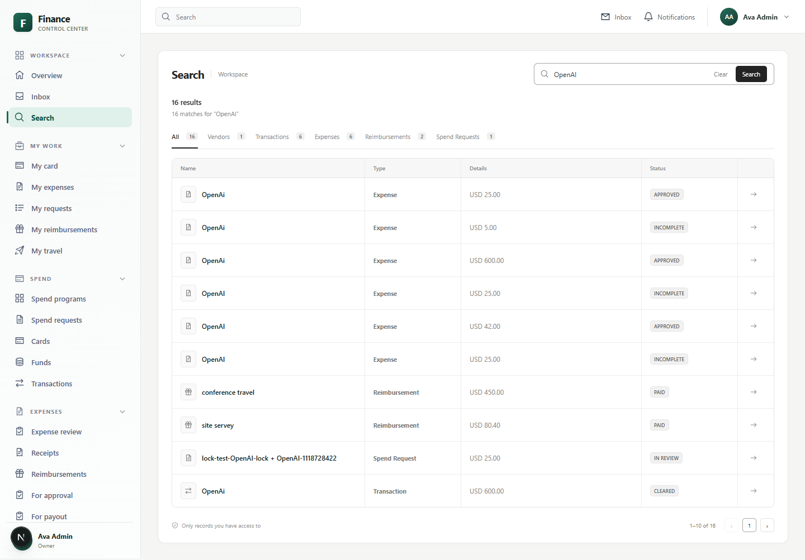
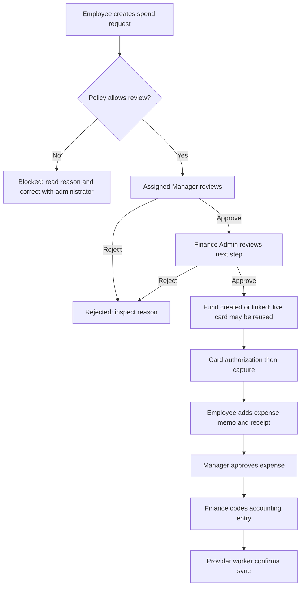
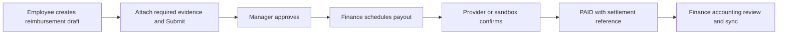
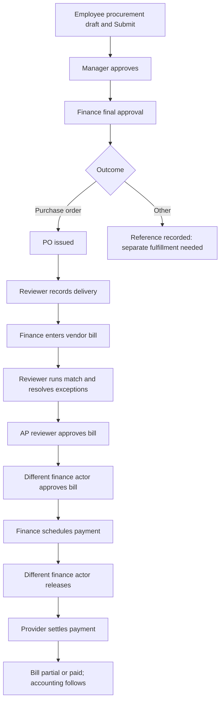

# Employee: complete role-based training manual

Reviewed against the working repository on **13 October 2026**. [Master training index](README.md).

## Contents

- [Role overview](#role-overview)
- [How to use this manual](#how-to-use-this-manual)
- [First-time setup and signing in](#first-time-setup-and-signing-in)
- [Daily operating routine](#daily-operating-routine)
- [Personal work: request, spend, document, and claim](#personal-work-request-spend-document-and-claim)
- [End-to-end workflow maps](#end-to-end-workflow-maps)
- [Practical training scenarios](#practical-training-scenarios)
- [Page-by-page navigation and create-field reference](#page-by-page-navigation-and-create-field-reference)
- [Troubleshooting and when to ask for help](#troubleshooting-and-when-to-ask-for-help)
- [Conditional and unfinished areas](#conditional-and-unfinished-areas)
- [Training checklist](#training-checklist)

## Role overview

You manage your own card-related work, request funding, complete expenses, claim reimbursements, request procurement, and arrange sandbox travel. You can read vendors in your assigned entity. You cannot approve others, manage roles/policies, release payments, or schedule payouts.

**Scope:** SELF for personal resources, plus ENTITY for vendor.read. A role/entity assignment must allow the selected legal entity. Your cardholder identity and requester identity determine personal access; a shared URL does not grant access to another employee’s records.

### Seeded permission reference

- `expense.create`
- `expense.read`
- `spend_request.create`
- `card.read`
- `reimbursement.create`
- `travel.book`
- `procurement.request`
- `vendor.read`

This is the checked-in seed, not a database audit of current assignments. Administrators can change role permissions and add roles. Older auth-matrix test fixtures contain different permission sets and must not be used as current training defaults.

## How to use this manual

Read in order, then practice the checklist in a training workspace. All examples are fictional training data. Replace example dates with suitable dates in your workspace. Never use the sample accounts for a real payment.

**Verification:** “Code verified” means the current frontend, connected API handler, and relevant business rules were inspected. It does not mean the application was run or that a connected provider completed a transaction. “Conditional” means a feature, provider, assignment, or environment setting is required. “Limited” means a visible control or backend operation has an incomplete user journey. No live login, new payment, database reset, or external transaction was performed for this guide.

The role beside your name, your company features, your assigned legal entity, and the record's current status determine what you can see and do. Multiple roles add permissions. A visible page does not guarantee every button will succeed.

## First-time setup and signing in

1. Obtain the application address, workspace name, and invitation from your administrator. Local development normally uses port 3000, but use the address your team supplies.
2. If invited, open the supplied activation link at **/activate**. Keep its token in the link. Enter **Workspace**, **Email**, **New password**, and **Confirm password**. Use 12–128 characters with uppercase, lowercase, and a number. Click **Activate account**. Expected result: **Your account is active**; then choose **Sign in**. Invitation delivery may be a sandbox link rather than an actual email.
3. At **/login**, enter **Workspace**, **Email**, and **Password**, then **Sign in**. Workspace is especially necessary when the email belongs to multiple companies. The demo workspace is **acme**. Expected result: **Workspace → Overview**, at **/app/home**.
4. Check the name and role at the bottom of the sidebar. Expand a sidebar section to see its pages. The header links to **Inbox** and **Notifications**; its search box opens workspace search.
5. Read the overview cards and use their links to open the underlying records. Missing modules can reflect your role or disabled features; zero totals do not prove all company records are absent.
6. To recover access, select **Forgot password?** on login, enter workspace and email, and submit the reset request. Click **Send reset link**. Use the latest delivered link at **/reset-password**, retain its token, check **Workspace** and **Email**, enter **New password** and **Confirm password**, and click **Reset password**. Expected result: **Password reset complete**; choose **Sign in**. Reset delivery and mail service operation are conditional. Do not keep retrying an expired token; ask an administrator for a fresh delivery.
7. Password change exists at **/app/company/security**: enter **Current password**, **New password**, and **Confirm password**, then **Change password**. This route is not a sidebar item; actual access depends on the session. A successful change signs out other sessions. At the end of work, open your account menu in the header and choose **Sign out**. Sessions expire after approximately 12 hours.

### Everyday navigation and list controls

1. **Workspace → Overview** (**/app/home**) is your starting point. Follow a summary link to its record list.
2. **Workspace → Search** (**/app/search**): enter a merchant or record name such as **OpenAI**, choose **Search**, then choose a result or its arrow. Type tabs narrow the results. Search respects the access granted by the server; a result may still fail to open if the related page has different access rules.
3. **Workspace → Inbox** (**/app/inbox**): review tasks assigned to your current approval step. Use **Refresh**, category tabs, search, type, priority, and sort controls. Opening a task shows policy details and activity. Marking a task as seen does not approve it.
4. **Insights → Notifications**, or the header **Notifications** (**/app/notifications**): choose **All** or **Unread**, open permitted linked records, and use **Mark all read** when finished. A notification is a message, not an approval or a payment confirmation.
5. On shared record lists, type in the search box and choose a status. Personal lists also offer **All**, **New**, and **Needs action**. **New** means recently created, not necessarily unread. Click a record to open a drawer or its full details. Use **Previous** and **Next** where present.
6. Where the list provides saved views, set the filters, enter a view name, and choose **Save view**. Reopen a saved view to reuse those filters. A saved view does not change permissions or record data.
7. Create forms open from their named button, such as **New spend request**. Fields with ***** are required by the form; the server may impose further requirements. Choose an existing item from a dropdown rather than typing a record ID. Fill the fields, click **Create** (or the specific form's save button), wait for the success/error message, and reopen the saved record to confirm its status. An error is not a completed operation.

**List limitation:** the shared API list reader returns at most 100 records. Page counts and filtered summaries may describe only that loaded set. Use a more specific search; ask support if a known older record remains missing. There is no verified unlimited export workflow in these screens.

### Reading status and policy

| Display | What you should do |
|---|---|
| DRAFT / INCOMPLETE | Complete the form, business purpose, and required documents before submitting. |
| IN_REVIEW / PENDING_APPROVAL | Wait for the current assigned reviewer. A first approval may leave the record in review. |
| PASS / WARN / REVIEW | Read the policy explanation. WARN or REVIEW can require additional human review. |
| BLOCK / BLOCKED | Read the blocking reason and ask the administrator how to correct the underlying problem. Approval does not bypass a hard block. |
| APPROVED | Approval is finished for that record. Funding, booking, or payment may still be required. |
| SCHEDULED / PROCESSING / SENT / SYNCING | Processing has started. Verify its completion in the record before treating it as finished. |
| PAID / SETTLED / SYNCED | Check the settlement or external reference and provider label. A sandbox result represents a simulated outcome. |
| REJECTED | Read the reason. Retry only where this manual confirms that correction and resubmission are supported. |

### Existing screenshot: navigation and search

This existing repository screenshot was inspected for illustration. It shows an Owner workspace with sample records. Its counts, dates, and visible modules are not a live verification of your account and may differ from the current build.

## Daily operating routine

1. Sign in; check **Overview**, **Notifications**, and your own pending records.
2. Check **My card** and available funds before a purchase; use **My requests** if approval/funding is needed.
3. Complete **My expenses** with purpose and receipts and submit eligible records.
4. Create legitimate out-of-pocket **My reimbursements**, then submit after evidence is complete.
5. Use **Procurement → Requests** for purchases needing a PO; **My travel** for travel quotes and approval.
6. Follow each status and contact the assigned reviewer if needed; a notification does not replace checking the record.
7. Confirm completed/paid/booked outcomes and sign out.

## Personal work: request, spend, document, and claim

These procedures require the matching creation permission. Owner and Finance Admin normally have it. The seeded Employee has it. The seeded Manager does **not** have personal creation permissions; a Manager who also needs personal tasks must receive an Employee or suitable custom role assignment.

### My card — view spending authority

Path: **My work → My card → /app/me/cards**. To open a particular card, use its link; details also exist at **/app/me/cards/[id]** and **/app/spend/cards/[id]**.

1. Read the card's last four digits, status, currency, and available funds. The page chooses a primary card; travel wallets may appear separately.
2. Review merchant restrictions, spending controls, linked fund, and originating request.
3. Use the **Card activity**, **Transactions**, **Spend top-ups**, **Travel wallets**, and **Authorizations** tabs to understand changes and purchases.
4. Open a transaction to review its merchant, amount, status, and linked expense. An authorization holds spending capacity; a cleared transaction represents captured spend.
5. If a card is lost or a purchase is declined, contact finance with the last four digits and transaction details. Employee and Manager do not receive **card.freeze** in the seed; do not expect **Freeze** or **Unfreeze** to be available to them.

Expected result: you can identify which card and funds are available to you and what purchases they allow. This application does not expose a verified employee workflow to reveal a full card number or security code.

### My requests — ask for funds before a purchase

Path: **My work → My requests → /app/me/requests → New spend request**.

1. Enter **What are you purchasing?** = **Training software subscription**.
2. Enter **Business purpose** = **Software for the support team's training project**.
3. Enter **Amount** = **120.00**; select **Legal entity** = **Acme US LLC** and confirm **Currency** = **USD**.
4. Select an active **Spend program**, such as **Software tools**. The amount must fit its limit, currency, dates, and your eligibility. A program selection can change the entity and currency.
5. Select **Vendor** = **OpenAI** if appropriate. A merchant-locked program filters this list; an unavailable vendor needs administrator attention.
6. Enter **Category** = **Software**. Choose **Fulfillment** = **Virtual card** or **Fund only**, according to the intended purchase. Choose **Recurrence** = **One-time** for this exercise. Recurrence is stored; automatic renewal of requests is not verified.
7. Leave **Expiration** blank to use program defaults, or choose a future date. Enter optional **Comments** with business context.
8. Click **Create**. This submits a spend request directly into review; there is no separate draft Submit step on this screen. A hard policy block instead creates a **BLOCKED** record.
9. Reopen the record at **/app/spend/requests/[id]** to read policy, approval progress, and linked funding. The manager normally reviews first and Finance Admin next.
10. After final approval, verify the funded result in **My card** and the linked fund. **Virtual card** can reuse the holder's live card and add funding; do not expect a new card number every time. **Fund only** creates spending authority without promising a new card.

Limited: there is no verified spend-request edit/resubmit screen for a rejected or blocked request. Ask the reviewer for the correction needed, then create a corrected request only after confirming the old record should not be used.

### My expenses — finish a company card purchase

Path: **My work → My expenses → /app/me/expenses → choose the merchant → /app/expenses/[id]**.

1. Choose an **INCOMPLETE** expense generated from card activity. There is no generic “New expense” form in My expenses; out-of-pocket spending uses reimbursements.
2. Review merchant, amount, currency, transaction, policy result, and the requirements checklist.
3. In **Business purpose / memo**, enter **Support training subscription for October**, then **Save memo**. Limit the text to 500 characters.
4. In **Attach receipt → File**, select the actual PDF, PNG, or JPEG receipt, then **Upload & link**. Wait for upload and linking to complete. Selecting a file alone does not link it. The Submit action can also upload a selected pending receipt.
5. Confirm the receipt details and scan status. Extracted merchant/amount values are guesses; mock OCR does not prove the invoice was correctly read.
6. Click **Submit expense**. Expected result: the expense goes into review and its manager receives the approval task. If the expense was rejected, complete the permitted corrections and use **Resubmit expense**.
7. Reopen the expense after the manager's decision. Confirm **APPROVED** and the activity history. Finance handles accounting separately.

**Split limitation:** the detail screen has Amount, Category, Department, and a split save control. The server requires all splits to equal the expense exactly. The current UI appends one split per save, so a partial first split fails; a single split equal to the full amount can succeed, but a normal multi-line split cannot be reliably entered through this UI. Ask finance/support for an approved alternative; do not repeatedly save partial amounts or assume a balanced multi-line split editor exists.

### Receipts — find and link an existing upload

Path: **Expenses → Receipts → /app/expenses/receipts**. Filter with **All**, **Unmatched**, or **Matched**.

1. Open an unmatched receipt to **/app/expenses/receipts/[id]**. A matched row takes you to its linked expense.
2. Search for the appropriate expense by employee, merchant, amount, date, transaction, or expense.
3. Review the candidate details and click **Link to this expense** to attach the receipt to that expense. Refresh and verify **MATCHED** and the linked record.
4. For a new receipt, use **My expenses → expense → Attach receipt**. The receipt list does not provide a standalone upload form.

Ownership and receipt-link restrictions are checked in the server. A receipt already used for another expense may be rejected. If you see records you cannot operate on, report that behavior; receipt list scoping is less specific than the ownership rules used for expense changes.

### My reimbursements — claim personal money spent for work

Path: **My work → My reimbursements → /app/me/reimbursements → New reimbursement**.

1. Select **Legal entity** and **Type**. For a standard example choose **Acme US LLC**, **Standard**, **Amount (standard only)** = **85.00**, **Currency** = **USD**.
2. Enter required **Business purpose** = **Taxi to customer training session**. Enter **Merchant** = **Training Taxi**, **Category** = **Travel**, and **Expense date** = the actual training date.
3. For **Mileage**, leave the standard amount empty and enter **Distance (miles)**, for example **120**. For **Per diem**, enter whole **Per-diem days** or **Eligible days**, for example **2**, and optionally **Destination** = **Austin**. The server calculates these amounts. Current code defaults yield USD 80.40 for 120 miles and USD 150.00 for two days; these are application defaults, not statements of current legal reimbursement rates. Verify the displayed rate and breakdown.
4. Click **Create**. Expected result: a **DRAFT** reimbursement with its calculated amount, duplicate check, and requirements.
5. Open **/app/expenses/reimbursements/[id]** from the saved row. Select a file under **Attach receipt** and click **Upload & link** when a receipt is required. Read all missing requirements before submitting. The standard USD 85 example needs a receipt under the seeded threshold policy.
6. Click **Submit**. Expected result: **IN_REVIEW** and a manager approval task. Duplicate detection or policy requirements can stop submission.
7. After manager approval, finance chooses **Schedule payout**. The claim becomes **SCHEDULED**. It becomes **PAID** only after payout confirmation. Follow the status; do not submit a second claim while the first is processing.

Limited: this UI has no general reimbursement edit form for correcting every field. “Resubmit” may be shown for NEEDS_INFO, but Inbox request-information does not automatically move the claim to that status. Rejected claims do not have a verified resubmission path. Ask finance how to handle the existing claim before making another one.

### Procurement Requests — obtain a purchase order

Path: **Procurement → Requests → /app/procurement/requests → New procurement request**.

1. Enter **Request name** = **Training room supplies**, **Legal entity** = **Acme US LLC**, and an available **Procurement program**.
2. Enter **Amount** = **600.00**, **Currency** = **USD**, **Outcome** = **Purchase order**, **Vendor** = the selected active supplier, and **Memo** = **Supplies for the onboarding classroom**.
3. Click **Create**. Expected result: a **DRAFT** request. Open **/app/procurement/requests/[id]**, review policy and details, then **Submit**.
4. The seeded procurement policy requires a vendor and memo; requests at the configured quote threshold can need a supporting document. The generic request form does not expose a quote upload or detailed line editor. If blocked for missing supporting material, ask the administrator; do not invent a quote attachment operation.
5. Wait for manager approval, then finance approval. A PO is created only after the final approval. A Purchase order outcome changes the request to **FULFILLED** and provides the PO link.
6. Finance or a permitted procurement reviewer records delivery and matches the supplier bill. Employee does not have the PO review/receiving permissions in the seed; hand off the resulting PO reference.

Limited: **Virtual card** and **Vendor setup** are selectable procurement outcomes, but the current approval handler records an outcome reference; it does not actually issue the card or complete vendor onboarding. Ask finance to perform the corresponding supported spend or vendor procedure separately. Do not treat the outcome reference as a fulfilled card or activated vendor.

### My travel — request and book a sandbox trip

Path: **My work → My travel → /app/me/travel → New trip**. Related pages are **Travel → Trips (/app/travel/trips)** and **Travel → Search (/app/travel/search)**, which directs you to an eligible trip.

1. Enter **Trip name** = **Customer training visit**, **Legal entity** = **Acme US LLC**, **Origin** = **AUS**, **Destination** = **New York** (use **JFK** if flight search requires an airport code), **Purpose** = **Train the customer operations team**, future **Start date** and **End date**, **Estimated cost** = **900.00**, **Currency** = **USD**.
2. Click **Create** and open the trip at **/app/travel/trips/[id]**. The end date must be on or after the start date.
3. Choose a supported search type (**Flights**, **Hotels**, or **Cars**) and **Search quotes**. Read supplier, amount, currency, policy, refundability, and provider information; click **Select** beside a returned offer. Expired offers require a fresh search.
4. Click **Submit**. A selected quote is required. Expected result: **PENDING_APPROVAL**, or a policy block with an explanation.
5. Wait for the manager and finance steps. Final approval makes the trip ready to book. Review **Reprice** before holding a quote; a material price change can require selection or approval again.
6. When available, choose **Place mock hold**, then **Confirm sandbox booking**. Expected result: the booking becomes **CONFIRMED** and the trip can become **BOOKED**. Confirming attaches travel funding/card instruments. A separate card authorization/capture is needed before card expense activity exists.
7. **Provision fund/card** is available on eligible ready/booked trips without instruments. The link fields are **Fund ID** and **Expense ID** text inputs, not dropdowns; this link block is shown only while the trip has no fund attached. Obtain the complete permitted record ID from the record's URL/system information or your administrator, enter it, then choose **Link fund** or **Link expense**. The record must belong to the trip's entity.
8. To unwind a permitted sandbox booking, choose **Cancel**, then **Refund / Simulate refund** if the booking is eligible. Verify the refund amount and status. A non-refundable or unconfirmed booking may reject the operation.
9. On My travel, **Manage** or **Review** opens the trip drawer and its full-trip link. **Edit** and **Delete** are offered only in eligible states; approved/booked trips cannot be directly edited or deleted. A rejected trip may be editable, but a complete return-to-draft/resubmit journey is not verified.

**Conditional:** all hold/confirm/cancel/refund actions here are sandbox operations and issue no live tickets or provider payments. Duffel can provide live search results; that does not turn this booking flow into live ticketing. Hotel/car search can be disabled by provider capabilities.

## End-to-end workflow maps

These maps describe the seeded/default path. Conditions and active workflow versions can change the review sequence.

```mermaid
flowchart LR
  T[Traveler creates trip] --> Q[Search and select quote]
  Q --> S[Submit]
  S --> M[Manager approval]
  M --> F[Finance approval]
  F --> R[Reprice as needed]
  R --> H[Place mock hold]
  H --> C[Confirm sandbox booking]
  C --> B[Booked trip and travel funding]
  B --> X[Eligible cancellation]
  X --> REF[Eligible simulated refund]
```

## Practical training scenarios

### Practice: USD 120 training subscription

1. Use My requests to request USD 120 from Software tools with a clear business purpose and matching vendor.
2. Confirm IN_REVIEW; Manager approves first; Finance Admin approves next.
3. Verify the linked funding/card. Finance performs a permitted sandbox authorization/capture or the configured issuer supplies transaction activity.
4. Open the resulting expense, save its memo, upload/link the receipt, then Submit expense.
5. Manager approves. Verify APPROVED; finance then handles accounting.

### Practice: USD 85 taxi reimbursement

Create a Standard USD 85 claim with purpose and receipt, Submit, wait for Manager approval, then follow Finance Admin's payout until PAID. Never equate APPROVED or SCHEDULED with money received.
## Page-by-page navigation and create-field reference

This lists every enabled-default sidebar destination available to the seeded role when its company feature is enabled. Read the corresponding operating procedure above for state changes and handoffs. A form is listed only when the page uses the shared configured form and the role has its create permission. Required below means required by that form; conditional server checks still apply.

### Workspace → Overview

**Exact route:** /app/home. [Source](<../../apps/web/src/app/app/home/page.tsx>)

1. Open the navigation path above.
2. Read its summaries and current filters. Search/filter the list when offered, then open the required record.
3. Follow the named procedure in this manual to review, update, or act on an eligible record. This entry does not imply a create form exists.

**Expected result:** the permitted list/detail or saved record is displayed; successful business completion requires the status/reference described in its operating procedure.

### Workspace → Inbox

**Exact route:** /app/inbox. [Source](<../../apps/web/src/app/app/inbox/page.tsx>)

1. Open the navigation path above.
2. Read its summaries and current filters. Search/filter the list when offered, then open the required record.
3. Follow the named procedure in this manual to review, update, or act on an eligible record. This entry does not imply a create form exists.

**Expected result:** the permitted list/detail or saved record is displayed; successful business completion requires the status/reference described in its operating procedure.

### Workspace → Search

**Exact route:** /app/search. [Source](<../../apps/web/src/app/app/search/page.tsx>)

1. Open the navigation path above.
2. Read its summaries and current filters. Search/filter the list when offered, then open the required record.
3. Follow the named procedure in this manual to review, update, or act on an eligible record. This entry does not imply a create form exists.

**Expected result:** the permitted list/detail or saved record is displayed; successful business completion requires the status/reference described in its operating procedure.

### My work → My card

**Exact route:** /app/me/cards. [Source](<../../apps/web/src/app/app/me/cards/page.tsx>)

1. Open the navigation path above.
2. Read its summaries and current filters. Search/filter the list when offered, then open the required record.
3. Follow the named procedure in this manual to review, update, or act on an eligible record. This entry does not imply a create form exists.

**Expected result:** the permitted list/detail or saved record is displayed; successful business completion requires the status/reference described in its operating procedure.

### My work → My expenses

**Exact route:** /app/me/expenses. [Source](<../../apps/web/src/app/app/me/expenses/page.tsx>)

Transactions needing receipts, review, and accounting handoff.

1. Open the navigation path above.
2. Read its summaries and current filters. Search/filter the list when offered, then open the required record.
3. Follow the named procedure in this manual to review, update, or act on an eligible record. This entry does not imply a create form exists.

**Expected result:** the permitted list/detail or saved record is displayed; successful business completion requires the status/reference described in its operating procedure.

### My work → My requests

**Exact route:** /app/me/requests. [Source](<../../apps/web/src/app/app/me/requests/page.tsx>)

Review spend before it happens, with an approval trail and linked fulfillment.

1. Open the navigation path above.
2. Read its summaries and current filters. Search/filter the list when offered, then open the required record.
3. For a new record choose **New spend request**, complete the fields below, then **Create**. Reopen the saved record and confirm its status.

| Exact field | Required in form | What to enter / sample | Choices or source |
|---|---|---|---|
| What are you purchasing? | Yes | Training example | Text |
| Business purpose | No | Software for customer training | Text |
| Amount | Yes | 600.00; positive amount | number |
| Currency | Yes | USD; must match entity/program | Text |
| Legal entity | Yes | Select Acme US LLC (or your assigned entity) | Select from entities |
| Spend program | Yes | Select an active applicable program | Select from spend-programs |
| Vendor | No | Select an active supplier, such as OpenAI | Select from vendors |
| Category | No | Software (or a configured allowed category) | Text |
| Fulfillment | No | Virtual card or Fund only | Virtual card, Fund only |
| Recurrence | No | One-time | One-time, Monthly, Quarterly |
| Expiration | No | A future expiration date, or leave blank | date |
| Comments | No | Explain the business context | Text |

**Expected result:** the permitted list/detail or saved record is displayed; successful business completion requires the status/reference described in its operating procedure.

### My work → My reimbursements

**Exact route:** /app/me/reimbursements. [Source](<../../apps/web/src/app/app/me/reimbursements/page.tsx>)

Employee out-of-pocket spend with server-calculated amounts and separate payout.

1. Open the navigation path above.
2. Read its summaries and current filters. Search/filter the list when offered, then open the required record.
3. For a new record choose **New reimbursement**, complete the fields below, then **Create**. Reopen the saved record and confirm its status.

| Exact field | Required in form | What to enter / sample | Choices or source |
|---|---|---|---|
| Legal entity | Yes | Select Acme US LLC (or your assigned entity) | Select from entities |
| Type | Yes | Standard, Mileage, or Per diem | Standard, Mileage, Per diem |
| Amount (standard only) | Depends on Type | 600.00; positive amount | number |
| Currency | Yes | USD; must match entity/program | Text |
| Business purpose | Yes | Describe the business purpose | Text |
| Merchant | No | Training Taxi | Text |
| Category | No | Software (or a configured allowed category) | Text |
| Expense date | No | Actual expense date | date |
| Destination (per diem) | No | Austin | Text |
| Distance (miles) | Depends on Type | 120 | number |
| Per-diem days | Depends on Type | 2 whole days | number |
| Eligible days | Depends on Type | 2 whole days; use one day-count basis | number |

**Expected result:** the permitted list/detail or saved record is displayed; successful business completion requires the status/reference described in its operating procedure.

### My work → My travel

**Exact route:** /app/me/travel. [Source](<../../apps/web/src/app/app/me/travel/page.tsx>)

Trip requests with search, reprice, approvals, sandbox hold/confirm, and cancel/refund. Live Duffel search does not issue live tickets.

1. Open the navigation path above.
2. Read its summaries and current filters. Search/filter the list when offered, then open the required record.
3. For a new record choose **New trip**, complete the fields below, then **Create**. Reopen the saved record and confirm its status.

| Exact field | Required in form | What to enter / sample | Choices or source |
|---|---|---|---|
| Trip name | Yes | Training example | Text |
| Legal entity | Yes | Select Acme US LLC (or your assigned entity) | Select from entities |
| Origin | No | AUS (airport code for flight search) | Text |
| Destination | Yes | Austin | Text |
| Purpose | No | Software for customer training | Text |
| Start date | Yes | Future departure date | date |
| End date | Yes | On or after the start date | date |
| Estimated cost | Yes | 900.00 | number |
| Currency | Yes | USD; must match entity/program | Text |

Page-configured actions: **Edit**, **Delete**, **Submit**. Actual availability also depends on status and server checks.

**Expected result:** the permitted list/detail or saved record is displayed; successful business completion requires the status/reference described in its operating procedure.

### Spend → Funds

**Exact route:** /app/spend/funds. [Source](<../../apps/web/src/app/app/spend/funds/page.tsx>)

Available funds and assigned spend authority.

1. Open the navigation path above.
2. Read its summaries and current filters. Search/filter the list when offered, then open the required record.
3. Follow the named procedure in this manual to review, update, or act on an eligible record. This entry does not imply a create form exists.

**Expected result:** the permitted list/detail or saved record is displayed; successful business completion requires the status/reference described in its operating procedure.

### Spend → Transactions

**Exact route:** /app/spend/transactions. [Source](<../../apps/web/src/app/app/spend/transactions/page.tsx>)

Card activity from authorization through clearing.

1. Open the navigation path above.
2. Read its summaries and current filters. Search/filter the list when offered, then open the required record.
3. Follow the named procedure in this manual to review, update, or act on an eligible record. This entry does not imply a create form exists.

**Expected result:** the permitted list/detail or saved record is displayed; successful business completion requires the status/reference described in its operating procedure.

### Expenses → Receipts

**Exact route:** /app/expenses/receipts. [Source](<../../apps/web/src/app/app/expenses/receipts/page.tsx>)

Uploaded receipts linked to card transactions and expenses.

1. Open the navigation path above.
2. Read its summaries and current filters. Search/filter the list when offered, then open the required record.
3. Follow the named procedure in this manual to review, update, or act on an eligible record. This entry does not imply a create form exists.

**Expected result:** the permitted list/detail or saved record is displayed; successful business completion requires the status/reference described in its operating procedure.

### Procurement → Requests

**Exact route:** /app/procurement/requests. [Source](<../../apps/web/src/app/app/procurement/requests/page.tsx>)

Requests begin at intake and produce a PO or another approved outcome only after final approval.

1. Open the navigation path above.
2. Read its summaries and current filters. Search/filter the list when offered, then open the required record.
3. For a new record choose **New procurement request**, complete the fields below, then **Create**. Reopen the saved record and confirm its status.

| Exact field | Required in form | What to enter / sample | Choices or source |
|---|---|---|---|
| Request name | Yes | Training example | Text |
| Legal entity | Yes | Select Acme US LLC (or your assigned entity) | Select from entities |
| Procurement program | Yes | Select an active applicable program | Select from procurement-programs |
| Amount | Yes | 600.00; positive amount | number |
| Currency | Yes | USD; must match entity/program | Text |
| Outcome | Yes | Purchase order; other outcomes have limited fulfillment | Purchase order, Virtual card, Vendor setup |
| Vendor | No | Select an active supplier, such as OpenAI | Select from vendors |
| Memo | No | Describe the business purpose | Text |

**Expected result:** the permitted list/detail or saved record is displayed; successful business completion requires the status/reference described in its operating procedure.

### Vendors & Bill Pay → Vendors

**Exact route:** /app/vendors. [Source](<../../apps/web/src/app/app/vendors/page.tsx>)

Shared counterparty identity with bank-change history and risk.

1. Open the navigation path above.
2. Read its summaries and current filters. Search/filter the list when offered, then open the required record.
3. Follow the named procedure in this manual to review, update, or act on an eligible record. This entry does not imply a create form exists.

**Expected result:** the permitted list/detail or saved record is displayed; successful business completion requires the status/reference described in its operating procedure.

### Insights → Notifications

**Exact route:** /app/notifications. [Source](<../../apps/web/src/app/app/notifications/page.tsx>)

1. Open the navigation path above.
2. Read its summaries and current filters. Search/filter the list when offered, then open the required record.
3. Follow the named procedure in this manual to review, update, or act on an eligible record. This entry does not imply a create form exists.

**Expected result:** the permitted list/detail or saved record is displayed; successful business completion requires the status/reference described in its operating procedure.

### Travel → Trips

**Exact route:** /app/travel/trips. [Source](<../../apps/web/src/app/app/travel/trips/page.tsx>)

Trip requests with search, reprice, approvals, sandbox hold/confirm, and cancel/refund. Live Duffel search does not issue live tickets.

1. Open the navigation path above.
2. Read its summaries and current filters. Search/filter the list when offered, then open the required record.
3. For a new record choose **New trip**, complete the fields below, then **Create**. Reopen the saved record and confirm its status.

| Exact field | Required in form | What to enter / sample | Choices or source |
|---|---|---|---|
| Trip name | Yes | Training example | Text |
| Legal entity | Yes | Select Acme US LLC (or your assigned entity) | Select from entities |
| Origin | No | AUS (airport code for flight search) | Text |
| Destination | Yes | Austin | Text |
| Purpose | No | Software for customer training | Text |
| Start date | Yes | Future departure date | date |
| End date | Yes | On or after the start date | date |
| Estimated cost | Yes | 900.00 | number |
| Currency | Yes | USD; must match entity/program | Text |

Page-configured actions: **Submit**. Actual availability also depends on status and server checks.

**Expected result:** the permitted list/detail or saved record is displayed; successful business completion requires the status/reference described in its operating procedure.

### Travel → Search

**Exact route:** /app/travel/search. [Source](<../../apps/web/src/app/app/travel/search/page.tsx>)

1. Open the navigation path above.
2. Read its summaries and current filters. Search/filter the list when offered, then open the required record.
3. Follow the named procedure in this manual to review, update, or act on an eligible record. This entry does not imply a create form exists.

**Expected result:** the permitted list/detail or saved record is displayed; successful business completion requires the status/reference described in its operating procedure.

## Troubleshooting and when to ask for help

| Problem | Explanation and steps |
|---|---|
| Cannot sign in / workspace requested | Check workspace slug, email, and password; use acme only for the seeded demo. A DRAFT account needs activation. A suspended or terminated account needs administrator attention. |
| Session expired | Sign in again, then reopen and check the record before retrying an operation. Do not assume an interrupted form was saved. |
| Activation/reset token invalid, expired, or already used | Open the latest full link. Ask for a fresh credential delivery; do not remove the token or reuse an old link. |
| 403 / missing page or button | Check the displayed roles, entity assignment, required permission, enabled company feature, and phase flag. Ask the administrator to inspect the assignment; opening a URL manually does not grant access. |
| No records found | Clear search/status filters; verify the correct account/entity, then search by a specific name. Shared lists can be limited to 100 loaded records. Ask support if the record is still missing. |
| Dropdown empty / Could not load form options | Wait for loading, reopen the form, verify the prerequisite entity/program/vendor is active and accessible. Entity changes can clear a previously selected vendor/program. |
| Currency mismatch or program unavailable | Use the currency of the selected legal entity and spend program. Confirm the program is active, within its dates, and available to your role/department/location. |
| Amount must be greater than zero | Enter a positive number without currency symbols; leave unused optional number fields blank. Whole counts/days must also meet their range requirements. |
| RECEIPT_REQUIRED / MEMO_REQUIRED / REQUIREMENTS_INCOMPLETE | Open the record requirements, supply the missing evidence/business purpose, save/link it, and retry only in a permitted state. |
| Attachment quarantined / document not ready / OCR pending | Wait for scan/processing and refresh. Use supported PDF/PNG/JPEG files. Ask support about the scan/worker if the status remains pending; do not bypass quarantine. |
| Duplicate invoice or reimbursement blocked | Search existing records and compare supplier, invoice number, amount, and dates. Do not change identifiers solely to evade a duplicate check. Finance should decide the correct existing record. |
| SOD_VIOLATION | Use a different qualified actor: requester cannot approve, payment scheduler cannot release, bank changer cannot verify, and distinct consecutive approval controls need different actors. Owner is also restricted. |
| NOT_ASSIGNED / approval not started | Check actual manager and current approval step. Creating a draft does not always submit it. Spend requests submit on creation; procurement/travel/reimbursement drafts need Submit. |
| INFO_REQUESTED but cannot resume | The current request-information journey is incomplete. Preserve the comment and record/task IDs; ask support to recover the pending approval. Do not assume a requester reply button exists. |
| State/conflict/record changed | Refresh and read the current status. Another person may already have completed the step. Retry once only if still appropriate. |
| Insufficient funds / budget exceeded / merchant or category blocked | Review available funding, pending holds, program/budget capacity, and card restrictions with finance. Approval does not override these spending controls. |
| QUOTE_REQUIRED / QUOTE_EXPIRED / REPRICE_REQUIRED | Select a fresh returned quote, reprice, and obtain any renewed approval. If procurement needs a quote attachment that its UI does not expose, escalate that specific screen limitation. |
| Payment remains processing / reimbursement scheduled / sync stays syncing | Check provider reference and labels; finance/technical support should check worker health, queue dispatch, provider configuration, and callbacks. Do not create a replacement payment/claim to force completion. |
| ERP_NOT_CONNECTED / mapping or controlled dimension error | Finance should connect the provider, select all required mappings, and use configured codes; retry only after correcting the cause. |
| Feature marked P1/P2 Not enabled | This is an explicitly gated product area. No complete production operation is promised by its route existing. |

For escalation, record the page URL, record/task ID, current status, error text, actor role, entity, and time. Include the correlation/reference ID if shown. Keep passwords, activation/reset tokens, and provider secrets out of tickets.
## Conditional and unfinished areas

The normal training sequence covers the working company-web journey. Later-phase pages require explicit phase flags and, in many cases, wildcard/Owner permission and company entitlements. Their presence in the repository does not prove an operational module. See [coverage and verification](coverage-and-verification.md) for every page, mounted API resource, model, and worker boundary.

- Banking transfers, disputes, tax, receivables, rewards, contracts, developer tools, sourcing/renewals, and specialist intelligence/reports are P1 or otherwise incomplete surfaces.
- AI assistant/agent/router/token/sheets screens are P2 and do not have a complete user operating journey in this build.
- Vendor portal, advisor console, mobile, and stack app contain scaffold screens; no separately authenticated Vendor, Advisor, or Super Admin role is seeded.
- Backend-only PO changes, budget updates, business limits, document intake helpers, and treasury settlement need an approved technical/operator workflow when no complete UI exists. They are inventoried, not presented as ordinary user buttons.

## Training checklist

- [ ] Activate and sign in with the correct workspace.
- [ ] Find your card, controls, funds, and transaction history.
- [ ] Create a valid spend request and follow both approval steps.
- [ ] Explain why funding is different from approval.
- [ ] Save an expense memo, link a receipt, submit, and inspect approval.
- [ ] Create Standard, Mileage, and Per diem sample claims; verify calculations.
- [ ] Submit a supported claim and distinguish APPROVED, SCHEDULED, and PAID.
- [ ] Create and submit a procurement draft and identify the resulting handoff.
- [ ] Create a trip, search/select a quote, submit, and complete a permitted sandbox booking.
- [ ] Find a record through Search and read a notification.
- [ ] Recognize a blocked/duplicate/permission error and provide useful escalation details.
- [ ] Sign out.

Trainer sign-off: record the trainee, date, exercised record IDs, demonstrated completion statuses, and unresolved limitations. A passing exercise includes identifying when to hand work to another role.
