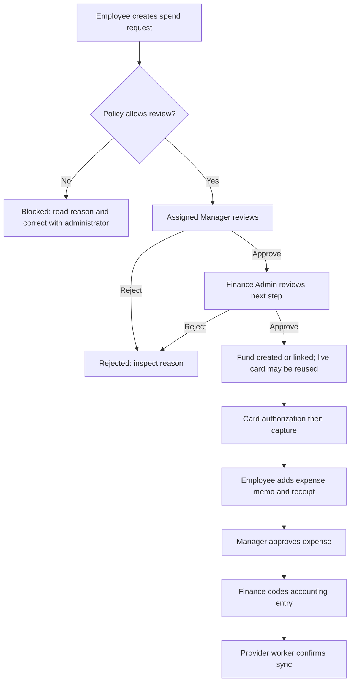
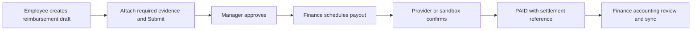
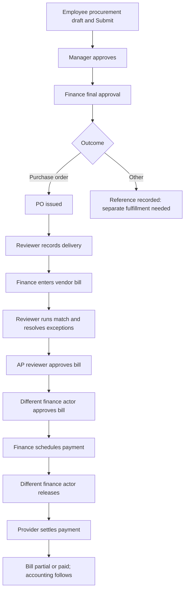

# Manager: complete role-based training manual

Reviewed against the working repository on **13 October 2026**. [Master training index](README.md).

## Contents

- [Role overview](#role-overview)
- [How to use this manual](#how-to-use-this-manual)
- [First-time setup and signing in](#first-time-setup-and-signing-in)
- [Daily operating routine](#daily-operating-routine)
- [Reviewing work and handing it to the next role](#reviewing-work-and-handing-it-to-the-next-role)
- [Cards, funds, transactions, and procurement review](#cards-funds-transactions-and-procurement-review)
- [End-to-end workflow maps](#end-to-end-workflow-maps)
- [Practical training scenarios](#practical-training-scenarios)
- [Page-by-page navigation and create-field reference](#page-by-page-navigation-and-create-field-reference)
- [Troubleshooting and when to ask for help](#troubleshooting-and-when-to-ask-for-help)
- [Conditional and unfinished areas](#conditional-and-unfinished-areas)
- [Training checklist](#training-checklist)

## Role overview

You review the work of your assigned direct reports: spend requests, expenses, reimbursements, procurement, and travel. You can read permitted cards, expenses, funds, transactions, and carry out procurement review operations. The seeded Manager is an approver role, not an Employee role plus approvals.

**Scope:** DIRECT_REPORTS for the seven seeded permissions. A manager assignment on the employee account is essential. You do not receive expense.create, spend_request.create, reimbursement.create, travel.book, payment, reporting, people, roles, or audit permissions by default. Personal pages may therefore be hidden even though you hold a management job.

### Seeded permission reference

- `expense.approve`
- `spend_request.approve`
- `reimbursement.approve`
- `travel.approve`
- `card.read`
- `expense.read`
- `procurement.review`

This is the checked-in seed, not a database audit of current assignments. Administrators can change role permissions and add roles. Older auth-matrix test fixtures contain different permission sets and must not be used as current training defaults.

## How to use this manual

Read in order, then practice the checklist in a training workspace. All examples are fictional training data. Replace example dates with suitable dates in your workspace. Never use the sample accounts for a real payment.

**Verification:** “Code verified” means the current frontend, connected API handler, and relevant business rules were inspected. It does not mean the application was run or that a connected provider completed a transaction. “Conditional” means a feature, provider, assignment, or environment setting is required. “Limited” means a visible control or backend operation has an incomplete user journey. No live login, new payment, database reset, or external transaction was performed for this guide.

The role beside your name, your company features, your assigned legal entity, and the record's current status determine what you can see and do. Multiple roles add permissions. A visible page does not guarantee every button will succeed.

## First-time setup and signing in

1. Obtain the application address, workspace name, and invitation from your administrator. Local development normally uses port 3000, but use the address your team supplies.
2. If invited, open the supplied activation link at **/activate**. Keep its token in the link. Enter **Workspace**, **Email**, **New password**, and **Confirm password**. Use 12–128 characters with uppercase, lowercase, and a number. Click **Activate account**. Expected result: **Your account is active**; then choose **Sign in**. Invitation delivery may be a sandbox link rather than an actual email.
3. At **/login**, enter **Workspace**, **Email**, and **Password**, then **Sign in**. Workspace is especially necessary when the email belongs to multiple companies. The demo workspace is **acme**. Expected result: **Workspace → Overview**, at **/app/home**.
4. Check the name and role at the bottom of the sidebar. Expand a sidebar section to see its pages. The header links to **Inbox** and **Notifications**; its search box opens workspace search.
5. Read the overview cards and use their links to open the underlying records. Missing modules can reflect your role or disabled features; zero totals do not prove all company records are absent.
6. To recover access, select **Forgot password?** on login, enter workspace and email, and submit the reset request. Click **Send reset link**. Use the latest delivered link at **/reset-password**, retain its token, check **Workspace** and **Email**, enter **New password** and **Confirm password**, and click **Reset password**. Expected result: **Password reset complete**; choose **Sign in**. Reset delivery and mail service operation are conditional. Do not keep retrying an expired token; ask an administrator for a fresh delivery.
7. Password change exists at **/app/company/security**: enter **Current password**, **New password**, and **Confirm password**, then **Change password**. This route is not a sidebar item; actual access depends on the session. A successful change signs out other sessions. At the end of work, open your account menu in the header and choose **Sign out**. Sessions expire after approximately 12 hours.

### Everyday navigation and list controls

1. **Workspace → Overview** (**/app/home**) is your starting point. Follow a summary link to its record list.
2. **Workspace → Search** (**/app/search**): enter a merchant or record name such as **OpenAI**, choose **Search**, then choose a result or its arrow. Type tabs narrow the results. Search respects the access granted by the server; a result may still fail to open if the related page has different access rules.
3. **Workspace → Inbox** (**/app/inbox**): review tasks assigned to your current approval step. Use **Refresh**, category tabs, search, type, priority, and sort controls. Opening a task shows policy details and activity. Marking a task as seen does not approve it.
4. **Insights → Notifications**, or the header **Notifications** (**/app/notifications**): choose **All** or **Unread**, open permitted linked records, and use **Mark all read** when finished. A notification is a message, not an approval or a payment confirmation.
5. On shared record lists, type in the search box and choose a status. Personal lists also offer **All**, **New**, and **Needs action**. **New** means recently created, not necessarily unread. Click a record to open a drawer or its full details. Use **Previous** and **Next** where present.
6. Where the list provides saved views, set the filters, enter a view name, and choose **Save view**. Reopen a saved view to reuse those filters. A saved view does not change permissions or record data.
7. Create forms open from their named button, such as **New spend request**. Fields with ***** are required by the form; the server may impose further requirements. Choose an existing item from a dropdown rather than typing a record ID. Fill the fields, click **Create** (or the specific form's save button), wait for the success/error message, and reopen the saved record to confirm its status. An error is not a completed operation.

**List limitation:** the shared API list reader returns at most 100 records. Page counts and filtered summaries may describe only that loaded set. Use a more specific search; ask support if a known older record remains missing. There is no verified unlimited export workflow in these screens.

### Reading status and policy

| Display | What you should do |
|---|---|
| DRAFT / INCOMPLETE | Complete the form, business purpose, and required documents before submitting. |
| IN_REVIEW / PENDING_APPROVAL | Wait for the current assigned reviewer. A first approval may leave the record in review. |
| PASS / WARN / REVIEW | Read the policy explanation. WARN or REVIEW can require additional human review. |
| BLOCK / BLOCKED | Read the blocking reason and ask the administrator how to correct the underlying problem. Approval does not bypass a hard block. |
| APPROVED | Approval is finished for that record. Funding, booking, or payment may still be required. |
| SCHEDULED / PROCESSING / SENT / SYNCING | Processing has started. Verify its completion in the record before treating it as finished. |
| PAID / SETTLED / SYNCED | Check the settlement or external reference and provider label. A sandbox result represents a simulated outcome. |
| REJECTED | Read the reason. Retry only where this manual confirms that correction and resubmission are supported. |

### Existing screenshot: navigation and search

This existing repository screenshot was inspected for illustration. It shows an Owner workspace with sample records. Its counts, dates, and visible modules are not a live verification of your account and may differ from the current build.

## Daily operating routine

1. Sign in; open **Inbox** and filter assigned approvals.
2. Review requester, purpose, evidence, amount, entity, policy, and current step before deciding.
3. Approve suitable spend, expense, reimbursement, procurement, and travel records; use clear comments for Reject/Request information.
4. Check that multi-step requests moved to finance and single-step expenses/reimbursements finished approval.
5. Review direct-report card/fund/transaction activity and purchase-order receiving/matching when authorized.
6. Follow unresolved exceptions; do not try to schedule payouts or create personal requests with the Manager role alone.
7. Sign out.

## Reviewing work and handing it to the next role

### Inbox approval procedure

Path: **Workspace → Inbox → /app/inbox → Approvals → Review**.

1. Filter to the relevant type and priority, then open **Review** on an assigned task.
2. Confirm the requester, legal entity, amount, currency, current approval step, and policy explanation. Open the source record if more detail is needed.
3. Review receipt/document evidence and the activity history. For procurement, inspect the requested outcome; for travel, inspect the selected quote and policy.
4. To proceed, choose **Approve**. Expected result: the current step completes; the next eligible reviewer gets the next step. A one-step expense or reimbursement can finish approval immediately. Refresh the source record to verify its status.
5. To stop the request, enter a clear comment such as **Supplier and business purpose do not match**, then **Reject**. The source record is set to **REJECTED**. Rejection is not a request for a minor correction.
6. To seek clarification, enter a comment such as **Please explain the customer training purpose**, then **Request information**. Expected result: the approval instance becomes **INFO_REQUESTED** and keeps approve/reject actions. This does not create a verified requester reply/resubmit form or necessarily change the source record status. Coordinate the clarification through your normal business process. Several domain Approve handlers only load IN_REVIEW instances, so approval after this action can fail; ask an administrator/support to recover the task rather than repeatedly submitting decisions.
7. Payment tasks use **Release** when permitted. Accounting and match exception tasks must be opened in their respective modules for coding or resolution. “Mark new as seen” only clears the local new-task marker.

### Who acts next under seeded workflows

| Record | First user | First reviewer | Next reviewer / operator | Completion evidence |
|---|---|---|---|---|
| Spend request | Employee creates; enters review immediately | Requester's Manager | Finance Admin, a different actor from a distinct prior control step | Approved funding and linked fund/card; request FULFILLED. |
| Card expense | Cardholder adds memo/receipt and submits | Requester's Manager | Finance handles accounting | APPROVED expense; accounting sync is a separate process. |
| Reimbursement | Employee creates draft, attaches evidence, submits | Requester's Manager | Finance Admin schedules payout | PAID with payout/settlement reference. |
| Procurement request | Employee creates draft, then submits | Requester's Manager | Finance Admin approves; procurement reviewer receives/matches | PO issued after final approval; matching and bill settlement occur later. |
| Bill | Owner or Finance Admin enters/submits | Eligible AP step actor | Different eligible finance step actor; scheduler and releaser follow | Settlement reference; bill PAID when remaining balance is zero. |
| Travel | Traveler creates, selects quote, submits | Traveler's Manager | Finance Admin then traveler/books operator | CONFIRMED sandbox booking / BOOKED trip. |

These are default/seed sequences, not a promise that the workspace still uses them. Follow the actual displayed approval progress. An explicitly assigned user or custom rule can change the next actor. AP and treasury are duties assigned to accounts; the seed does not define separate AP or Treasury roles.

### Approval restrictions

You cannot decide your own approval. A person cannot approve consecutive **distinct** control steps, such as AP followed by finance. Owner access does not remove these rules. A manager must actually be the requester's assigned manager for a normal manager step. Having an approval permission alone is insufficient if the current workflow step belongs to another actor.

Illustration from the repository, showing an Owner account. Task counts and appearance may differ; use the current buttons and permissions as your guide.

### Manager review pages

| Navigation | Exact route | Steps and expected result |
|---|---|---|
| Spend → Spend requests | /app/spend/requests | Search the direct report's request; open /app/spend/requests/[id]; read policy and progress; Approve the manager step. Finance still needs to act. Use Inbox for Reject or Request information. |
| Expenses → Expense review | /app/expenses/transactions | Choose an expense; open /app/expenses/[id]; inspect memo, receipt, requirements, and timeline; Approve. Seeded expense workflow ends after manager approval. |
| Expenses → Reimbursements → For approval | /app/expenses/reimbursements?status=IN_REVIEW | Open /app/expenses/reimbursements/[id]; check claim type, breakdown, receipt, duplicate result; Approve. Finance gets the approved claim for payout. |
| Procurement → Requests | /app/procurement/requests | Open /app/procurement/requests/[id]; verify vendor, memo, amount, policy, and outcome; Approve. Finance finishes approval before a PO is issued. |
| Travel → Trip requests | /app/travel/requests | Use For approval, Ready to book, or Decided; open the trip; review selected quote and policy; Approve the current step. The traveler still needs to book after all approvals. |

The seeded Manager's direct-report scope applies to owned resources, cards through their holder, and POs through the requester. Some catalogs/child lists are filtered differently; do not assume every visible list means organization-wide operating authority. The Manager cannot create personal expenses, requests, reimbursements, or trips with that role alone, and cannot schedule reimbursement payouts or release bill payments.

## Cards, funds, transactions, and procurement review

1. **Spend → Funds (/app/spend/funds)**: open a permitted direct-report fund at **/app/spend/funds/[id]**; read available amount, limit, linked request/card, and transactions. There is no Manager create/top-up form here.
2. **Spend → Transactions (/app/spend/transactions)**: open **/app/spend/transactions/[id]**; inspect direct-report card activity and linked expense. Manager lacks card.issue, so Capture/Void/Reverse are not Manager actions.
3. **Procurement → Programs (/app/procurement/programs)**: the seeded Manager has procurement.review, which also permits **New intake program**. Enter Program name and Default outcome and Create only when your company's duties authorize configuration. This is broader than an approval-only job title suggests.
4. **Procurement → Purchase Orders (/app/procurement/purchase-orders)**: open **/app/procurement/purchase-orders/[id]**, read delivery and match status. You may Record receipt for a permitted PO: enter Amount or Quantity and Memo, then save. Use one basis; quantity takes precedence in the detail UI. Confirm received totals do not exceed the order.
5. **Procurement → Receiving (/app/procurement/receiving)**: choose Record receipt, select an eligible Purchase order, enter Amount (or use quantity) or Quantity (or use amount), optional Memo, then Create.
6. PO matching can require selecting a bill that the seeded Manager cannot read. The Manager has no bill.read permission; finance should perform that portion when the bill picker is inaccessible. Do not create an unrelated bill or ask for blanket access just to complete the exercise.
7. **Procurement → Match Exceptions (/app/procurement/match-exceptions)**: open an accessible exception, review the PO/variance, enter Comment, then use the justified action: Approve override, Request receiving update, Request corrected invoice, Mark corrected, Resolve, Comment, or Reject. Requested-update/comment decisions keep it in review. Variance at least 1000 requires Owner for Approve override.
8. The Manager's scope does not guarantee a complete employee directory or organization reports; request a corrected reporting assignment if a task is missing.

## End-to-end workflow maps

These maps describe the seeded/default path. Conditions and active workflow versions can change the review sequence.

```mermaid
flowchart LR
  T[Traveler creates trip] --> Q[Search and select quote]
  Q --> S[Submit]
  S --> M[Manager approval]
  M --> F[Finance approval]
  F --> R[Reprice as needed]
  R --> H[Place mock hold]
  H --> C[Confirm sandbox booking]
  C --> B[Booked trip and travel funding]
  B --> X[Eligible cancellation]
  X --> REF[Eligible simulated refund]
```

## Practical training scenarios

### Practice: review Elena's training requests

1. Have the Employee submit a USD 120 software request, USD 85 reimbursement, USD 600 procurement request, and a quoted USD 900 trip in a training workspace.
2. Confirm Elena is your direct report and each task's current step belongs to you.
3. Open each task in Inbox, verify purpose/evidence/policy, and Approve.
4. Confirm the spend/procurement/travel tasks continue to finance, while the reimbursement becomes approved for finance payout.
5. After a captured card purchase, approve Elena's completed expense.
6. For a separate unsuitable practice request, enter a reason and Reject; verify the source record is REJECTED. Do not reject the records intended for the successful workflow.
## Page-by-page navigation and create-field reference

This lists every enabled-default sidebar destination available to the seeded role when its company feature is enabled. Read the corresponding operating procedure above for state changes and handoffs. A form is listed only when the page uses the shared configured form and the role has its create permission. Required below means required by that form; conditional server checks still apply.

### Workspace → Overview

**Exact route:** /app/home. [Source](<../../apps/web/src/app/app/home/page.tsx>)

1. Open the navigation path above.
2. Read its summaries and current filters. Search/filter the list when offered, then open the required record.
3. Follow the named procedure in this manual to review, update, or act on an eligible record. This entry does not imply a create form exists.

**Expected result:** the permitted list/detail or saved record is displayed; successful business completion requires the status/reference described in its operating procedure.

### Workspace → Inbox

**Exact route:** /app/inbox. [Source](<../../apps/web/src/app/app/inbox/page.tsx>)

1. Open the navigation path above.
2. Read its summaries and current filters. Search/filter the list when offered, then open the required record.
3. Follow the named procedure in this manual to review, update, or act on an eligible record. This entry does not imply a create form exists.

**Expected result:** the permitted list/detail or saved record is displayed; successful business completion requires the status/reference described in its operating procedure.

### Workspace → Search

**Exact route:** /app/search. [Source](<../../apps/web/src/app/app/search/page.tsx>)

1. Open the navigation path above.
2. Read its summaries and current filters. Search/filter the list when offered, then open the required record.
3. Follow the named procedure in this manual to review, update, or act on an eligible record. This entry does not imply a create form exists.

**Expected result:** the permitted list/detail or saved record is displayed; successful business completion requires the status/reference described in its operating procedure.

### My work → My card

**Exact route:** /app/me/cards. [Source](<../../apps/web/src/app/app/me/cards/page.tsx>)

1. Open the navigation path above.
2. Read its summaries and current filters. Search/filter the list when offered, then open the required record.
3. Follow the named procedure in this manual to review, update, or act on an eligible record. This entry does not imply a create form exists.

**Expected result:** the permitted list/detail or saved record is displayed; successful business completion requires the status/reference described in its operating procedure.

### My work → My expenses

**Exact route:** /app/me/expenses. [Source](<../../apps/web/src/app/app/me/expenses/page.tsx>)

Transactions needing receipts, review, and accounting handoff.

1. Open the navigation path above.
2. Read its summaries and current filters. Search/filter the list when offered, then open the required record.
3. Follow the named procedure in this manual to review, update, or act on an eligible record. This entry does not imply a create form exists.

**Expected result:** the permitted list/detail or saved record is displayed; successful business completion requires the status/reference described in its operating procedure.

### Spend → Spend requests

**Exact route:** /app/spend/requests. [Source](<../../apps/web/src/app/app/spend/requests/page.tsx>)

Review spend before it happens, with an approval trail and linked fulfillment.

1. Open the navigation path above.
2. Read its summaries and current filters. Search/filter the list when offered, then open the required record.
3. Follow the named procedure in this manual to review, update, or act on an eligible record. This entry does not imply a create form exists.

Page-configured actions: **Approve**. Actual availability also depends on status and server checks.

**Expected result:** the permitted list/detail or saved record is displayed; successful business completion requires the status/reference described in its operating procedure.

### Spend → Funds

**Exact route:** /app/spend/funds. [Source](<../../apps/web/src/app/app/spend/funds/page.tsx>)

Available funds and assigned spend authority.

1. Open the navigation path above.
2. Read its summaries and current filters. Search/filter the list when offered, then open the required record.
3. Follow the named procedure in this manual to review, update, or act on an eligible record. This entry does not imply a create form exists.

**Expected result:** the permitted list/detail or saved record is displayed; successful business completion requires the status/reference described in its operating procedure.

### Spend → Transactions

**Exact route:** /app/spend/transactions. [Source](<../../apps/web/src/app/app/spend/transactions/page.tsx>)

Card activity from authorization through clearing.

1. Open the navigation path above.
2. Read its summaries and current filters. Search/filter the list when offered, then open the required record.
3. Follow the named procedure in this manual to review, update, or act on an eligible record. This entry does not imply a create form exists.

**Expected result:** the permitted list/detail or saved record is displayed; successful business completion requires the status/reference described in its operating procedure.

### Expenses → Expense review

**Exact route:** /app/expenses/transactions. [Source](<../../apps/web/src/app/app/expenses/transactions/page.tsx>)

Transactions needing receipts, review, and accounting handoff.

1. Open the navigation path above.
2. Read its summaries and current filters. Search/filter the list when offered, then open the required record.
3. Follow the named procedure in this manual to review, update, or act on an eligible record. This entry does not imply a create form exists.

**Expected result:** the permitted list/detail or saved record is displayed; successful business completion requires the status/reference described in its operating procedure.

### Expenses → Reimbursements

**Exact route:** /app/expenses/reimbursements. [Source](<../../apps/web/src/app/app/expenses/reimbursements/page.tsx>)

Employee out-of-pocket spend with server-calculated amounts and separate payout.

1. Open the navigation path above.
2. Read its summaries and current filters. Search/filter the list when offered, then open the required record.
3. Follow the named procedure in this manual to review, update, or act on an eligible record. This entry does not imply a create form exists.

**Expected result:** the permitted list/detail or saved record is displayed; successful business completion requires the status/reference described in its operating procedure.

### Expenses → For approval

**Exact route:** /app/expenses/reimbursements?status=IN_REVIEW. [Source](<../../apps/web/src/app/app/expenses/reimbursements/page.tsx>)

Employee out-of-pocket spend with server-calculated amounts and separate payout.

1. Open the navigation path above.
2. Read its summaries and current filters. Search/filter the list when offered, then open the required record.
3. Follow the named procedure in this manual to review, update, or act on an eligible record. This entry does not imply a create form exists.

**Expected result:** the permitted list/detail or saved record is displayed; successful business completion requires the status/reference described in its operating procedure.

### Procurement → Requests

**Exact route:** /app/procurement/requests. [Source](<../../apps/web/src/app/app/procurement/requests/page.tsx>)

Requests begin at intake and produce a PO or another approved outcome only after final approval.

1. Open the navigation path above.
2. Read its summaries and current filters. Search/filter the list when offered, then open the required record.
3. Follow the named procedure in this manual to review, update, or act on an eligible record. This entry does not imply a create form exists.

**Expected result:** the permitted list/detail or saved record is displayed; successful business completion requires the status/reference described in its operating procedure.

### Procurement → Programs

**Exact route:** /app/procurement/programs. [Source](<../../apps/web/src/app/app/procurement/programs/page.tsx>)

Intake programs that route purchase requests to the right reviewers.

1. Open the navigation path above.
2. Read its summaries and current filters. Search/filter the list when offered, then open the required record.
3. For a new record choose **New intake program**, complete the fields below, then **Create**. Reopen the saved record and confirm its status.

| Exact field | Required in form | What to enter / sample | Choices or source |
|---|---|---|---|
| Program name | Yes | Training example | Text |
| Default outcome | No | Purchase order | Purchase order, Virtual card, Vendor setup |

**Expected result:** the permitted list/detail or saved record is displayed; successful business completion requires the status/reference described in its operating procedure.

### Procurement → Purchase Orders

**Exact route:** /app/procurement/purchase-orders. [Source](<../../apps/web/src/app/app/procurement/purchase-orders/page.tsx>)

Approved commitments with lines, receiving, and 2/3-way match.

1. Open the navigation path above.
2. Read its summaries and current filters. Search/filter the list when offered, then open the required record.
3. Follow the named procedure in this manual to review, update, or act on an eligible record. This entry does not imply a create form exists.

**Expected result:** the permitted list/detail or saved record is displayed; successful business completion requires the status/reference described in its operating procedure.

### Procurement → Receiving

**Exact route:** /app/procurement/receiving. [Source](<../../apps/web/src/app/app/procurement/receiving/page.tsx>)

Goods and services received against approved purchase orders.

1. Open the navigation path above.
2. Read its summaries and current filters. Search/filter the list when offered, then open the required record.
3. For a new record choose **Record receipt**, complete the fields below, then **Create**. Reopen the saved record and confirm its status.

| Exact field | Required in form | What to enter / sample | Choices or source |
|---|---|---|---|
| Purchase order | Yes | Select the issued/open PO | Select from purchase-orders |
| Amount (or use quantity) | No | 600.00; positive amount | number |
| Quantity (or use amount) | No | 1, or a positive quantity within remaining delivery | number |
| Memo | No | Describe the business purpose | Text |

**Expected result:** the permitted list/detail or saved record is displayed; successful business completion requires the status/reference described in its operating procedure.

### Procurement → Match Exceptions

**Exact route:** /app/procurement/match-exceptions. [Source](<../../apps/web/src/app/app/procurement/match-exceptions/page.tsx>)

1. Open the navigation path above.
2. Read its summaries and current filters. Search/filter the list when offered, then open the required record.
3. Follow the named procedure in this manual to review, update, or act on an eligible record. This entry does not imply a create form exists.

**Expected result:** the permitted list/detail or saved record is displayed; successful business completion requires the status/reference described in its operating procedure.

### Insights → Notifications

**Exact route:** /app/notifications. [Source](<../../apps/web/src/app/app/notifications/page.tsx>)

1. Open the navigation path above.
2. Read its summaries and current filters. Search/filter the list when offered, then open the required record.
3. Follow the named procedure in this manual to review, update, or act on an eligible record. This entry does not imply a create form exists.

**Expected result:** the permitted list/detail or saved record is displayed; successful business completion requires the status/reference described in its operating procedure.

### Travel → Trip requests

**Exact route:** /app/travel/requests. [Source](<../../apps/web/src/app/app/travel/requests/page.tsx>)

Trip requests with search, reprice, approvals, sandbox hold/confirm, and cancel/refund. Live Duffel search does not issue live tickets.

1. Open the navigation path above.
2. Read its summaries and current filters. Search/filter the list when offered, then open the required record.
3. Follow the named procedure in this manual to review, update, or act on an eligible record. This entry does not imply a create form exists.

Page-configured actions: **Approve**. Actual availability also depends on status and server checks.

**Expected result:** the permitted list/detail or saved record is displayed; successful business completion requires the status/reference described in its operating procedure.

## Troubleshooting and when to ask for help

| Problem | Explanation and steps |
|---|---|
| Cannot sign in / workspace requested | Check workspace slug, email, and password; use acme only for the seeded demo. A DRAFT account needs activation. A suspended or terminated account needs administrator attention. |
| Session expired | Sign in again, then reopen and check the record before retrying an operation. Do not assume an interrupted form was saved. |
| Activation/reset token invalid, expired, or already used | Open the latest full link. Ask for a fresh credential delivery; do not remove the token or reuse an old link. |
| 403 / missing page or button | Check the displayed roles, entity assignment, required permission, enabled company feature, and phase flag. Ask the administrator to inspect the assignment; opening a URL manually does not grant access. |
| No records found | Clear search/status filters; verify the correct account/entity, then search by a specific name. Shared lists can be limited to 100 loaded records. Ask support if the record is still missing. |
| Dropdown empty / Could not load form options | Wait for loading, reopen the form, verify the prerequisite entity/program/vendor is active and accessible. Entity changes can clear a previously selected vendor/program. |
| Currency mismatch or program unavailable | Use the currency of the selected legal entity and spend program. Confirm the program is active, within its dates, and available to your role/department/location. |
| Amount must be greater than zero | Enter a positive number without currency symbols; leave unused optional number fields blank. Whole counts/days must also meet their range requirements. |
| RECEIPT_REQUIRED / MEMO_REQUIRED / REQUIREMENTS_INCOMPLETE | Open the record requirements, supply the missing evidence/business purpose, save/link it, and retry only in a permitted state. |
| Attachment quarantined / document not ready / OCR pending | Wait for scan/processing and refresh. Use supported PDF/PNG/JPEG files. Ask support about the scan/worker if the status remains pending; do not bypass quarantine. |
| Duplicate invoice or reimbursement blocked | Search existing records and compare supplier, invoice number, amount, and dates. Do not change identifiers solely to evade a duplicate check. Finance should decide the correct existing record. |
| SOD_VIOLATION | Use a different qualified actor: requester cannot approve, payment scheduler cannot release, bank changer cannot verify, and distinct consecutive approval controls need different actors. Owner is also restricted. |
| NOT_ASSIGNED / approval not started | Check actual manager and current approval step. Creating a draft does not always submit it. Spend requests submit on creation; procurement/travel/reimbursement drafts need Submit. |
| INFO_REQUESTED but cannot resume | The current request-information journey is incomplete. Preserve the comment and record/task IDs; ask support to recover the pending approval. Do not assume a requester reply button exists. |
| State/conflict/record changed | Refresh and read the current status. Another person may already have completed the step. Retry once only if still appropriate. |
| Insufficient funds / budget exceeded / merchant or category blocked | Review available funding, pending holds, program/budget capacity, and card restrictions with finance. Approval does not override these spending controls. |
| QUOTE_REQUIRED / QUOTE_EXPIRED / REPRICE_REQUIRED | Select a fresh returned quote, reprice, and obtain any renewed approval. If procurement needs a quote attachment that its UI does not expose, escalate that specific screen limitation. |
| Payment remains processing / reimbursement scheduled / sync stays syncing | Check provider reference and labels; finance/technical support should check worker health, queue dispatch, provider configuration, and callbacks. Do not create a replacement payment/claim to force completion. |
| ERP_NOT_CONNECTED / mapping or controlled dimension error | Finance should connect the provider, select all required mappings, and use configured codes; retry only after correcting the cause. |
| Feature marked P1/P2 Not enabled | This is an explicitly gated product area. No complete production operation is promised by its route existing. |

For escalation, record the page URL, record/task ID, current status, error text, actor role, entity, and time. Include the correlation/reference ID if shown. Keep passwords, activation/reset tokens, and provider secrets out of tickets.
## Conditional and unfinished areas

The normal training sequence covers the working company-web journey. Later-phase pages require explicit phase flags and, in many cases, wildcard/Owner permission and company entitlements. Their presence in the repository does not prove an operational module. See [coverage and verification](coverage-and-verification.md) for every page, mounted API resource, model, and worker boundary.

- Banking transfers, disputes, tax, receivables, rewards, contracts, developer tools, sourcing/renewals, and specialist intelligence/reports are P1 or otherwise incomplete surfaces.
- AI assistant/agent/router/token/sheets screens are P2 and do not have a complete user operating journey in this build.
- Vendor portal, advisor console, mobile, and stack app contain scaffold screens; no separately authenticated Vendor, Advisor, or Super Admin role is seeded.
- Backend-only PO changes, budget updates, business limits, document intake helpers, and treasury settlement need an approved technical/operator workflow when no complete UI exists. They are inventoried, not presented as ordinary user buttons.

## Training checklist

- [ ] Explain direct-report scope and identify your actual reports.
- [ ] Find assigned tasks and identify the current step.
- [ ] Review expense evidence and approve a completed expense.
- [ ] Approve reimbursement and hand it to finance for payout.
- [ ] Approve a spend request without mistaking it for final fulfillment.
- [ ] Approve procurement/travel and verify the finance handoff.
- [ ] Reject a separate practice record with a meaningful comment.
- [ ] Explain the request-information recovery limitation.
- [ ] Inspect direct-report cards, funds, and transactions.
- [ ] Record permitted receiving and evaluate matching, or identify the required operator.
- [ ] Recognize self-approval and wrong-step errors.
- [ ] Explain why Manager alone cannot create personal work or pay reimbursements.

Trainer sign-off: record the trainee, date, exercised record IDs, demonstrated completion statuses, and unresolved limitations. A passing exercise includes identifying when to hand work to another role.
