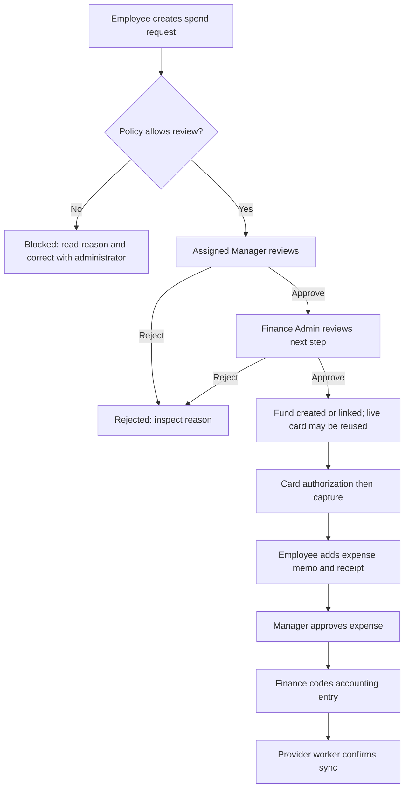
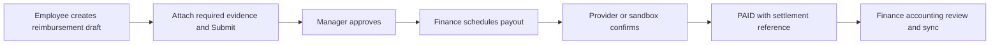
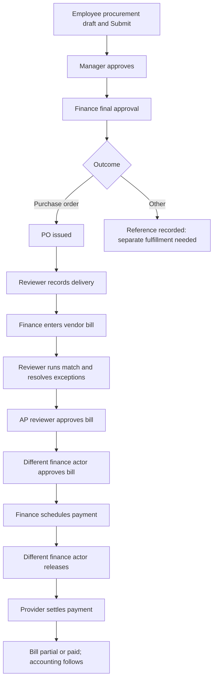

# Owner: complete role-based training manual

Reviewed against the working repository on **13 October 2026**. [Master training index](README.md).

## Contents

- [Role overview](#role-overview)
- [How to use this manual](#how-to-use-this-manual)
- [First-time setup and signing in](#first-time-setup-and-signing-in)
- [Daily operating routine](#daily-operating-routine)
- [Personal work: request, spend, document, and claim](#personal-work-request-spend-document-and-claim)
- [Reviewing work and handing it to the next role](#reviewing-work-and-handing-it-to-the-next-role)
- [Finance operations, page by page](#finance-operations-page-by-page)
- [Company administration and access management](#company-administration-and-access-management)
- [End-to-end workflow maps](#end-to-end-workflow-maps)
- [Practical training scenarios](#practical-training-scenarios)
- [Page-by-page navigation and create-field reference](#page-by-page-navigation-and-create-field-reference)
- [Troubleshooting and when to ask for help](#troubleshooting-and-when-to-ask-for-help)
- [Conditional and unfinished areas](#conditional-and-unfinished-areas)
- [Training checklist](#training-checklist)

## Role overview

You administer the current company and can operate all permitted modules. Owner has organization-wide access inside this tenant, including wildcard-only surfaces when enabled. You maintain access, structure, policy, reviewers, and exceptional decisions.

Owner bypasses normal resource permission filters but remains subject to record state, self-approval, independent payment release, and distinct approval-step controls.

### Seeded permission reference

- `*`

This is the checked-in seed, not a database audit of current assignments. Administrators can change role permissions and add roles. Older auth-matrix test fixtures contain different permission sets and must not be used as current training defaults.

## How to use this manual

Read in order, then practice the checklist in a training workspace. All examples are fictional training data. Replace example dates with suitable dates in your workspace. Never use the sample accounts for a real payment.

**Verification:** “Code verified” means the current frontend, connected API handler, and relevant business rules were inspected. It does not mean the application was run or that a connected provider completed a transaction. “Conditional” means a feature, provider, assignment, or environment setting is required. “Limited” means a visible control or backend operation has an incomplete user journey. No live login, new payment, database reset, or external transaction was performed for this guide.

The role beside your name, your company features, your assigned legal entity, and the record's current status determine what you can see and do. Multiple roles add permissions. A visible page does not guarantee every button will succeed.

## First-time setup and signing in

1. Obtain the application address, workspace name, and invitation from your administrator. Local development normally uses port 3000, but use the address your team supplies.
2. If invited, open the supplied activation link at **/activate**. Keep its token in the link. Enter **Workspace**, **Email**, **New password**, and **Confirm password**. Use 12–128 characters with uppercase, lowercase, and a number. Click **Activate account**. Expected result: **Your account is active**; then choose **Sign in**. Invitation delivery may be a sandbox link rather than an actual email.
3. At **/login**, enter **Workspace**, **Email**, and **Password**, then **Sign in**. Workspace is especially necessary when the email belongs to multiple companies. The demo workspace is **acme**. Expected result: **Workspace → Overview**, at **/app/home**.
4. Check the name and role at the bottom of the sidebar. Expand a sidebar section to see its pages. The header links to **Inbox** and **Notifications**; its search box opens workspace search.
5. Read the overview cards and use their links to open the underlying records. Missing modules can reflect your role or disabled features; zero totals do not prove all company records are absent.
6. To recover access, select **Forgot password?** on login, enter workspace and email, and submit the reset request. Click **Send reset link**. Use the latest delivered link at **/reset-password**, retain its token, check **Workspace** and **Email**, enter **New password** and **Confirm password**, and click **Reset password**. Expected result: **Password reset complete**; choose **Sign in**. Reset delivery and mail service operation are conditional. Do not keep retrying an expired token; ask an administrator for a fresh delivery.
7. Password change exists at **/app/company/security**: enter **Current password**, **New password**, and **Confirm password**, then **Change password**. This route is not a sidebar item; actual access depends on the session. A successful change signs out other sessions. At the end of work, open your account menu in the header and choose **Sign out**. Sessions expire after approximately 12 hours.

### Everyday navigation and list controls

1. **Workspace → Overview** (**/app/home**) is your starting point. Follow a summary link to its record list.
2. **Workspace → Search** (**/app/search**): enter a merchant or record name such as **OpenAI**, choose **Search**, then choose a result or its arrow. Type tabs narrow the results. Search respects the access granted by the server; a result may still fail to open if the related page has different access rules.
3. **Workspace → Inbox** (**/app/inbox**): review tasks assigned to your current approval step. Use **Refresh**, category tabs, search, type, priority, and sort controls. Opening a task shows policy details and activity. Marking a task as seen does not approve it.
4. **Insights → Notifications**, or the header **Notifications** (**/app/notifications**): choose **All** or **Unread**, open permitted linked records, and use **Mark all read** when finished. A notification is a message, not an approval or a payment confirmation.
5. On shared record lists, type in the search box and choose a status. Personal lists also offer **All**, **New**, and **Needs action**. **New** means recently created, not necessarily unread. Click a record to open a drawer or its full details. Use **Previous** and **Next** where present.
6. Where the list provides saved views, set the filters, enter a view name, and choose **Save view**. Reopen a saved view to reuse those filters. A saved view does not change permissions or record data.
7. Create forms open from their named button, such as **New spend request**. Fields with ***** are required by the form; the server may impose further requirements. Choose an existing item from a dropdown rather than typing a record ID. Fill the fields, click **Create** (or the specific form's save button), wait for the success/error message, and reopen the saved record to confirm its status. An error is not a completed operation.

**List limitation:** the shared API list reader returns at most 100 records. Page counts and filtered summaries may describe only that loaded set. Use a more specific search; ask support if a known older record remains missing. There is no verified unlimited export workflow in these screens.

### Reading status and policy

| Display | What you should do |
|---|---|
| DRAFT / INCOMPLETE | Complete the form, business purpose, and required documents before submitting. |
| IN_REVIEW / PENDING_APPROVAL | Wait for the current assigned reviewer. A first approval may leave the record in review. |
| PASS / WARN / REVIEW | Read the policy explanation. WARN or REVIEW can require additional human review. |
| BLOCK / BLOCKED | Read the blocking reason and ask the administrator how to correct the underlying problem. Approval does not bypass a hard block. |
| APPROVED | Approval is finished for that record. Funding, booking, or payment may still be required. |
| SCHEDULED / PROCESSING / SENT / SYNCING | Processing has started. Verify its completion in the record before treating it as finished. |
| PAID / SETTLED / SYNCED | Check the settlement or external reference and provider label. A sandbox result represents a simulated outcome. |
| REJECTED | Read the reason. Retry only where this manual confirms that correction and resubmission are supported. |

### Existing screenshot: navigation and search

This existing repository screenshot was inspected for illustration. It shows an Owner workspace with sample records. Its counts, dates, and visible modules are not a live verification of your account and may differ from the current build.

## Daily operating routine

1. Sign in; review organization overview, Inbox, exceptions, and integration health.
2. Resolve ownership/access/manager assignments and maintain active reviewers.
3. Review budgets, policy/workflow versions, and high-value procurement exceptions.
4. Complete only the approval/release steps for which you are an eligible independent actor.
5. Follow the finance operating steps for cards, procurement, bills, payouts, and accounting where needed.
6. Confirm final statuses and audit changes; arrange remaining work with the next role.
7. Sign out.

## Personal work: request, spend, document, and claim

These procedures require the matching creation permission. Owner and Finance Admin normally have it. The seeded Employee has it. The seeded Manager does **not** have personal creation permissions; a Manager who also needs personal tasks must receive an Employee or suitable custom role assignment.

### My card — view spending authority

Path: **My work → My card → /app/me/cards**. To open a particular card, use its link; details also exist at **/app/me/cards/[id]** and **/app/spend/cards/[id]**.

1. Read the card's last four digits, status, currency, and available funds. The page chooses a primary card; travel wallets may appear separately.
2. Review merchant restrictions, spending controls, linked fund, and originating request.
3. Use the **Card activity**, **Transactions**, **Spend top-ups**, **Travel wallets**, and **Authorizations** tabs to understand changes and purchases.
4. Open a transaction to review its merchant, amount, status, and linked expense. An authorization holds spending capacity; a cleared transaction represents captured spend.
5. If a card is lost or a purchase is declined, contact finance with the last four digits and transaction details. Employee and Manager do not receive **card.freeze** in the seed; do not expect **Freeze** or **Unfreeze** to be available to them.

Expected result: you can identify which card and funds are available to you and what purchases they allow. This application does not expose a verified employee workflow to reveal a full card number or security code.

### My requests — ask for funds before a purchase

Path: **My work → My requests → /app/me/requests → New spend request**.

1. Enter **What are you purchasing?** = **Training software subscription**.
2. Enter **Business purpose** = **Software for the support team's training project**.
3. Enter **Amount** = **120.00**; select **Legal entity** = **Acme US LLC** and confirm **Currency** = **USD**.
4. Select an active **Spend program**, such as **Software tools**. The amount must fit its limit, currency, dates, and your eligibility. A program selection can change the entity and currency.
5. Select **Vendor** = **OpenAI** if appropriate. A merchant-locked program filters this list; an unavailable vendor needs administrator attention.
6. Enter **Category** = **Software**. Choose **Fulfillment** = **Virtual card** or **Fund only**, according to the intended purchase. Choose **Recurrence** = **One-time** for this exercise. Recurrence is stored; automatic renewal of requests is not verified.
7. Leave **Expiration** blank to use program defaults, or choose a future date. Enter optional **Comments** with business context.
8. Click **Create**. This submits a spend request directly into review; there is no separate draft Submit step on this screen. A hard policy block instead creates a **BLOCKED** record.
9. Reopen the record at **/app/spend/requests/[id]** to read policy, approval progress, and linked funding. The manager normally reviews first and Finance Admin next.
10. After final approval, verify the funded result in **My card** and the linked fund. **Virtual card** can reuse the holder's live card and add funding; do not expect a new card number every time. **Fund only** creates spending authority without promising a new card.

Limited: there is no verified spend-request edit/resubmit screen for a rejected or blocked request. Ask the reviewer for the correction needed, then create a corrected request only after confirming the old record should not be used.

### My expenses — finish a company card purchase

Path: **My work → My expenses → /app/me/expenses → choose the merchant → /app/expenses/[id]**.

1. Choose an **INCOMPLETE** expense generated from card activity. There is no generic “New expense” form in My expenses; out-of-pocket spending uses reimbursements.
2. Review merchant, amount, currency, transaction, policy result, and the requirements checklist.
3. In **Business purpose / memo**, enter **Support training subscription for October**, then **Save memo**. Limit the text to 500 characters.
4. In **Attach receipt → File**, select the actual PDF, PNG, or JPEG receipt, then **Upload & link**. Wait for upload and linking to complete. Selecting a file alone does not link it. The Submit action can also upload a selected pending receipt.
5. Confirm the receipt details and scan status. Extracted merchant/amount values are guesses; mock OCR does not prove the invoice was correctly read.
6. Click **Submit expense**. Expected result: the expense goes into review and its manager receives the approval task. If the expense was rejected, complete the permitted corrections and use **Resubmit expense**.
7. Reopen the expense after the manager's decision. Confirm **APPROVED** and the activity history. Finance handles accounting separately.

**Split limitation:** the detail screen has Amount, Category, Department, and a split save control. The server requires all splits to equal the expense exactly. The current UI appends one split per save, so a partial first split fails; a single split equal to the full amount can succeed, but a normal multi-line split cannot be reliably entered through this UI. Ask finance/support for an approved alternative; do not repeatedly save partial amounts or assume a balanced multi-line split editor exists.

### Receipts — find and link an existing upload

Path: **Expenses → Receipts → /app/expenses/receipts**. Filter with **All**, **Unmatched**, or **Matched**.

1. Open an unmatched receipt to **/app/expenses/receipts/[id]**. A matched row takes you to its linked expense.
2. Search for the appropriate expense by employee, merchant, amount, date, transaction, or expense.
3. Review the candidate details and click **Link to this expense** to attach the receipt to that expense. Refresh and verify **MATCHED** and the linked record.
4. For a new receipt, use **My expenses → expense → Attach receipt**. The receipt list does not provide a standalone upload form.

Ownership and receipt-link restrictions are checked in the server. A receipt already used for another expense may be rejected. If you see records you cannot operate on, report that behavior; receipt list scoping is less specific than the ownership rules used for expense changes.

### My reimbursements — claim personal money spent for work

Path: **My work → My reimbursements → /app/me/reimbursements → New reimbursement**.

1. Select **Legal entity** and **Type**. For a standard example choose **Acme US LLC**, **Standard**, **Amount (standard only)** = **85.00**, **Currency** = **USD**.
2. Enter required **Business purpose** = **Taxi to customer training session**. Enter **Merchant** = **Training Taxi**, **Category** = **Travel**, and **Expense date** = the actual training date.
3. For **Mileage**, leave the standard amount empty and enter **Distance (miles)**, for example **120**. For **Per diem**, enter whole **Per-diem days** or **Eligible days**, for example **2**, and optionally **Destination** = **Austin**. The server calculates these amounts. Current code defaults yield USD 80.40 for 120 miles and USD 150.00 for two days; these are application defaults, not statements of current legal reimbursement rates. Verify the displayed rate and breakdown.
4. Click **Create**. Expected result: a **DRAFT** reimbursement with its calculated amount, duplicate check, and requirements.
5. Open **/app/expenses/reimbursements/[id]** from the saved row. Select a file under **Attach receipt** and click **Upload & link** when a receipt is required. Read all missing requirements before submitting. The standard USD 85 example needs a receipt under the seeded threshold policy.
6. Click **Submit**. Expected result: **IN_REVIEW** and a manager approval task. Duplicate detection or policy requirements can stop submission.
7. After manager approval, finance chooses **Schedule payout**. The claim becomes **SCHEDULED**. It becomes **PAID** only after payout confirmation. Follow the status; do not submit a second claim while the first is processing.

Limited: this UI has no general reimbursement edit form for correcting every field. “Resubmit” may be shown for NEEDS_INFO, but Inbox request-information does not automatically move the claim to that status. Rejected claims do not have a verified resubmission path. Ask finance how to handle the existing claim before making another one.

### Procurement Requests — obtain a purchase order

Path: **Procurement → Requests → /app/procurement/requests → New procurement request**.

1. Enter **Request name** = **Training room supplies**, **Legal entity** = **Acme US LLC**, and an available **Procurement program**.
2. Enter **Amount** = **600.00**, **Currency** = **USD**, **Outcome** = **Purchase order**, **Vendor** = the selected active supplier, and **Memo** = **Supplies for the onboarding classroom**.
3. Click **Create**. Expected result: a **DRAFT** request. Open **/app/procurement/requests/[id]**, review policy and details, then **Submit**.
4. The seeded procurement policy requires a vendor and memo; requests at the configured quote threshold can need a supporting document. The generic request form does not expose a quote upload or detailed line editor. If blocked for missing supporting material, ask the administrator; do not invent a quote attachment operation.
5. Wait for manager approval, then finance approval. A PO is created only after the final approval. A Purchase order outcome changes the request to **FULFILLED** and provides the PO link.
6. Finance or a permitted procurement reviewer records delivery and matches the supplier bill. Employee does not have the PO review/receiving permissions in the seed; hand off the resulting PO reference.

Limited: **Virtual card** and **Vendor setup** are selectable procurement outcomes, but the current approval handler records an outcome reference; it does not actually issue the card or complete vendor onboarding. Ask finance to perform the corresponding supported spend or vendor procedure separately. Do not treat the outcome reference as a fulfilled card or activated vendor.

### My travel — request and book a sandbox trip

Path: **My work → My travel → /app/me/travel → New trip**. Related pages are **Travel → Trips (/app/travel/trips)** and **Travel → Search (/app/travel/search)**, which directs you to an eligible trip.

1. Enter **Trip name** = **Customer training visit**, **Legal entity** = **Acme US LLC**, **Origin** = **AUS**, **Destination** = **New York** (use **JFK** if flight search requires an airport code), **Purpose** = **Train the customer operations team**, future **Start date** and **End date**, **Estimated cost** = **900.00**, **Currency** = **USD**.
2. Click **Create** and open the trip at **/app/travel/trips/[id]**. The end date must be on or after the start date.
3. Choose a supported search type (**Flights**, **Hotels**, or **Cars**) and **Search quotes**. Read supplier, amount, currency, policy, refundability, and provider information; click **Select** beside a returned offer. Expired offers require a fresh search.
4. Click **Submit**. A selected quote is required. Expected result: **PENDING_APPROVAL**, or a policy block with an explanation.
5. Wait for the manager and finance steps. Final approval makes the trip ready to book. Review **Reprice** before holding a quote; a material price change can require selection or approval again.
6. When available, choose **Place mock hold**, then **Confirm sandbox booking**. Expected result: the booking becomes **CONFIRMED** and the trip can become **BOOKED**. Confirming attaches travel funding/card instruments. A separate card authorization/capture is needed before card expense activity exists.
7. **Provision fund/card** is available on eligible ready/booked trips without instruments. The link fields are **Fund ID** and **Expense ID** text inputs, not dropdowns; this link block is shown only while the trip has no fund attached. Obtain the complete permitted record ID from the record's URL/system information or your administrator, enter it, then choose **Link fund** or **Link expense**. The record must belong to the trip's entity.
8. To unwind a permitted sandbox booking, choose **Cancel**, then **Refund / Simulate refund** if the booking is eligible. Verify the refund amount and status. A non-refundable or unconfirmed booking may reject the operation.
9. On My travel, **Manage** or **Review** opens the trip drawer and its full-trip link. **Edit** and **Delete** are offered only in eligible states; approved/booked trips cannot be directly edited or deleted. A rejected trip may be editable, but a complete return-to-draft/resubmit journey is not verified.

**Conditional:** all hold/confirm/cancel/refund actions here are sandbox operations and issue no live tickets or provider payments. Duffel can provide live search results; that does not turn this booking flow into live ticketing. Hotel/car search can be disabled by provider capabilities.

## Reviewing work and handing it to the next role

### Inbox approval procedure

Path: **Workspace → Inbox → /app/inbox → Approvals → Review**.

1. Filter to the relevant type and priority, then open **Review** on an assigned task.
2. Confirm the requester, legal entity, amount, currency, current approval step, and policy explanation. Open the source record if more detail is needed.
3. Review receipt/document evidence and the activity history. For procurement, inspect the requested outcome; for travel, inspect the selected quote and policy.
4. To proceed, choose **Approve**. Expected result: the current step completes; the next eligible reviewer gets the next step. A one-step expense or reimbursement can finish approval immediately. Refresh the source record to verify its status.
5. To stop the request, enter a clear comment such as **Supplier and business purpose do not match**, then **Reject**. The source record is set to **REJECTED**. Rejection is not a request for a minor correction.
6. To seek clarification, enter a comment such as **Please explain the customer training purpose**, then **Request information**. Expected result: the approval instance becomes **INFO_REQUESTED** and keeps approve/reject actions. This does not create a verified requester reply/resubmit form or necessarily change the source record status. Coordinate the clarification through your normal business process. Several domain Approve handlers only load IN_REVIEW instances, so approval after this action can fail; ask an administrator/support to recover the task rather than repeatedly submitting decisions.
7. Payment tasks use **Release** when permitted. Accounting and match exception tasks must be opened in their respective modules for coding or resolution. “Mark new as seen” only clears the local new-task marker.

### Who acts next under seeded workflows

| Record | First user | First reviewer | Next reviewer / operator | Completion evidence |
|---|---|---|---|---|
| Spend request | Employee creates; enters review immediately | Requester's Manager | Finance Admin, a different actor from a distinct prior control step | Approved funding and linked fund/card; request FULFILLED. |
| Card expense | Cardholder adds memo/receipt and submits | Requester's Manager | Finance handles accounting | APPROVED expense; accounting sync is a separate process. |
| Reimbursement | Employee creates draft, attaches evidence, submits | Requester's Manager | Finance Admin schedules payout | PAID with payout/settlement reference. |
| Procurement request | Employee creates draft, then submits | Requester's Manager | Finance Admin approves; procurement reviewer receives/matches | PO issued after final approval; matching and bill settlement occur later. |
| Bill | Owner or Finance Admin enters/submits | Eligible AP step actor | Different eligible finance step actor; scheduler and releaser follow | Settlement reference; bill PAID when remaining balance is zero. |
| Travel | Traveler creates, selects quote, submits | Traveler's Manager | Finance Admin then traveler/books operator | CONFIRMED sandbox booking / BOOKED trip. |

These are default/seed sequences, not a promise that the workspace still uses them. Follow the actual displayed approval progress. An explicitly assigned user or custom rule can change the next actor. AP and treasury are duties assigned to accounts; the seed does not define separate AP or Treasury roles.

### Approval restrictions

You cannot decide your own approval. A person cannot approve consecutive **distinct** control steps, such as AP followed by finance. Owner access does not remove these rules. A manager must actually be the requester's assigned manager for a normal manager step. Having an approval permission alone is insufficient if the current workflow step belongs to another actor.

Illustration from the repository, showing an Owner account. Task counts and appearance may differ; use the current buttons and permissions as your guide.

### Manager review pages

| Navigation | Exact route | Steps and expected result |
|---|---|---|
| Spend → Spend requests | /app/spend/requests | Search the direct report's request; open /app/spend/requests/[id]; read policy and progress; Approve the manager step. Finance still needs to act. Use Inbox for Reject or Request information. |
| Expenses → Expense review | /app/expenses/transactions | Choose an expense; open /app/expenses/[id]; inspect memo, receipt, requirements, and timeline; Approve. Seeded expense workflow ends after manager approval. |
| Expenses → Reimbursements → For approval | /app/expenses/reimbursements?status=IN_REVIEW | Open /app/expenses/reimbursements/[id]; check claim type, breakdown, receipt, duplicate result; Approve. Finance gets the approved claim for payout. |
| Procurement → Requests | /app/procurement/requests | Open /app/procurement/requests/[id]; verify vendor, memo, amount, policy, and outcome; Approve. Finance finishes approval before a PO is issued. |
| Travel → Trip requests | /app/travel/requests | Use For approval, Ready to book, or Decided; open the trip; review selected quote and policy; Approve the current step. The traveler still needs to book after all approvals. |

The seeded Manager's direct-report scope applies to owned resources, cards through their holder, and POs through the requester. Some catalogs/child lists are filtered differently; do not assume every visible list means organization-wide operating authority. The Manager cannot create personal expenses, requests, reimbursements, or trips with that role alone, and cannot schedule reimbursement payouts or release bill payments.

## Finance operations, page by page

### Set up budgets and spend programs

1. Open **Insights → Budgets → /app/insights/budgets → New budget**. Enter **Budget name** = **Training 2026**, **Legal entity** = **Acme US LLC**, **Amount** = **10000**, **Currency** = **USD**, **Period** = **Monthly**, then **Create**.
2. Open the budget at **/app/insights/budgets/[id]**. Check **Capacity**, **Actual**, **Committed**, **Remaining**, utilization, freshness, and linked programs. Committed funds are reserved; actual funds are captured spending. Do not add currencies together as if they were one currency.
3. Open **Spend → Spend programs → /app/spend/programs → New spend program**. Enter **Program name** = **Training software**, the same entity/currency, **Maximum request amount** = **500**, and choose the budget.
4. Set **Default fulfillment** = **Virtual card** or **Fund only**. Optional controls are **Default merchant lock**, **Default allowed MCCs (comma-separated)**, **Default per-transaction limit**, **Default velocity max amount**, **Default velocity max count**, and **Default validity (days)**. For a controlled exercise use merchant lock **OpenAI**, allowed category **software**, per-transaction limit **200**, and validity **30** days. Leave unused numeric fields blank.
5. Click **Create**; open **/app/spend/programs/[id]** to inspect and modify the implemented settings with **Save changes**. Program maximum cannot be reduced below an active issued fund. **Deactivate** stops future use; confirm the browser prompt. It does not prove existing purchases have been unwound.
6. Open **Spend → Funds → /app/spend/funds**, then **/app/spend/funds/[id]**, to inspect owner, limit, available amount, source request, transactions, and cards. This page is an inspection/handoff surface; no generic fund creation form is provided despite a fund.create permission name.

Budget update and some program eligibility/date settings exist in backend models or handlers without a complete matching screen. Do not assume the generic create form configures every stored field. Budget detail is read-oriented in this build.

### Cards and transactions

Path: **Spend → Cards → /app/cards → select a card → /app/cards/[id]** (the shared detail implementation is also at **/app/spend/cards/[id]**).

1. Search by holder, last four digits, or fund. Use the card status tabs, sort, and **More filters → Merchant lock** to narrow the list.
2. Open the card. Check holder, entity, status, currency, funding sources, spending totals, and activity. The card list is not a standalone “Issue card” form; spend approval and travel provisioning are implemented issuance paths.
3. With card.freeze permission, use **Freeze** when required, **Unfreeze** to restore a frozen card, or **Terminate** to end it. Confirm requested prompts. Termination cannot be reversed by unfreezing.
4. In the control form, enter **Merchant lock**; **Allowed categories (comma-separated)**; **Blocked categories**; **Allowed countries**; **Blocked countries**; **Per-transaction limit**; **Daily / weekly / monthly limits**; **Velocity max amount**; **Velocity max count**; and **Velocity window (hours)** as required. Example: merchant **OpenAI**, allowed category **software**, country **US**, per-transaction limit **200**, daily **400**, velocity count **5**, window **24**. Use uppercase two-letter country codes. Click **Save controls** and confirm the refreshed values.
5. **Sandbox only:** the authorization form accepts **Merchant**, **Amount**, and category/MCC. Use **OpenAI**, **42.00**, **software** and the available authorize action. Read approval/decline information. The button is **Authorize** in mock mode or **Authorize & capture** when the issuer explicitly enables Stripe test helpers. It is not available for unrestricted production use.
6. Open **Spend → Transactions → /app/spend/transactions → /app/spend/transactions/[id]**. Inspect authorization, fund/card, merchant, accounting/expense links, and activity.
7. On an eligible mock **PENDING** transaction use **Capture** or **Simulate clearing**, or **Void** to release the hold. On an eligible mock **CLEARED** transaction **Reverse** unwinds it. Refresh the fund and linked expense to verify the outcome. These are sandbox lifecycle controls; production requires issuer events.
8. In Stripe mode, **Authorize & capture** can be available when Stripe test helpers are explicitly enabled; otherwise use the configured issuer process. Issuer events/test helpers create and capture activity. Do not substitute mock capture/void/reverse controls for Stripe events. Whether Stripe is configured, funded, or receiving webhooks was not verified for this guide.

### Reimbursements: approval and payout are separate

1. Open **Expenses → Reimbursements → For approval** (**/app/expenses/reimbursements?status=IN_REVIEW**). Inspect the claim's amount calculation, evidence, duplicates, and progress. Approve only an assigned current step; finance cannot simply replace the employee's manager on a manager step.
2. Open **For payout** (**/app/expenses/reimbursements?status=APPROVED**). Open the approved claim, choose **Schedule payout**. The current detail button sends ACH; other payout rails exist in the API but are not exposed as a chooser here.
3. Confirm **SCHEDULED** and the provider reference. In an authorized sandbox **Confirm payout** simulates provider completion. The worker may complete mock payouts. Production blocks the manual confirmation endpoint and requires an actual provider integration.
4. Check **Paid / History** (**?status=PAID**) for **PAID**, paid date, and settlement reference. Check **Failures** (**?status=FAILED**) for failure reasons. Eligible failed payouts can be scheduled again after resolving the problem.
5. Backend failure/returned operations exist, but no complete user controls for marking failures/returns were found in the normal reimbursement detail. Escalate those cases to the operations team rather than inventing a button.

### Vendors and independent bank verification

Path: **Vendors & Bill Pay → Vendors → /app/vendors → Add vendor**.

1. Enter **Vendor name** = **Training Supplies Ltd**, **Category** = **Office**, **Legal entity** = **Acme US LLC**, **Risk** = **Low**, and optional **Notes**. Click **Create**. Duplicate vendor names can be rejected.
2. Open **/app/vendors/[id]**. Review/edit **Name**, **Legal name**, **Display name**, **Category**, **Risk**, and **Notes**. Click **Save vendor**. Use **Deactivate** only when the vendor should no longer be selected.
3. In bank details enter **Last 4** = **6789**, **Routing (masked)** = **xxxx111**, **Payment method** = **ACH**, and **Change reason** = **Training supplier initial setup**. Click **Update bank details**. These fields store masked information; they are not a complete real-bank onboarding flow.
4. A different authorized person opens the vendor's bank history and chooses **Verify** on the relevant bank-history account. The person who changed bank details cannot verify that same change. Verify the current account/status before releasing a payment.
5. Review linked bills, POs, payments, risk, and activity from the vendor's detail page. Employee has vendor read access for its entity but no vendor or bank maintenance permission by default.

### Bills — intake, correct, submit, and approve

Paths: **Vendors & Bill Pay → Bills → /app/bill-pay/bills → Create bill → /app/bill-pay/bills/new**.

1. Select **Legal entity** and active **Vendor**. Enter **Invoice number** = **TRAIN-2026-001**, optional **Invoice date** and **Due date**, and **Memo** = **Classroom supplies**. Currency is read-only and follows the selected entity.
2. Select an **Invoice document** in PDF/PNG/JPEG format if available. Wait until the upload completes. This form does not provide a complete “scan invoice and automatically fill every field” workflow; enter and check the invoice data yourself.
3. In **Line items**, enter required **Description** = **Training supplies**, **Quantity** = **1**, **Unit price** = **600.00**, **Tax** = **0**. Optional fields are **Category**, **GL account**, **Department**, **Location**, and **Project / job**. Use **Add line** or **Remove line** as appropriate. The server validates line totals.
4. Check **Save as draft** for a draft, then **Create bill**. Unchecked creates a bill for the active submission path; confirm its actual status after creation. Do not assume a duplicate warning means the bill was saved.
5. Open **/app/bill-pay/bills/[id]**. On a **DRAFT**, correct invoice number/date, due date, memo, and line details, then **Save draft corrections**. Submitted bills cannot be edited with this draft-only action.
6. Choose **Submit for approval** on an eligible draft/needs-review bill. Use the list's **Drafts**, **For approval**, **For payment**, **History**, or **Urgent** tabs to follow it. Exact stage links include **?stage=approval**, **?stage=payment**, and **?stage=history**.
7. A different eligible AP reviewer chooses **Approve bill** for step one; a different eligible finance reviewer chooses **Approve bill** for step two. Both may have the actual **Finance Admin** role. Bill creator cannot be the sole approver; consecutive distinct AP/finance control steps cannot use the same actor.
8. After final approval, check **APPROVED** and the remaining balance. The approval does not send money.
9. **Cancel bill** is available in permitted states, but active payments must be cancelled first. Review the confirmation and resulting status.

### Schedule, release, and settle payments

1. Open an **APPROVED** or **PARTIAL** bill. In its payment section enter an allowed **Partial amount** if appropriate, then **Schedule payment**. This detail button sends ACH and defaults a blank amount to the remaining bill balance; it has no payment-method chooser. Alternatively **Vendors & Bill Pay → Payments → /app/bill-pay/payments → Schedule payment** provides **Approved bill**, **Amount**, and **Payment method**.
2. Example: schedule **600.00 USD** against TRAIN-2026-001 using **ACH** for a US entity. The server rejects unsupported country rails, currency mismatch, or an amount greater than the uncommitted bill balance. Other scheduled payments reduce the amount available to schedule.
3. A **different person** opens **/app/bill-pay/payments/[id]** or the payment in Inbox and chooses **Release payment** / **Release** as shown. The scheduler cannot release their own payment, including as Owner.
4. Expected result: provider acceptance and **PROCESSING** or equivalent sent status. This is not settlement. In a permitted sandbox, the bill's payment row can offer **Confirm settlement**; real completion must come from the configured rail/provider.
5. Refresh the payment and bill. Verify a settlement reference and **SETTLED** payment. The bill becomes **PARTIAL** or **PAID** according to its remaining balance. Settlement creates accounting work.
6. A backend cancel action exists for **SCHEDULED** payments, but the current Payments detail/list do not expose a complete Cancel control. Ask the authorized operations team to cancel through its approved operator process before release. Released/settled payments do not have a verified user refund/cancel procedure here.

Conditional: payment-rail selection can use mock or a Stripe adapter; worker mock settlement also requires its mode setting. A working UI or provider reference does not prove funds moved through a real bank. Do not interpret Stripe integration labels as verified live ACH/wire/check support.

### Payment runs — release an existing batch

Path: **Vendors & Bill Pay → Payment runs → /app/bill-pay/payment-runs → Create run**.

1. Enter **Run name** = **Training supplier batch**, **Legal entity**, and **Source account** belonging to that entity, then **Create**. A source account dropdown needs an existing configured bank account; this form does not connect a bank.
2. Open **/app/bill-pay/payment-runs/[id]**. Select eligible scheduled payments and **Add selected payments**. Use a payment's remove control if it should leave an open run. A payment cannot belong to two runs.
3. Verify totals, included payments, entity, and source. A different person chooses **Release run**. That person must differ from the run creator and from the creators of all included payments.
4. Track each payment until settlement. Releasing the run sends included payments; it does not instantly settle the bill or guarantee every payment completed.

### Procurement programs, receiving, matching, and exceptions

1. Open **Procurement → Programs → /app/procurement/programs → New intake program**. Enter **Program name** = **Training purchases** and **Default outcome** = **Purchase order**, then **Create**. Advanced workflow, quote, tolerance, budget, and receiving configuration is not fully exposed by this small form.
2. Process the manager/finance approval steps described earlier. **Procurement → Purchase Orders → /app/procurement/purchase-orders** lists POs created after final approval. Open **/app/procurement/purchase-orders/[id]** and verify supplier, lines, amount, status, commitment, and match progress.
3. In the receipt section enter **Amount** = **600.00** for full delivery of the sample purchase, or an appropriate **Quantity**, plus **Memo** = **Classroom supplies received**; choose **Record receipt**. If both amount and quantity are filled, the detail UI sends quantity; use one basis deliberately. Never receive more than the remaining order.
4. Alternatively open **Procurement → Receiving → /app/procurement/receiving → Record receipt**, choose the **Purchase order**, enter **Amount (or use quantity)** or **Quantity (or use amount)**, and **Memo**, then **Create**. Verify the receiving row and updated PO totals.
5. Finance creates the supplier bill for the same entity. Return to PO details, choose the relevant bill, enter **Invoiced quantity** if needed, and use **Run 2/3-way match**. Matching compares order, invoice, and receiving when applicable. Verify a match result, or an exception; a match result does not pay the bill.
6. Open **Procurement → Match Exceptions → /app/procurement/match-exceptions**. Select the exception, inspect the variance, PO and bill links, and enter **Comment** explaining the decision.
7. Choose the appropriate implemented action: **Approve override**, **Request receiving update**, **Request corrected invoice**, **Mark corrected**, **Resolve**, **Comment**, or **Reject**. Request/comment actions keep the exception in review; completed corrective/override actions can mark the match within tolerance. Verify that source facts were actually corrected before marking resolution. A request button records the resolution state; it does not prove an external vendor received a message.
8. A variance of **1000 or more** requires Owner/wildcard access for **Approve override**. Finance Admin alone cannot perform that high-value override.

Limited: PO change request and approval handlers exist in the API, but the normal PO detail does not expose a complete change-order editor and approval journey. Do not teach a nonexistent “Change order” button or assume delivery matching provides a complete explicit PO-close control.

### Accounting: review, code, ready, sync, and repair

The supplementary direct route **/app/accounting/banking** filters accounting entries to BANK/BANK_TRANSFER source types. It is not a standard visible Accounting tab in the current layout. Open it only for already-existing permitted postings; this read-oriented queue does not create bank transfers or prove treasury posting automation is complete.

| Page | Exact route | Purpose |
|---|---|---|
| Accounting → Overview | /app/accounting/overview | Summary and batch sync of ready entries. |
| Needs review | /app/accounting/review | Review source records and add posting information. |
| Ready to sync | /app/accounting/ready-to-sync | Ready entries; Sync or Undo ready. |
| Synced | /app/accounting/synced | Check completed entries and external references. |
| Sync errors | /app/accounting/errors | Read errors, correct supported coding, Retry or Mark ready as applicable. |
| Cards | /app/accounting/card | Card-source entries, reached through Accounting tabs. |
| Reimbursements | /app/accounting/reimbursements | Reimbursement-source entries. |
| Bill Pay | /app/accounting/bill-pay | Bill/payment-source entries. |
| Rules | /app/accounting/rules | Create deterministic coding rules. |
| Integrations | /app/accounting/integrations | Provider connection and QuickBooks mappings. |

1. In **Needs review**, open an entry drawer. Verify source type/reference, amount, currency, existing coding, and status.
2. Fill **Category**, **GL account**, **Department**, **Location**, **Project**, **Class**, and **Memo / posting description** as appropriate; choose **Save coding**. At least a category or a posting code is needed before readiness. Configured controlled lists must contain the selected value; do not type an invented GL code.
3. Choose **Mark ready**. Expected result: **READY_TO_SYNC**. Use **Undo ready** before sync if review is needed again. Coding cannot be changed during or after sync.
4. In **Ready to sync**, choose **Sync** on a ready entry. The overview's **Sync all ready** button processes ready entries. Expected result: **SYNCING**, then the worker returns **SYNCED** or **SYNC_ERROR**. A connected provider is required.
5. In **Synced**, verify the external ID and source. In **Sync errors**, read the exact error, resolve the provider/mapping/coding issue, then **Retry** or **Mark ready** as the current state allows. Verify the final external reference; do not repeatedly create duplicate source records to fix sync failures.
6. In **Rules → New rule**, enter **Rule name** = **Training software coding**, optional **Source type** = **Card**, **Memo contains** = **training**, required **Set category** = **Software**, optional **GL account** = an existing configured code, **Department**, and **Priority (lower first)** = **100**, then **Create**. The rule applies deterministically when sources enter the queue; retroactive re-coding of all old entries is not a verified operation.
7. In **Company → Accounting dimensions → /app/company/accounting-dimensions**, choose **Type** (a preset or Custom); enter **Key** when Custom is selected, **Label**, and **Values** as **code|Label**, one per line. Example **6200|Software** and **6300|Travel**. Click **Save dimension**; use **Edit** only for locally managed dimensions. Provider-synced dimensions cannot be edited locally.

### QuickBooks and integration health

1. Open **Accounting → Integrations**. Check whether QuickBooks is configured. If not, ask the technical administrator to configure its credentials and callback; there is no user password form for server secrets.
2. With accounting sync permission, select **Connect QuickBooks**, complete the provider authorization, and return to the application. Live provider authorization was not tested for these documents.
3. Select all four mappings: **Default expense account**, **Card liability account**, **Accounts payable account**, and **Payment bank account**. Click **Save mappings**. Use actual accounts returned by the connected provider.
4. Use **Refresh QuickBooks data** to fetch provider accounts and **Disconnect** only if the connection should end. Check health with **Ping** where offered. Verify the refreshed catalog timestamp and connection state after the action.
5. **Company → Integrations → /app/company/integrations** shows family/provider, connection state, and diagnostics. Open the relevant health information and use **Ping** where authorized. A ping success is not a completed accounting posting or a guarantee of every integration capability.

### Insights and audit

1. **Insights → Dashboard → /app/insights/dashboard**: inspect financial summaries and follow the relevant cards to source queues. Compare like currencies, filter as offered, and check freshness before acting.
2. **Insights → Budgets**: inspect remaining capacity and links before approving new commitments. A displayed utilization bar is not an override for a server-side budget block.
3. **Travel → Reports → /app/travel/reports**: review travel totals, policy information, and source trips. Reporting access requires report.read; the seeded Manager does not have it.
4. **Company → Audit log → /app/company/audit**: open change records and read actor, action, object, time, and old/new values where provided. Finance Admin receives audit.read in the current seed. Audit is a review surface, not an undo control.

## Company administration and access management

### Settings and organization structure

1. Open **Company → Settings → /app/company/settings**. Review company/workspace information and shortcuts. Only the actual **Owner** role can save company name changes through the current handler; Finance Admin's roles.assign permission does not grant this particular save operation.
2. As Owner, fill **Update organization name** with at least two characters and click **Save name**. The workspace slug is not editable here. Refresh and confirm the displayed name.
3. **Company → Entities → /app/company/entities → Add entity**: enter **Legal name** = **Training US LLC**, **Country code (ISO 2)** = **US**, **Currency code (ISO 3)** = **USD**, then **Create**. This creates an organization entity, not a new tenant/workspace.
4. **Company → Departments → /app/company/departments → Add department**: enter **Department name** = **Training**, then **Create**.
5. **Company → Locations → /app/company/locations → Add location**: enter **Location name** = **Austin Training Center**, then **Create**.
6. On these lists open a record, choose **Edit**, change the exposed fields, then **Save changes**. **Archive** asks for confirmation. Active linked financial records can block entity archival; read the error before proceeding.

### People — invite, activate, assign, and manage

**Current Finance Admin limitation:** the People resource currently applies an entity filter to the person ID rather than the person’s legal-entity field. With the seeded entity-limited Finance Admin assignment, the People list can therefore return no users, and shared person actions can return not found. Direct detail handling follows a different path. Owner can carry out the onboarding procedure; an affected Finance Admin should report the scope mismatch and have Owner complete it. Do not interpret an empty People list as an empty company or add duplicate people to work around it.

1. Open **Company → People → /app/company/people → Invite person**. Enter **First name** = **Sam**, **Last name** = **Trainer**, **Work email** = **sam.trainer@example.test**, **Role** = **Employee**, and **Manager** = the actual active manager. Click **Send invite**.
2. Expected result: a **DRAFT** person with an invitation. Use the sandbox delivery link when supplied; real email delivery is not guaranteed by this screen. Ask the new user to follow the activation instructions at the start of this manual.
3. Open **/app/company/people/[id]**. Review personal status, manager, department, location, entity, and roles. Set **Manager**, **Department**, **Location**, and **Legal entity** in the assignment form as required, then **Save assignments**. A person cannot manage themselves.
4. In role assignment, choose **Role** and **Entity scope**, then **Assign role**. A role assignment can grant organization-wide or entity-limited authority; verify the resulting access using the person's own session. Multiple roles add privileges, so adding a restricted role does not remove privileges from another assignment.
5. Use **Remove** beside an unwanted role assignment. Only Owner can grant/remove Owner access, and the last Owner assignment is protected. Preserve at least one active Owner.
6. Activation normally moves a person to **ACTIVE**. The list's **Publish / activate** action cannot bypass a person who still needs token activation. Use the **Active**, **Draft / invite**, and **Suspended** filters to track onboarding.
7. Use **Reset activation / credentials** on the person's detail (or **Reset credentials** from the list) for another permitted user's recovery, **Suspend** to stop an active account, or **Terminate** to end access, after reviewing each confirmation. You cannot suspend/terminate yourself. Non-Owners cannot terminate an Owner; the last active Owner is protected.
8. There is no verified dedicated “Unsuspend” button. Check the implemented reset/activation route with the administrator if suspended access must be restored. Do not promise one-click reinstatement.

**Training prerequisite:** make role/entity assignments explicit for a new user before asking them to create financial records. The invite form does not expose every entity/scope setting. A person can activate successfully yet still receive an entity access error.

### Roles — create a permission-based custom role

Path: **Company → Roles → /app/company/roles → Create role → /app/company/roles/new**.

1. In **Name**, enter **Role name** = **Training AP Clerk** (2–80 characters), and optional **Description** describing its responsibilities. Continue to **Permissions**.
2. Select the implemented page capabilities under **Read**, **Write**, **Edit**, and **Delete**. Disabled cells are unavailable. Select at least one permission; for this exercise choose only the bill/vendor capabilities you actually intend to grant.
3. Continue to **Scope**. Choose **Self**, **Direct reports**, **Department**, **Entity**, or **Organization**, as appropriate. Organization permissions assigned to a specific entity become entity-scoped in the authenticated session. Scope filtering varies by resource; always validate access using a representative record.
4. In **Review**, inspect the resulting selection and create the role. Open **/app/company/roles/[id]** to inspect its permission list and use **Edit role** where permitted. System role names are locked; supported permissions/scope can still be edited. Custom role wildcard assignment is rejected.
5. Return to the person's page and **Assign role**, choosing the correct entity. Refresh/sign in again to refresh the visible navigation after a change.
6. Practice with a test person: verify one allowed record, one denied action, and a record outside the intended scope. Custom role page checkboxes can map to the same underlying permission; the permissions are not independent button-level switches.

**Approval eligibility limitation:** giving a custom role an approve permission does not automatically make it eligible for every named manager/finance/AP step. Standard finance/AP routing recognizes specified role names or an explicit step assignment. Several other role names occur in routing code (Controller, Accounting Admin, Department Head, Accounts Payable Admin), but they are not seeded roles. They are not independent fully configured roles in this repository, so this training pack does not invent manuals for them.

### Policies — configure requirements and test an example

Path: **Company → Policies → /app/company/policy**.

1. In **Create policy**, fill required **Policy name** = **Training receipts**, **Object type** = **expense**, **Priority** = **100**, and **Effective date** as appropriate. Leave **Enabled** off while reviewing a draft.
2. In **Conditions and actions**, choose **Rule type** = the receipt requirement rule; enter **Amount threshold** = **75** where shown. Use **Add rule** for other implemented requirements; use the remove control to drop an unwanted rule.
3. Supported UI rule types cover receipts, business purpose/memo, vendor, quote, high value, category amount, manager approval, hard block, travel maximum, and out-of-policy travel. Fill **Category** or **Result when matched** only for rules that expose those fields. A fixed result is read-only.
4. In the simulation area, enter an example amount and set the available receipt/memo/vendor/attachment/category/out-of-policy indicators. Choose **Simulate** and read the evaluation and required actions. For a missing-receipt example, test an amount above the threshold with receipt off.
5. Save the policy with **Save**. Existing policy **Edit / version** creates a new version rather than silently rewriting the earlier one. Use its **Enable** or **Disable** control as appropriate.
6. Confirm the active version and test a new sample record. Simulation explains a rule outcome; it does not prove every existing pending record will be recalculated. Pending approvals preserve their resolved workflow; do not promise retroactive routing changes.

**Known mismatch:** the frontend and registry expose a policy Enable action, but the resource access map omits its enable permission. A non-Owner such as Finance Admin can therefore receive a permission error from that action. Creating/versioning an enabled policy and Owner enable behavior use different paths. Treat this as an implementation issue, not a reason to repeatedly change user privileges.

### Approval rules — define who acts next

Path: **Company → Approval rules → /app/company/approvals**.

1. Fill **Workflow name**, choose **Object type** (spend_request, bill, expense, reimbursement, procurement, or travel), and decide whether **Enable after save** should be checked.
2. For each step choose **Approver** and **Approval mode**. Use **Sequential** for manager followed by finance. **Parallel** uses a **Parallel group** value shared by the relevant steps; the engine tracks each step's approval before progressing, so do not assume the UI gives every group member a simultaneous independent task.
3. Enter optional **Minimum amount**, **Maximum amount**, **Department condition**, and **Legal entity condition**. Leave a condition blank for no condition. Use **Add step** and its remove control as needed.
4. Enter representative amount, department, and entity in the preview area, then **Preview / simulate**. Check which steps remain. The engine falls back to the original steps if all routed steps filter out; a preview with no steps is not proof that production submission skips approval.
5. Click **Save** to save/create the workflow. Existing **Edit / version** makes a new version; **Enable** / **Disable** control its availability. Verify that future records choose the intended workflow.
6. Ensure that required reviewers exist and have the required permission, entity access, and assignment. Legal/CFO-type steps currently require Owner; selecting their label does not create a new legal or CFO role. Distinct consecutive control steps require different people.

### Owner-specific exceptions

Owner has organization-wide access within the current tenant, including routes that use wildcard checks, but must still meet workflow status and separation-of-duties rules. Owner does not automatically see other companies. Only actual Owner can change the company name and grant/remove Owner membership. High-value procurement overrides require Owner or wildcard. A custom role cannot be granted the wildcard through the role builder.

## End-to-end workflow maps

These maps describe the seeded/default path. Conditions and active workflow versions can change the review sequence.

```mermaid
flowchart LR
  T[Traveler creates trip] --> Q[Search and select quote]
  Q --> S[Submit]
  S --> M[Manager approval]
  M --> F[Finance approval]
  F --> R[Reprice as needed]
  R --> H[Place mock hold]
  H --> C[Confirm sandbox booking]
  C --> B[Booked trip and travel funding]
  B --> X[Eligible cancellation]
  X --> REF[Eligible simulated refund]
```

## Practical training scenarios

### Practice: onboard a new employee and finish a supplier purchase

1. Create the Training department and Austin Training Center location. Invite Sam Trainer as Employee.
2. Assign Sam's manager and correct entity, then have Sam activate and verify personal pages.
3. Configure an appropriate budget and spend/intake program. Have Sam create a USD 600 procurement request for Training Supplies Ltd, with purpose and vendor.
4. Sam's manager approves; an independent Finance Admin completes finance approval. Verify that the PO appears only after the final approval.
5. A permitted reviewer records delivery and matches the supplier bill.
6. Have separate qualified AP and finance actors approve the bill. Schedule payment with one actor and release with another.
7. Verify settlement, bill remaining balance, accounting sync, and audit history. Use a separate high-variance practice exception to rehearse Owner override judgment; do not manufacture an override in the successful purchase.
8. Check Sam cannot perform finance payout/release operations with Employee alone.
## Page-by-page navigation and create-field reference

This lists every enabled-default sidebar destination available to the seeded role when its company feature is enabled. Read the corresponding operating procedure above for state changes and handoffs. A form is listed only when the page uses the shared configured form and the role has its create permission. Required below means required by that form; conditional server checks still apply.

### Workspace → Overview

**Exact route:** /app/home. [Source](<../../apps/web/src/app/app/home/page.tsx>)

1. Open the navigation path above.
2. Read its summaries and current filters. Search/filter the list when offered, then open the required record.
3. Follow the named procedure in this manual to review, update, or act on an eligible record. This entry does not imply a create form exists.

**Expected result:** the permitted list/detail or saved record is displayed; successful business completion requires the status/reference described in its operating procedure.

### Workspace → Inbox

**Exact route:** /app/inbox. [Source](<../../apps/web/src/app/app/inbox/page.tsx>)

1. Open the navigation path above.
2. Read its summaries and current filters. Search/filter the list when offered, then open the required record.
3. Follow the named procedure in this manual to review, update, or act on an eligible record. This entry does not imply a create form exists.

**Expected result:** the permitted list/detail or saved record is displayed; successful business completion requires the status/reference described in its operating procedure.

### Workspace → Search

**Exact route:** /app/search. [Source](<../../apps/web/src/app/app/search/page.tsx>)

1. Open the navigation path above.
2. Read its summaries and current filters. Search/filter the list when offered, then open the required record.
3. Follow the named procedure in this manual to review, update, or act on an eligible record. This entry does not imply a create form exists.

**Expected result:** the permitted list/detail or saved record is displayed; successful business completion requires the status/reference described in its operating procedure.

### My work → My card

**Exact route:** /app/me/cards. [Source](<../../apps/web/src/app/app/me/cards/page.tsx>)

1. Open the navigation path above.
2. Read its summaries and current filters. Search/filter the list when offered, then open the required record.
3. Follow the named procedure in this manual to review, update, or act on an eligible record. This entry does not imply a create form exists.

**Expected result:** the permitted list/detail or saved record is displayed; successful business completion requires the status/reference described in its operating procedure.

### My work → My expenses

**Exact route:** /app/me/expenses. [Source](<../../apps/web/src/app/app/me/expenses/page.tsx>)

Transactions needing receipts, review, and accounting handoff.

1. Open the navigation path above.
2. Read its summaries and current filters. Search/filter the list when offered, then open the required record.
3. Follow the named procedure in this manual to review, update, or act on an eligible record. This entry does not imply a create form exists.

**Expected result:** the permitted list/detail or saved record is displayed; successful business completion requires the status/reference described in its operating procedure.

### My work → My requests

**Exact route:** /app/me/requests. [Source](<../../apps/web/src/app/app/me/requests/page.tsx>)

Review spend before it happens, with an approval trail and linked fulfillment.

1. Open the navigation path above.
2. Read its summaries and current filters. Search/filter the list when offered, then open the required record.
3. For a new record choose **New spend request**, complete the fields below, then **Create**. Reopen the saved record and confirm its status.

| Exact field | Required in form | What to enter / sample | Choices or source |
|---|---|---|---|
| What are you purchasing? | Yes | Training example | Text |
| Business purpose | No | Software for customer training | Text |
| Amount | Yes | 600.00; positive amount | number |
| Currency | Yes | USD; must match entity/program | Text |
| Legal entity | Yes | Select Acme US LLC (or your assigned entity) | Select from entities |
| Spend program | Yes | Select an active applicable program | Select from spend-programs |
| Vendor | No | Select an active supplier, such as OpenAI | Select from vendors |
| Category | No | Software (or a configured allowed category) | Text |
| Fulfillment | No | Virtual card or Fund only | Virtual card, Fund only |
| Recurrence | No | One-time | One-time, Monthly, Quarterly |
| Expiration | No | A future expiration date, or leave blank | date |
| Comments | No | Explain the business context | Text |

**Expected result:** the permitted list/detail or saved record is displayed; successful business completion requires the status/reference described in its operating procedure.

### My work → My reimbursements

**Exact route:** /app/me/reimbursements. [Source](<../../apps/web/src/app/app/me/reimbursements/page.tsx>)

Employee out-of-pocket spend with server-calculated amounts and separate payout.

1. Open the navigation path above.
2. Read its summaries and current filters. Search/filter the list when offered, then open the required record.
3. For a new record choose **New reimbursement**, complete the fields below, then **Create**. Reopen the saved record and confirm its status.

| Exact field | Required in form | What to enter / sample | Choices or source |
|---|---|---|---|
| Legal entity | Yes | Select Acme US LLC (or your assigned entity) | Select from entities |
| Type | Yes | Standard, Mileage, or Per diem | Standard, Mileage, Per diem |
| Amount (standard only) | Depends on Type | 600.00; positive amount | number |
| Currency | Yes | USD; must match entity/program | Text |
| Business purpose | Yes | Describe the business purpose | Text |
| Merchant | No | Training Taxi | Text |
| Category | No | Software (or a configured allowed category) | Text |
| Expense date | No | Actual expense date | date |
| Destination (per diem) | No | Austin | Text |
| Distance (miles) | Depends on Type | 120 | number |
| Per-diem days | Depends on Type | 2 whole days | number |
| Eligible days | Depends on Type | 2 whole days; use one day-count basis | number |

**Expected result:** the permitted list/detail or saved record is displayed; successful business completion requires the status/reference described in its operating procedure.

### My work → My travel

**Exact route:** /app/me/travel. [Source](<../../apps/web/src/app/app/me/travel/page.tsx>)

Trip requests with search, reprice, approvals, sandbox hold/confirm, and cancel/refund. Live Duffel search does not issue live tickets.

1. Open the navigation path above.
2. Read its summaries and current filters. Search/filter the list when offered, then open the required record.
3. For a new record choose **New trip**, complete the fields below, then **Create**. Reopen the saved record and confirm its status.

| Exact field | Required in form | What to enter / sample | Choices or source |
|---|---|---|---|
| Trip name | Yes | Training example | Text |
| Legal entity | Yes | Select Acme US LLC (or your assigned entity) | Select from entities |
| Origin | No | AUS (airport code for flight search) | Text |
| Destination | Yes | Austin | Text |
| Purpose | No | Software for customer training | Text |
| Start date | Yes | Future departure date | date |
| End date | Yes | On or after the start date | date |
| Estimated cost | Yes | 900.00 | number |
| Currency | Yes | USD; must match entity/program | Text |

Page-configured actions: **Edit**, **Delete**, **Submit**. Actual availability also depends on status and server checks.

**Expected result:** the permitted list/detail or saved record is displayed; successful business completion requires the status/reference described in its operating procedure.

### Spend → Spend programs

**Exact route:** /app/spend/programs. [Source](<../../apps/web/src/app/app/spend/programs/page.tsx>)

Reusable controls for how employees request and use company funds.

1. Open the navigation path above.
2. Read its summaries and current filters. Search/filter the list when offered, then open the required record.
3. For a new record choose **New spend program**, complete the fields below, then **Create**. Reopen the saved record and confirm its status.

| Exact field | Required in form | What to enter / sample | Choices or source |
|---|---|---|---|
| Program name | Yes | Training example | Text |
| Legal entity | Yes | Select Acme US LLC (or your assigned entity) | Select from entities |
| Maximum request amount | Yes | 500.00 | number |
| Currency | Yes | USD; must match entity/program | Text |
| Budget | No | Select a budget for the same entity | Select from budgets |
| Default fulfillment | No | Virtual card or Fund only | Virtual card, Fund only |
| Default merchant lock | No | OpenAI, or blank if no merchant lock intended | Text |
| Default allowed MCCs (comma-separated) | No | software, or blank | Text |
| Default per-transaction limit | No | 200.00, or blank | number |
| Default velocity max amount | No | 400.00, or blank | number |
| Default velocity max count | No | 5 whole transactions, or blank | number |
| Default validity (days) | No | 30 whole days, or blank | number |

Page-configured actions: **Deactivate**. Actual availability also depends on status and server checks.

**Expected result:** the permitted list/detail or saved record is displayed; successful business completion requires the status/reference described in its operating procedure.

### Spend → Spend requests

**Exact route:** /app/spend/requests. [Source](<../../apps/web/src/app/app/spend/requests/page.tsx>)

Review spend before it happens, with an approval trail and linked fulfillment.

1. Open the navigation path above.
2. Read its summaries and current filters. Search/filter the list when offered, then open the required record.
3. For a new record choose **New spend request**, complete the fields below, then **Create**. Reopen the saved record and confirm its status.

| Exact field | Required in form | What to enter / sample | Choices or source |
|---|---|---|---|
| What are you purchasing? | Yes | Training example | Text |
| Business purpose | No | Software for customer training | Text |
| Amount | Yes | 600.00; positive amount | number |
| Currency | Yes | USD; must match entity/program | Text |
| Legal entity | Yes | Select Acme US LLC (or your assigned entity) | Select from entities |
| Spend program | Yes | Select an active applicable program | Select from spend-programs |
| Vendor | No | Select an active supplier, such as OpenAI | Select from vendors |
| Category | No | Software (or a configured allowed category) | Text |
| Fulfillment | No | Virtual card or Fund only | Virtual card, Fund only |
| Recurrence | No | One-time | One-time, Monthly, Quarterly |
| Expiration | No | A future expiration date, or leave blank | date |
| Comments | No | Explain the business context | Text |

Page-configured actions: **Approve**. Actual availability also depends on status and server checks.

**Expected result:** the permitted list/detail or saved record is displayed; successful business completion requires the status/reference described in its operating procedure.

### Spend → Cards

**Exact route:** /app/cards. [Source](<../../apps/web/src/app/app/cards/page.tsx>)

1. Open the navigation path above.
2. Read its summaries and current filters. Search/filter the list when offered, then open the required record.
3. Follow the named procedure in this manual to review, update, or act on an eligible record. This entry does not imply a create form exists.

**Expected result:** the permitted list/detail or saved record is displayed; successful business completion requires the status/reference described in its operating procedure.

### Spend → Funds

**Exact route:** /app/spend/funds. [Source](<../../apps/web/src/app/app/spend/funds/page.tsx>)

Available funds and assigned spend authority.

1. Open the navigation path above.
2. Read its summaries and current filters. Search/filter the list when offered, then open the required record.
3. Follow the named procedure in this manual to review, update, or act on an eligible record. This entry does not imply a create form exists.

**Expected result:** the permitted list/detail or saved record is displayed; successful business completion requires the status/reference described in its operating procedure.

### Spend → Transactions

**Exact route:** /app/spend/transactions. [Source](<../../apps/web/src/app/app/spend/transactions/page.tsx>)

Card activity from authorization through clearing.

1. Open the navigation path above.
2. Read its summaries and current filters. Search/filter the list when offered, then open the required record.
3. Follow the named procedure in this manual to review, update, or act on an eligible record. This entry does not imply a create form exists.

**Expected result:** the permitted list/detail or saved record is displayed; successful business completion requires the status/reference described in its operating procedure.

### Expenses → Expense review

**Exact route:** /app/expenses/transactions. [Source](<../../apps/web/src/app/app/expenses/transactions/page.tsx>)

Transactions needing receipts, review, and accounting handoff.

1. Open the navigation path above.
2. Read its summaries and current filters. Search/filter the list when offered, then open the required record.
3. Follow the named procedure in this manual to review, update, or act on an eligible record. This entry does not imply a create form exists.

**Expected result:** the permitted list/detail or saved record is displayed; successful business completion requires the status/reference described in its operating procedure.

### Expenses → Receipts

**Exact route:** /app/expenses/receipts. [Source](<../../apps/web/src/app/app/expenses/receipts/page.tsx>)

Uploaded receipts linked to card transactions and expenses.

1. Open the navigation path above.
2. Read its summaries and current filters. Search/filter the list when offered, then open the required record.
3. Follow the named procedure in this manual to review, update, or act on an eligible record. This entry does not imply a create form exists.

**Expected result:** the permitted list/detail or saved record is displayed; successful business completion requires the status/reference described in its operating procedure.

### Expenses → Reimbursements

**Exact route:** /app/expenses/reimbursements. [Source](<../../apps/web/src/app/app/expenses/reimbursements/page.tsx>)

Employee out-of-pocket spend with server-calculated amounts and separate payout.

1. Open the navigation path above.
2. Read its summaries and current filters. Search/filter the list when offered, then open the required record.
3. For a new record choose **New reimbursement**, complete the fields below, then **Create**. Reopen the saved record and confirm its status.

| Exact field | Required in form | What to enter / sample | Choices or source |
|---|---|---|---|
| Legal entity | Yes | Select Acme US LLC (or your assigned entity) | Select from entities |
| Type | Yes | Standard, Mileage, or Per diem | Standard, Mileage, Per diem |
| Amount (standard only) | Depends on Type | 600.00; positive amount | number |
| Currency | Yes | USD; must match entity/program | Text |
| Business purpose | Yes | Describe the business purpose | Text |
| Merchant | No | Training Taxi | Text |
| Category | No | Software (or a configured allowed category) | Text |
| Expense date | No | Actual expense date | date |
| Destination (per diem) | No | Austin | Text |
| Distance (miles) | Depends on Type | 120 | number |
| Per-diem days | Depends on Type | 2 whole days | number |
| Eligible days | Depends on Type | 2 whole days; use one day-count basis | number |

**Expected result:** the permitted list/detail or saved record is displayed; successful business completion requires the status/reference described in its operating procedure.

### Expenses → For approval

**Exact route:** /app/expenses/reimbursements?status=IN_REVIEW. [Source](<../../apps/web/src/app/app/expenses/reimbursements/page.tsx>)

Employee out-of-pocket spend with server-calculated amounts and separate payout.

1. Open the navigation path above.
2. Read its summaries and current filters. Search/filter the list when offered, then open the required record.
3. For a new record choose **New reimbursement**, complete the fields below, then **Create**. Reopen the saved record and confirm its status.

| Exact field | Required in form | What to enter / sample | Choices or source |
|---|---|---|---|
| Legal entity | Yes | Select Acme US LLC (or your assigned entity) | Select from entities |
| Type | Yes | Standard, Mileage, or Per diem | Standard, Mileage, Per diem |
| Amount (standard only) | Depends on Type | 600.00; positive amount | number |
| Currency | Yes | USD; must match entity/program | Text |
| Business purpose | Yes | Describe the business purpose | Text |
| Merchant | No | Training Taxi | Text |
| Category | No | Software (or a configured allowed category) | Text |
| Expense date | No | Actual expense date | date |
| Destination (per diem) | No | Austin | Text |
| Distance (miles) | Depends on Type | 120 | number |
| Per-diem days | Depends on Type | 2 whole days | number |
| Eligible days | Depends on Type | 2 whole days; use one day-count basis | number |

**Expected result:** the permitted list/detail or saved record is displayed; successful business completion requires the status/reference described in its operating procedure.

### Expenses → For payout

**Exact route:** /app/expenses/reimbursements?status=APPROVED. [Source](<../../apps/web/src/app/app/expenses/reimbursements/page.tsx>)

Employee out-of-pocket spend with server-calculated amounts and separate payout.

1. Open the navigation path above.
2. Read its summaries and current filters. Search/filter the list when offered, then open the required record.
3. For a new record choose **New reimbursement**, complete the fields below, then **Create**. Reopen the saved record and confirm its status.

| Exact field | Required in form | What to enter / sample | Choices or source |
|---|---|---|---|
| Legal entity | Yes | Select Acme US LLC (or your assigned entity) | Select from entities |
| Type | Yes | Standard, Mileage, or Per diem | Standard, Mileage, Per diem |
| Amount (standard only) | Depends on Type | 600.00; positive amount | number |
| Currency | Yes | USD; must match entity/program | Text |
| Business purpose | Yes | Describe the business purpose | Text |
| Merchant | No | Training Taxi | Text |
| Category | No | Software (or a configured allowed category) | Text |
| Expense date | No | Actual expense date | date |
| Destination (per diem) | No | Austin | Text |
| Distance (miles) | Depends on Type | 120 | number |
| Per-diem days | Depends on Type | 2 whole days | number |
| Eligible days | Depends on Type | 2 whole days; use one day-count basis | number |

**Expected result:** the permitted list/detail or saved record is displayed; successful business completion requires the status/reference described in its operating procedure.

### Expenses → Paid / History

**Exact route:** /app/expenses/reimbursements?status=PAID. [Source](<../../apps/web/src/app/app/expenses/reimbursements/page.tsx>)

Employee out-of-pocket spend with server-calculated amounts and separate payout.

1. Open the navigation path above.
2. Read its summaries and current filters. Search/filter the list when offered, then open the required record.
3. For a new record choose **New reimbursement**, complete the fields below, then **Create**. Reopen the saved record and confirm its status.

| Exact field | Required in form | What to enter / sample | Choices or source |
|---|---|---|---|
| Legal entity | Yes | Select Acme US LLC (or your assigned entity) | Select from entities |
| Type | Yes | Standard, Mileage, or Per diem | Standard, Mileage, Per diem |
| Amount (standard only) | Depends on Type | 600.00; positive amount | number |
| Currency | Yes | USD; must match entity/program | Text |
| Business purpose | Yes | Describe the business purpose | Text |
| Merchant | No | Training Taxi | Text |
| Category | No | Software (or a configured allowed category) | Text |
| Expense date | No | Actual expense date | date |
| Destination (per diem) | No | Austin | Text |
| Distance (miles) | Depends on Type | 120 | number |
| Per-diem days | Depends on Type | 2 whole days | number |
| Eligible days | Depends on Type | 2 whole days; use one day-count basis | number |

**Expected result:** the permitted list/detail or saved record is displayed; successful business completion requires the status/reference described in its operating procedure.

### Expenses → Failures

**Exact route:** /app/expenses/reimbursements?status=FAILED. [Source](<../../apps/web/src/app/app/expenses/reimbursements/page.tsx>)

Employee out-of-pocket spend with server-calculated amounts and separate payout.

1. Open the navigation path above.
2. Read its summaries and current filters. Search/filter the list when offered, then open the required record.
3. For a new record choose **New reimbursement**, complete the fields below, then **Create**. Reopen the saved record and confirm its status.

| Exact field | Required in form | What to enter / sample | Choices or source |
|---|---|---|---|
| Legal entity | Yes | Select Acme US LLC (or your assigned entity) | Select from entities |
| Type | Yes | Standard, Mileage, or Per diem | Standard, Mileage, Per diem |
| Amount (standard only) | Depends on Type | 600.00; positive amount | number |
| Currency | Yes | USD; must match entity/program | Text |
| Business purpose | Yes | Describe the business purpose | Text |
| Merchant | No | Training Taxi | Text |
| Category | No | Software (or a configured allowed category) | Text |
| Expense date | No | Actual expense date | date |
| Destination (per diem) | No | Austin | Text |
| Distance (miles) | Depends on Type | 120 | number |
| Per-diem days | Depends on Type | 2 whole days | number |
| Eligible days | Depends on Type | 2 whole days; use one day-count basis | number |

**Expected result:** the permitted list/detail or saved record is displayed; successful business completion requires the status/reference described in its operating procedure.

### Procurement → Requests

**Exact route:** /app/procurement/requests. [Source](<../../apps/web/src/app/app/procurement/requests/page.tsx>)

Requests begin at intake and produce a PO or another approved outcome only after final approval.

1. Open the navigation path above.
2. Read its summaries and current filters. Search/filter the list when offered, then open the required record.
3. For a new record choose **New procurement request**, complete the fields below, then **Create**. Reopen the saved record and confirm its status.

| Exact field | Required in form | What to enter / sample | Choices or source |
|---|---|---|---|
| Request name | Yes | Training example | Text |
| Legal entity | Yes | Select Acme US LLC (or your assigned entity) | Select from entities |
| Procurement program | Yes | Select an active applicable program | Select from procurement-programs |
| Amount | Yes | 600.00; positive amount | number |
| Currency | Yes | USD; must match entity/program | Text |
| Outcome | Yes | Purchase order; other outcomes have limited fulfillment | Purchase order, Virtual card, Vendor setup |
| Vendor | No | Select an active supplier, such as OpenAI | Select from vendors |
| Memo | No | Describe the business purpose | Text |

**Expected result:** the permitted list/detail or saved record is displayed; successful business completion requires the status/reference described in its operating procedure.

### Procurement → Programs

**Exact route:** /app/procurement/programs. [Source](<../../apps/web/src/app/app/procurement/programs/page.tsx>)

Intake programs that route purchase requests to the right reviewers.

1. Open the navigation path above.
2. Read its summaries and current filters. Search/filter the list when offered, then open the required record.
3. For a new record choose **New intake program**, complete the fields below, then **Create**. Reopen the saved record and confirm its status.

| Exact field | Required in form | What to enter / sample | Choices or source |
|---|---|---|---|
| Program name | Yes | Training example | Text |
| Default outcome | No | Purchase order | Purchase order, Virtual card, Vendor setup |

**Expected result:** the permitted list/detail or saved record is displayed; successful business completion requires the status/reference described in its operating procedure.

### Procurement → Purchase Orders

**Exact route:** /app/procurement/purchase-orders. [Source](<../../apps/web/src/app/app/procurement/purchase-orders/page.tsx>)

Approved commitments with lines, receiving, and 2/3-way match.

1. Open the navigation path above.
2. Read its summaries and current filters. Search/filter the list when offered, then open the required record.
3. Follow the named procedure in this manual to review, update, or act on an eligible record. This entry does not imply a create form exists.

**Expected result:** the permitted list/detail or saved record is displayed; successful business completion requires the status/reference described in its operating procedure.

### Procurement → Receiving

**Exact route:** /app/procurement/receiving. [Source](<../../apps/web/src/app/app/procurement/receiving/page.tsx>)

Goods and services received against approved purchase orders.

1. Open the navigation path above.
2. Read its summaries and current filters. Search/filter the list when offered, then open the required record.
3. For a new record choose **Record receipt**, complete the fields below, then **Create**. Reopen the saved record and confirm its status.

| Exact field | Required in form | What to enter / sample | Choices or source |
|---|---|---|---|
| Purchase order | Yes | Select the issued/open PO | Select from purchase-orders |
| Amount (or use quantity) | No | 600.00; positive amount | number |
| Quantity (or use amount) | No | 1, or a positive quantity within remaining delivery | number |
| Memo | No | Describe the business purpose | Text |

**Expected result:** the permitted list/detail or saved record is displayed; successful business completion requires the status/reference described in its operating procedure.

### Procurement → Match Exceptions

**Exact route:** /app/procurement/match-exceptions. [Source](<../../apps/web/src/app/app/procurement/match-exceptions/page.tsx>)

1. Open the navigation path above.
2. Read its summaries and current filters. Search/filter the list when offered, then open the required record.
3. Follow the named procedure in this manual to review, update, or act on an eligible record. This entry does not imply a create form exists.

**Expected result:** the permitted list/detail or saved record is displayed; successful business completion requires the status/reference described in its operating procedure.

### Vendors & Bill Pay → Vendors

**Exact route:** /app/vendors. [Source](<../../apps/web/src/app/app/vendors/page.tsx>)

Shared counterparty identity with bank-change history and risk.

1. Open the navigation path above.
2. Read its summaries and current filters. Search/filter the list when offered, then open the required record.
3. For a new record choose **Add vendor**, complete the fields below, then **Create**. Reopen the saved record and confirm its status.

| Exact field | Required in form | What to enter / sample | Choices or source |
|---|---|---|---|
| Vendor name | Yes | Training example | Text |
| Category | No | Software (or a configured allowed category) | Text |
| Legal entity | Yes | Select Acme US LLC (or your assigned entity) | Select from entities |
| Risk | No | Low | Low, Medium, High |
| Notes | No | Training supplier setup | Text |

**Expected result:** the permitted list/detail or saved record is displayed; successful business completion requires the status/reference described in its operating procedure.

### Vendors & Bill Pay → Bills

**Exact route:** /app/bill-pay/bills. [Source](<../../apps/web/src/app/app/bill-pay/bills/page.tsx>)

Invoices move from intake to approval, payment release, and settlement.

1. Open the navigation path above.
2. Read its summaries and current filters. Search/filter the list when offered, then open the required record.
3. Follow the named procedure in this manual to review, update, or act on an eligible record. This entry does not imply a create form exists.

**Special form:** the new-bill page uses its own line-item form; use the detailed Bills instructions above rather than the shared resource field definition.

**Expected result:** the permitted list/detail or saved record is displayed; successful business completion requires the status/reference described in its operating procedure.

### Vendors & Bill Pay → For approval

**Exact route:** /app/bill-pay/bills?stage=approval. [Source](<../../apps/web/src/app/app/bill-pay/bills/page.tsx>)

Invoices move from intake to approval, payment release, and settlement.

1. Open the navigation path above.
2. Read its summaries and current filters. Search/filter the list when offered, then open the required record.
3. Follow the named procedure in this manual to review, update, or act on an eligible record. This entry does not imply a create form exists.

**Special form:** the new-bill page uses its own line-item form; use the detailed Bills instructions above rather than the shared resource field definition.

**Expected result:** the permitted list/detail or saved record is displayed; successful business completion requires the status/reference described in its operating procedure.

### Vendors & Bill Pay → For payment

**Exact route:** /app/bill-pay/bills?stage=payment. [Source](<../../apps/web/src/app/app/bill-pay/bills/page.tsx>)

Invoices move from intake to approval, payment release, and settlement.

1. Open the navigation path above.
2. Read its summaries and current filters. Search/filter the list when offered, then open the required record.
3. Follow the named procedure in this manual to review, update, or act on an eligible record. This entry does not imply a create form exists.

**Special form:** the new-bill page uses its own line-item form; use the detailed Bills instructions above rather than the shared resource field definition.

**Expected result:** the permitted list/detail or saved record is displayed; successful business completion requires the status/reference described in its operating procedure.

### Vendors & Bill Pay → Payments

**Exact route:** /app/bill-pay/payments. [Source](<../../apps/web/src/app/app/bill-pay/payments/page.tsx>)

Scheduled and released payments. Settlement is tracked separately.

1. Open the navigation path above.
2. Read its summaries and current filters. Search/filter the list when offered, then open the required record.
3. For a new record choose **Schedule payment**, complete the fields below, then **Create**. Reopen the saved record and confirm its status.

| Exact field | Required in form | What to enter / sample | Choices or source |
|---|---|---|---|
| Approved bill | Yes | Select an approved/partial bill | Select from bills |
| Amount | Yes | 600.00; positive amount | number |
| Payment method | Yes | ACH for a supported US training entity | ACH, Wire, Check |

**Expected result:** the permitted list/detail or saved record is displayed; successful business completion requires the status/reference described in its operating procedure.

### Vendors & Bill Pay → Payment runs

**Exact route:** /app/bill-pay/payment-runs. [Source](<../../apps/web/src/app/app/bill-pay/payment-runs/page.tsx>)

Batch container for already-scheduled payments — separate from bill approval.

1. Open the navigation path above.
2. Read its summaries and current filters. Search/filter the list when offered, then open the required record.
3. For a new record choose **Create run**, complete the fields below, then **Create**. Reopen the saved record and confirm its status.

| Exact field | Required in form | What to enter / sample | Choices or source |
|---|---|---|---|
| Run name | Yes | Training example | Text |
| Legal entity | Yes | Select Acme US LLC (or your assigned entity) | Select from entities |
| Source account | Yes | Select an existing account for the entity | Select from banking |

**Expected result:** the permitted list/detail or saved record is displayed; successful business completion requires the status/reference described in its operating procedure.

### Vendors & Bill Pay → History

**Exact route:** /app/bill-pay/bills?stage=history. [Source](<../../apps/web/src/app/app/bill-pay/bills/page.tsx>)

Invoices move from intake to approval, payment release, and settlement.

1. Open the navigation path above.
2. Read its summaries and current filters. Search/filter the list when offered, then open the required record.
3. Follow the named procedure in this manual to review, update, or act on an eligible record. This entry does not imply a create form exists.

**Special form:** the new-bill page uses its own line-item form; use the detailed Bills instructions above rather than the shared resource field definition.

**Expected result:** the permitted list/detail or saved record is displayed; successful business completion requires the status/reference described in its operating procedure.

### Accounting → Overview

**Exact route:** /app/accounting/overview. [Source](<../../apps/web/src/app/app/accounting/overview/page.tsx>)

1. Open the navigation path above.
2. Read its summaries and current filters. Search/filter the list when offered, then open the required record.
3. Follow the named procedure in this manual to review, update, or act on an eligible record. This entry does not imply a create form exists.

**Expected result:** the permitted list/detail or saved record is displayed; successful business completion requires the status/reference described in its operating procedure.

### Accounting → Needs review

**Exact route:** /app/accounting/review. [Source](<../../apps/web/src/app/app/accounting/review/page.tsx>)

Review and code financial activity before export or ERP sync.

1. Open the navigation path above.
2. Read its summaries and current filters. Search/filter the list when offered, then open the required record.
3. Follow the named procedure in this manual to review, update, or act on an eligible record. This entry does not imply a create form exists.

Page-configured actions: **Mark ready**, **Retry**. Actual availability also depends on status and server checks.

**Expected result:** the permitted list/detail or saved record is displayed; successful business completion requires the status/reference described in its operating procedure.

### Accounting → Ready to sync

**Exact route:** /app/accounting/ready-to-sync. [Source](<../../apps/web/src/app/app/accounting/ready-to-sync/page.tsx>)

Review and code financial activity before export or ERP sync.

1. Open the navigation path above.
2. Read its summaries and current filters. Search/filter the list when offered, then open the required record.
3. Follow the named procedure in this manual to review, update, or act on an eligible record. This entry does not imply a create form exists.

Page-configured actions: **Undo ready**, **Sync**. Actual availability also depends on status and server checks.

**Expected result:** the permitted list/detail or saved record is displayed; successful business completion requires the status/reference described in its operating procedure.

### Accounting → Synced

**Exact route:** /app/accounting/synced. [Source](<../../apps/web/src/app/app/accounting/synced/page.tsx>)

Review and code financial activity before export or ERP sync.

1. Open the navigation path above.
2. Read its summaries and current filters. Search/filter the list when offered, then open the required record.
3. Follow the named procedure in this manual to review, update, or act on an eligible record. This entry does not imply a create form exists.

**Expected result:** the permitted list/detail or saved record is displayed; successful business completion requires the status/reference described in its operating procedure.

### Accounting → Sync errors

**Exact route:** /app/accounting/errors. [Source](<../../apps/web/src/app/app/accounting/errors/page.tsx>)

Review and code financial activity before export or ERP sync.

1. Open the navigation path above.
2. Read its summaries and current filters. Search/filter the list when offered, then open the required record.
3. Follow the named procedure in this manual to review, update, or act on an eligible record. This entry does not imply a create form exists.

Page-configured actions: **Retry**, **Mark ready**. Actual availability also depends on status and server checks.

**Expected result:** the permitted list/detail or saved record is displayed; successful business completion requires the status/reference described in its operating procedure.

### Accounting → Rules

**Exact route:** /app/accounting/rules. [Source](<../../apps/web/src/app/app/accounting/rules/page.tsx>)

Deterministic coding rules applied when sources enter the queue.

1. Open the navigation path above.
2. Read its summaries and current filters. Search/filter the list when offered, then open the required record.
3. For a new record choose **New rule**, complete the fields below, then **Create**. Reopen the saved record and confirm its status.

| Exact field | Required in form | What to enter / sample | Choices or source |
|---|---|---|---|
| Rule name | Yes | Training example | Text |
| Source type | No | Card, Reimbursement, Bill, or Payment | Card, Reimbursement, Bill, Payment |
| Memo contains | No | training | Text |
| Set category | Yes | Software (or a configured allowed category) | Text |
| GL account | No | Choose/use an existing configured code | Text |
| Department | No | Use configured department value | Text |
| Priority (lower first) | No | 100 (shared create form requires a positive number) | number |

**Expected result:** the permitted list/detail or saved record is displayed; successful business completion requires the status/reference described in its operating procedure.

### Accounting → Integrations

**Exact route:** /app/accounting/integrations. [Source](<../../apps/web/src/app/app/accounting/integrations/page.tsx>)

Connected providers and synchronization state.

1. Open the navigation path above.
2. Read its summaries and current filters. Search/filter the list when offered, then open the required record.
3. Follow the named procedure in this manual to review, update, or act on an eligible record. This entry does not imply a create form exists.

Page-configured actions: **Ping**. Actual availability also depends on status and server checks.

**Expected result:** the permitted list/detail or saved record is displayed; successful business completion requires the status/reference described in its operating procedure.

### Insights → Dashboard

**Exact route:** /app/insights/dashboard. [Source](<../../apps/web/src/app/app/insights/dashboard/page.tsx>)

1. Open the navigation path above.
2. Read its summaries and current filters. Search/filter the list when offered, then open the required record.
3. Follow the named procedure in this manual to review, update, or act on an eligible record. This entry does not imply a create form exists.

**Expected result:** the permitted list/detail or saved record is displayed; successful business completion requires the status/reference described in its operating procedure.

### Insights → Budgets

**Exact route:** /app/insights/budgets. [Source](<../../apps/web/src/app/app/insights/budgets/page.tsx>)

Spend targets with server-side actual, committed, and remaining capacity (no double count).

1. Open the navigation path above.
2. Read its summaries and current filters. Search/filter the list when offered, then open the required record.
3. For a new record choose **New budget**, complete the fields below, then **Create**. Reopen the saved record and confirm its status.

| Exact field | Required in form | What to enter / sample | Choices or source |
|---|---|---|---|
| Budget name | Yes | Training example | Text |
| Legal entity | Yes | Select Acme US LLC (or your assigned entity) | Select from entities |
| Amount | Yes | 600.00; positive amount | number |
| Currency | Yes | USD; must match entity/program | Text |
| Period | Yes | Monthly | Monthly, Quarterly, Annual |

**Expected result:** the permitted list/detail or saved record is displayed; successful business completion requires the status/reference described in its operating procedure.

### Insights → Notifications

**Exact route:** /app/notifications. [Source](<../../apps/web/src/app/app/notifications/page.tsx>)

1. Open the navigation path above.
2. Read its summaries and current filters. Search/filter the list when offered, then open the required record.
3. Follow the named procedure in this manual to review, update, or act on an eligible record. This entry does not imply a create form exists.

**Expected result:** the permitted list/detail or saved record is displayed; successful business completion requires the status/reference described in its operating procedure.

### Travel → Trips

**Exact route:** /app/travel/trips. [Source](<../../apps/web/src/app/app/travel/trips/page.tsx>)

Trip requests with search, reprice, approvals, sandbox hold/confirm, and cancel/refund. Live Duffel search does not issue live tickets.

1. Open the navigation path above.
2. Read its summaries and current filters. Search/filter the list when offered, then open the required record.
3. For a new record choose **New trip**, complete the fields below, then **Create**. Reopen the saved record and confirm its status.

| Exact field | Required in form | What to enter / sample | Choices or source |
|---|---|---|---|
| Trip name | Yes | Training example | Text |
| Legal entity | Yes | Select Acme US LLC (or your assigned entity) | Select from entities |
| Origin | No | AUS (airport code for flight search) | Text |
| Destination | Yes | Austin | Text |
| Purpose | No | Software for customer training | Text |
| Start date | Yes | Future departure date | date |
| End date | Yes | On or after the start date | date |
| Estimated cost | Yes | 900.00 | number |
| Currency | Yes | USD; must match entity/program | Text |

Page-configured actions: **Submit**, **Approve**. Actual availability also depends on status and server checks.

**Expected result:** the permitted list/detail or saved record is displayed; successful business completion requires the status/reference described in its operating procedure.

### Travel → Trip requests

**Exact route:** /app/travel/requests. [Source](<../../apps/web/src/app/app/travel/requests/page.tsx>)

Trip requests with search, reprice, approvals, sandbox hold/confirm, and cancel/refund. Live Duffel search does not issue live tickets.

1. Open the navigation path above.
2. Read its summaries and current filters. Search/filter the list when offered, then open the required record.
3. For a new record choose **New trip**, complete the fields below, then **Create**. Reopen the saved record and confirm its status.

| Exact field | Required in form | What to enter / sample | Choices or source |
|---|---|---|---|
| Trip name | Yes | Training example | Text |
| Legal entity | Yes | Select Acme US LLC (or your assigned entity) | Select from entities |
| Origin | No | AUS (airport code for flight search) | Text |
| Destination | Yes | Austin | Text |
| Purpose | No | Software for customer training | Text |
| Start date | Yes | Future departure date | date |
| End date | Yes | On or after the start date | date |
| Estimated cost | Yes | 900.00 | number |
| Currency | Yes | USD; must match entity/program | Text |

Page-configured actions: **Approve**. Actual availability also depends on status and server checks.

**Expected result:** the permitted list/detail or saved record is displayed; successful business completion requires the status/reference described in its operating procedure.

### Travel → Search

**Exact route:** /app/travel/search. [Source](<../../apps/web/src/app/app/travel/search/page.tsx>)

1. Open the navigation path above.
2. Read its summaries and current filters. Search/filter the list when offered, then open the required record.
3. Follow the named procedure in this manual to review, update, or act on an eligible record. This entry does not imply a create form exists.

**Expected result:** the permitted list/detail or saved record is displayed; successful business completion requires the status/reference described in its operating procedure.

### Travel → Reports

**Exact route:** /app/travel/reports. [Source](<../../apps/web/src/app/app/travel/reports/page.tsx>)

1. Open the navigation path above.
2. Read its summaries and current filters. Search/filter the list when offered, then open the required record.
3. Follow the named procedure in this manual to review, update, or act on an eligible record. This entry does not imply a create form exists.

**Expected result:** the permitted list/detail or saved record is displayed; successful business completion requires the status/reference described in its operating procedure.

### Company → Settings

**Exact route:** /app/company/settings. [Source](<../../apps/web/src/app/app/company/settings/page.tsx>)

1. Open the navigation path above.
2. Read its summaries and current filters. Search/filter the list when offered, then open the required record.
3. Follow the named procedure in this manual to review, update, or act on an eligible record. This entry does not imply a create form exists.

**Expected result:** the permitted list/detail or saved record is displayed; successful business completion requires the status/reference described in its operating procedure.

### Company → Entities

**Exact route:** /app/company/entities. [Source](<../../apps/web/src/app/app/company/entities/page.tsx>)

Legal entities, countries, and accounting currencies.

1. Open the navigation path above.
2. Read its summaries and current filters. Search/filter the list when offered, then open the required record.
3. For a new record choose **Add entity**, complete the fields below, then **Create**. Reopen the saved record and confirm its status.

| Exact field | Required in form | What to enter / sample | Choices or source |
|---|---|---|---|
| Legal name | Yes | Training example | Text |
| Country code (ISO 2) | Yes | US | Text |
| Currency code (ISO 3) | Yes | USD; must match entity/program | Text |

Page-configured actions: **Edit**, **Archive**. Actual availability also depends on status and server checks.

**Expected result:** the permitted list/detail or saved record is displayed; successful business completion requires the status/reference described in its operating procedure.

### Company → Departments

**Exact route:** /app/company/departments. [Source](<../../apps/web/src/app/app/company/departments/page.tsx>)

Departments used for people, policies, and reporting.

1. Open the navigation path above.
2. Read its summaries and current filters. Search/filter the list when offered, then open the required record.
3. For a new record choose **Add department**, complete the fields below, then **Create**. Reopen the saved record and confirm its status.

| Exact field | Required in form | What to enter / sample | Choices or source |
|---|---|---|---|
| Department name | Yes | Training example | Text |

Page-configured actions: **Edit**, **Archive**. Actual availability also depends on status and server checks.

**Expected result:** the permitted list/detail or saved record is displayed; successful business completion requires the status/reference described in its operating procedure.

### Company → Locations

**Exact route:** /app/company/locations. [Source](<../../apps/web/src/app/app/company/locations/page.tsx>)

Office locations and regional assignments.

1. Open the navigation path above.
2. Read its summaries and current filters. Search/filter the list when offered, then open the required record.
3. For a new record choose **Add location**, complete the fields below, then **Create**. Reopen the saved record and confirm its status.

| Exact field | Required in form | What to enter / sample | Choices or source |
|---|---|---|---|
| Location name | Yes | Training example | Text |

Page-configured actions: **Edit**, **Archive**. Actual availability also depends on status and server checks.

**Expected result:** the permitted list/detail or saved record is displayed; successful business completion requires the status/reference described in its operating procedure.

### Company → People

**Exact route:** /app/company/people. [Source](<../../apps/web/src/app/app/company/people/page.tsx>)

Invite people as drafts. They activate with a one-time token, then appear as active users.

1. Open the navigation path above.
2. Read its summaries and current filters. Search/filter the list when offered, then open the required record.
3. For a new record choose **Invite person**, complete the fields below, then **Send invite**. Reopen the saved record and confirm its status.

| Exact field | Required in form | What to enter / sample | Choices or source |
|---|---|---|---|
| First name | Yes | Sam | Text |
| Last name | Yes | Trainer | Text |
| Work email | Yes | sam.trainer@example.test | email |
| Role | Yes | Select the intended role | Select from rbac |
| Manager | No | Select the actual active manager | Select from people |

Page-configured actions: **Publish / activate**, **Reset credentials**, **Terminate**. Actual availability also depends on status and server checks.

**Expected result:** the permitted list/detail or saved record is displayed; successful business completion requires the status/reference described in its operating procedure.

### Company → Roles

**Exact route:** /app/company/roles. [Source](<../../apps/web/src/app/app/company/roles/page.tsx>)

Additive roles that define finance access. Use Create role for the permission funnel.

1. Open the navigation path above.
2. Read its summaries and current filters. Search/filter the list when offered, then open the required record.
3. Follow the named procedure in this manual to review, update, or act on an eligible record. This entry does not imply a create form exists.

**Expected result:** the permitted list/detail or saved record is displayed; successful business completion requires the status/reference described in its operating procedure.

### Company → Policies

**Exact route:** /app/company/policy. [Source](<../../apps/web/src/app/app/company/policy/page.tsx>)

1. Open the navigation path above.
2. Read its summaries and current filters. Search/filter the list when offered, then open the required record.
3. Follow the named procedure in this manual to review, update, or act on an eligible record. This entry does not imply a create form exists.

**Expected result:** the permitted list/detail or saved record is displayed; successful business completion requires the status/reference described in its operating procedure.

### Company → Approval rules

**Exact route:** /app/company/approvals. [Source](<../../apps/web/src/app/app/company/approvals/page.tsx>)

1. Open the navigation path above.
2. Read its summaries and current filters. Search/filter the list when offered, then open the required record.
3. Follow the named procedure in this manual to review, update, or act on an eligible record. This entry does not imply a create form exists.

**Expected result:** the permitted list/detail or saved record is displayed; successful business completion requires the status/reference described in its operating procedure.

### Company → Accounting dimensions

**Exact route:** /app/company/accounting-dimensions. [Source](<../../apps/web/src/app/app/company/accounting-dimensions/page.tsx>)

1. Open the navigation path above.
2. Read its summaries and current filters. Search/filter the list when offered, then open the required record.
3. Follow the named procedure in this manual to review, update, or act on an eligible record. This entry does not imply a create form exists.

**Expected result:** the permitted list/detail or saved record is displayed; successful business completion requires the status/reference described in its operating procedure.

### Company → Integrations

**Exact route:** /app/company/integrations. [Source](<../../apps/web/src/app/app/company/integrations/page.tsx>)

1. Open the navigation path above.
2. Read its summaries and current filters. Search/filter the list when offered, then open the required record.
3. Follow the named procedure in this manual to review, update, or act on an eligible record. This entry does not imply a create form exists.

**Expected result:** the permitted list/detail or saved record is displayed; successful business completion requires the status/reference described in its operating procedure.

### Company → Audit log

**Exact route:** /app/company/audit. [Source](<../../apps/web/src/app/app/company/audit/page.tsx>)

A chronological record of material changes.

1. Open the navigation path above.
2. Read its summaries and current filters. Search/filter the list when offered, then open the required record.
3. Follow the named procedure in this manual to review, update, or act on an eligible record. This entry does not imply a create form exists.

**Expected result:** the permitted list/detail or saved record is displayed; successful business completion requires the status/reference described in its operating procedure.

## Troubleshooting and when to ask for help

| Problem | Explanation and steps |
|---|---|
| Cannot sign in / workspace requested | Check workspace slug, email, and password; use acme only for the seeded demo. A DRAFT account needs activation. A suspended or terminated account needs administrator attention. |
| Session expired | Sign in again, then reopen and check the record before retrying an operation. Do not assume an interrupted form was saved. |
| Activation/reset token invalid, expired, or already used | Open the latest full link. Ask for a fresh credential delivery; do not remove the token or reuse an old link. |
| 403 / missing page or button | Check the displayed roles, entity assignment, required permission, enabled company feature, and phase flag. Ask the administrator to inspect the assignment; opening a URL manually does not grant access. |
| No records found | Clear search/status filters; verify the correct account/entity, then search by a specific name. Shared lists can be limited to 100 loaded records. Ask support if the record is still missing. |
| Dropdown empty / Could not load form options | Wait for loading, reopen the form, verify the prerequisite entity/program/vendor is active and accessible. Entity changes can clear a previously selected vendor/program. |
| Currency mismatch or program unavailable | Use the currency of the selected legal entity and spend program. Confirm the program is active, within its dates, and available to your role/department/location. |
| Amount must be greater than zero | Enter a positive number without currency symbols; leave unused optional number fields blank. Whole counts/days must also meet their range requirements. |
| RECEIPT_REQUIRED / MEMO_REQUIRED / REQUIREMENTS_INCOMPLETE | Open the record requirements, supply the missing evidence/business purpose, save/link it, and retry only in a permitted state. |
| Attachment quarantined / document not ready / OCR pending | Wait for scan/processing and refresh. Use supported PDF/PNG/JPEG files. Ask support about the scan/worker if the status remains pending; do not bypass quarantine. |
| Duplicate invoice or reimbursement blocked | Search existing records and compare supplier, invoice number, amount, and dates. Do not change identifiers solely to evade a duplicate check. Finance should decide the correct existing record. |
| SOD_VIOLATION | Use a different qualified actor: requester cannot approve, payment scheduler cannot release, bank changer cannot verify, and distinct consecutive approval controls need different actors. Owner is also restricted. |
| NOT_ASSIGNED / approval not started | Check actual manager and current approval step. Creating a draft does not always submit it. Spend requests submit on creation; procurement/travel/reimbursement drafts need Submit. |
| INFO_REQUESTED but cannot resume | The current request-information journey is incomplete. Preserve the comment and record/task IDs; ask support to recover the pending approval. Do not assume a requester reply button exists. |
| State/conflict/record changed | Refresh and read the current status. Another person may already have completed the step. Retry once only if still appropriate. |
| Insufficient funds / budget exceeded / merchant or category blocked | Review available funding, pending holds, program/budget capacity, and card restrictions with finance. Approval does not override these spending controls. |
| QUOTE_REQUIRED / QUOTE_EXPIRED / REPRICE_REQUIRED | Select a fresh returned quote, reprice, and obtain any renewed approval. If procurement needs a quote attachment that its UI does not expose, escalate that specific screen limitation. |
| Payment remains processing / reimbursement scheduled / sync stays syncing | Check provider reference and labels; finance/technical support should check worker health, queue dispatch, provider configuration, and callbacks. Do not create a replacement payment/claim to force completion. |
| ERP_NOT_CONNECTED / mapping or controlled dimension error | Finance should connect the provider, select all required mappings, and use configured codes; retry only after correcting the cause. |
| Feature marked P1/P2 Not enabled | This is an explicitly gated product area. No complete production operation is promised by its route existing. |

For escalation, record the page URL, record/task ID, current status, error text, actor role, entity, and time. Include the correlation/reference ID if shown. Keep passwords, activation/reset tokens, and provider secrets out of tickets.
## Conditional and unfinished areas

The normal training sequence covers the working company-web journey. Later-phase pages require explicit phase flags and, in many cases, wildcard/Owner permission and company entitlements. Their presence in the repository does not prove an operational module. See [coverage and verification](coverage-and-verification.md) for every page, mounted API resource, model, and worker boundary.

- Banking transfers, disputes, tax, receivables, rewards, contracts, developer tools, sourcing/renewals, and specialist intelligence/reports are P1 or otherwise incomplete surfaces.
- AI assistant/agent/router/token/sheets screens are P2 and do not have a complete user operating journey in this build.
- Vendor portal, advisor console, mobile, and stack app contain scaffold screens; no separately authenticated Vendor, Advisor, or Super Admin role is seeded.
- Backend-only PO changes, budget updates, business limits, document intake helpers, and treasury settlement need an approved technical/operator workflow when no complete UI exists. They are inventoried, not presented as ordinary user buttons.

**Treasury backend example (conditional, no complete default web form):** create a transfer between two different valid accounts with amount and currency; a second eligible actor approves CREATED → APPROVED; a third independent actor releases APPROVED → SENT. Creator/approver cannot release. Settlement requires provider evidence; the normal web treasury scaffold does not constitute a complete live transfer workflow. Do not instruct a new user to execute this through an invented transfer form.

## Training checklist

- [ ] Complete the Finance Admin operational exercises within independent-actor rules.
- [ ] Change company name and inspect entity/department/location setup.
- [ ] Invite a user, confirm activation, and configure manager/entity assignments.
- [ ] Grant/remove roles without removing the last active Owner.
- [ ] Create and validate a custom role with a denied outside-scope example.
- [ ] Test policy requirements and preview approval routing before enabling.
- [ ] Explain why AP/Treasury email identities are not additional roles.
- [ ] Resolve a justified high-value match override and inspect audit evidence.
- [ ] Explain phase-gated/scaffold areas and incomplete request-information recovery.
- [ ] Identify missing provider/worker configuration before treating a record as paid, booked, or synced.

Trainer sign-off: record the trainee, date, exercised record IDs, demonstrated completion statuses, and unresolved limitations. A passing exercise includes identifying when to hand work to another role.
